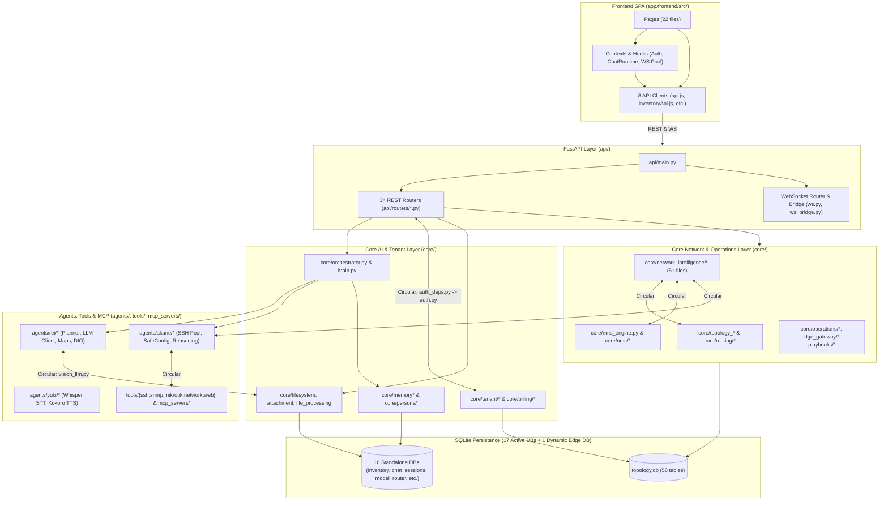

# PHASE 2 — COMPLETE CODE UNDERSTANDING & CODEBASE ARCHITECTURE (`02_CODEBASE_ARCHITECTURE.md`)

**Audit Date**: 2026-11-08  
**Target Workspace**: `/home/Lingga/Documents/project/Network_AI_Agent`  
**Primary Ecosystem Directory**: `/home/Lingga/Documents/project/Network_AI_Agent/AIRA_ECOSYSTEM`  
**Audit Mode**: Read-Only Static & Architectural Analysis (Zero Code Mutation)

---

## 1. Executive Architectural Overview

AIRA OS (`AIRA_ECOSYSTEM/`) is a monolithic Python (FastAPI) + React 18 (Vite + Tailwind CSS) platform combining conversational AI orchestration, MikroTik RouterOS/SNMP network management (NMS), multi-layer topology discovery, deterministic and LLM-assisted network intelligence, multi-tenant RBAC, subscription billing, and voice/desktop interaction.

### 1.1 High-Level Architectural Reality vs. Intended Layering

Although the directory layout suggests a clean 5-layer separation (`app/frontend/` -> `api/` -> `core/` -> `agents/` -> `tools/` & `mcp_servers/`), static AST import analysis across all 557 Python files and 223 Frontend `src/` files proves that **the actual architecture suffers from severe layer inversions, circular couplings, and multi-generational subsystem duplication**:

1. **Upward Layer Inversions (`core` importing `api`, `agents`, and `mcp_servers`)**:
   - `core/tenant/auth_deps.py:46` imports `api.routers.auth.get_current_user_context` (`core` -> `api`).
   - `core/attachment/main.py:36-39` imports `api.routers`, `api.ws_bridge`, and `agents.akane.connection_manager` (`core` -> `api` & `agents`).
   - `core/orchestrator.py:36-44` imports `agents.rei.*`, `agents.akane.registry`, and `agents.hikari.registry`.
   - `core/nms_engine.py:843` and `core/topology_engine.py:3604` import `agents.akane.connection_manager`.
   - `core/network_intelligence/{evidence,simulator,preflight,command_execution,checks,reasoning_orchestrator}.py` import `agents.akane.connection_manager`, `agents.akane.reasoning_engine`, and `agents.rei.provider_client`.
   - `core/nms/models.py:35` imports `mcp_servers.network.security.mask_sensitive_data`, which triggers `mcp_servers/network/__init__.py:4` (`from mcp_servers.network.server import create_network_mcp_server`), pulling in the entire MCP server, `paramiko`, and `pysnmp` whenever `core.nms` is imported.
2. **Multi-Generational Subsystem Duplication**:
   - **Two NMS Subsystems**: Active monolithic `core/nms_engine.py` + `nms_models.py` + `nms_snmp.py` vs. largely unused modular `core/nms/` (`scheduler.py`, `monitoring.py`, `capability.py`, `alerts.py`, `metrics_store.py`).
   - **Three Generations of Network Intelligence**: Gen 1 (`models.py`, `evidence.py`, `store.py` -> `network_intelligence.db`), Gen 2 (`network_models.py`, `correlation.py`, `auto_orchestrator.py`), and Gen 3 (`intelligence_models.py`, `evidence_service.py`, `correlation_engine.py`, `investigator.py`).
   - **Two Incident Engines Sharing One Table**: Tenant-unaware `ProactiveIncidentEngine` (`core/operations/incident_engine.py`) vs. tenant-scoped `MultiTenantIncidentEngine` (`core/operations/multi_tenant_incident_engine.py`) both writing to `operational_incidents` in `topology.db`.
   - **Two Memory & Two Persona Systems**: Legacy global `core/memory.py` (`long_term_memory.db`) & `core/persona/` (`persona.db`) vs. multi-tenant `core/tenant/memory_service.py` (`topology.db:user_memories`) & `core/tenant/persona_service.py` (`topology.db:user_personas`).

---

## 2. Complete Module-by-Module Documentation (All 15 Required Dimensions)

### Module 1: FastAPI Application & Real-Time Transport (`api/`)
1. **Nama module**: `api` (including `api.routers`, `api.ws_manager`, `api.ws_bridge`, `api.schemas`)
2. **Lokasi direktori**: `AIRA_ECOSYSTEM/api/` (and `AIRA_ECOSYSTEM/api/routers/`)
3. **Tujuan module**: HTTP REST API gateway, WebSocket server (`/ws/chat/{session_id}` and `/ws/nms`), CORS/security header middleware, application lifecycle management, and EventBus-to-WebSocket bridging.
4. **Fitur yang disediakan**: 315 unique HTTP route handlers across 34 router modules (335 mounted route paths because `files.router` is mounted twice at `/` and `/api`), 2 WebSocket endpoints, health checks (`/health`, `/api/health`), and background startup/shutdown hooks for NMS, Scheduler, Memory compaction, and EventBus bridging.
5. **File yang digunakan**: 44 files: `api/__init__.py`, `api/main.py`, `api/schemas.py`, `api/ws_bridge.py`, `api/ws_manager.py`, `api/capabilities_logic.py`, `api/selection_logic.py`, `api/workspace_links_logic.py`, `api/model_router_api.py`, `api/settings_api.py`, and 34 router files in `api/routers/` (`admin_platform.py`, `artifacts.py`, `attachments.py`, `auth.py`, `automations.py`, `billing.py`, `capabilities.py`, `chat.py`, `connections.py`, `decisions.py`, `devices.py`, `files.py`, `gateways.py`, `location.py`, `logs.py`, `memory.py`, `models.py`, `network_intelligence.py`, `nms.py`, `operations.py`, `persona.py`, `personalization.py`, `playbooks.py`, `portal.py`, `providers.py`, `selection.py`, `sessions.py`, `settings.py`, `tools.py`, `topology.py`, `user_management.py`, `voice.py`, `workspace_links.py`, `ws.py`).
6. **Fungsi dan class penting**: `app` (`api/main.py:61`), `security_headers_middleware` (`api/main.py:79`), `ConnectionManager` (`api/ws_manager.py:16`), ` start_ws_bridge` / `_handle_event` (`api/ws_bridge.py:42, 198`), `ws_nms` (`api/routers/ws.py:355`), `ws_chat` (`api/routers/ws.py:385`), `require_topology_admin` (`api/routers/topology.py:58`), `require_platform_admin` (`api/routers/admin_platform.py:39`).
7. **Dependency internal**: Imports nearly all `core.*` packages (`core.orchestrator`, `core.tenant.*`, `core.billing.*`, `core.topology_engine`, `core.nms_engine`, `core.network_intelligence.*`, `core.operations.*`, `core.edge_gateway.*`, `core.playbooks.*`, `core.filesystem.*`, `core.attachment.*`, `core.artifacts.*`, `core.location.*`, `core.selection.*`, `core.memory`, `core.persona`, `core.model_store`, `core.log_store`, `core.chat_sessions`) and `agents.akane.connection_manager`, `agents.yuki.{service,stt,tts}`.
8. **Dependency eksternal**: `fastapi`, `starlette`, `pydantic`, `uvicorn`, `websockets`.
9. **Input**: HTTP JSON requests, multipart file uploads (`UploadFile`), query/path parameters, `Authorization: Bearer` headers, `X-Guest-ID` / `X-Topology-Admin-Token` / `X-Signature` headers, and WebSocket JSON frames.
10. **Output**: JSON REST responses, binary file/artifact downloads (`Response`, `FileResponse`), and real-time WebSocket JSON event frames (`thinking`, `tool_start`, `tool_end`, `stream_chunk`, `done`, `nms_snapshot`, `nms_status_change`).
11. **Data yang diproses**: User credentials, session tokens, chat messages, network topology graphs, device credentials, telemetry metrics, RBAC policies, billing invoices, and workspace files.
12. **API yang digunakan**: Exposes `/api/*`, `/api/v1/*`, `/files/*`, `/host/info`, `/ws/chat/{session_id}`, `/ws/nms`.
13. **Database table/model yang digunakan**: Indirectly touches all 17 active SQLite databases; directly queries `topology.db` (`tenants`, `operational_users`, `chat_sessions`) in `admin_platform.py` and `personalization.py`.
14. **Hubungan dengan module lain**: Entry point invoked by Frontend (`app/frontend/src/`) and Edge Gateways; dispatches work to `core.*` and `agents.*`. Circularly coupled with `core.tenant` because `core/tenant/auth_deps.py:46` imports `api.routers.auth`.
15. **Kondisi implementasi saat ini**: **PARTIALLY BROKEN / INSECURE (`CONFIRMED`)**. 13+ routers and both WebSocket endpoints have zero authentication; 2 route paths are shadowed (`POST /api/v1/admin/permissions/simulate` and `GET /api/intelligence/actions/policy`); `files.router` is mounted twice; `gateways.py` router-level RBAC blocks edge gateway agents from enrolling or sending telemetry.

---

### Module 2: Core AI Orchestration, Brain, Context, Events & Guardrails (`core/` root + `core/ai/`, `core/context/`, `core/events/`, `core/dio/`, `core/capabilities/`)
1. **Nama module**: `core.orchestrator`, `core.brain`, `core.task_classifier`, `core.ai`, `core.context`, `core.events`, `core.dio`, `core.capabilities`
2. **Lokasi direktori**: `AIRA_ECOSYSTEM/core/` (root modules + `ai/`, `context/`, `events/`, `dio/`, `capabilities/`, `observability/`, `plugins/`, `governance/`)
3. **Tujuan module**: Central conversational AI turn orchestration, system prompt construction, intent/task classification, tool guardrails, Dynamic Interaction Objects (DIO), capability registry, and internal pub/sub EventBus.
4. **Fitur yang disediakan**: Multi-turn chat execution (`Orchestrator.handle_turn` / `route`), dynamic system prompt assembly (`brain.get_system_prompt`), 8-category task classification (`task_classifier.classify_task`), tool pre-validation and loop detection (`tool_guardrails.py`), interactive form/confirm cards (`core/dio/`), and asynchronous event broadcasting (`core/events/bus.py`).
5. **File yang digunakan**: `core/orchestrator.py`, `core/brain.py`, `core/task_classifier.py`, `core/tool_guardrails.py`, `core/intent_guard.py`, `core/scheduler.py`, `core/token_usage.py`, `core/global_settings.py`, `core/ai/reasoning_engine.py`, `core/ai/vendor_syntax_engine.py`, `core/context/{builder,models}.py`, `core/events/{bus,models,scope}.py`, `core/dio/{builders,detector,models,validator}.py`, `core/capabilities/{models,registry}.py`, `core/observability/telemetry.py`, `core/plugins/{loader,validator}.py`, `core/governance/retention_engine.py`.
6. **Fungsi dan class penting**: `Orchestrator` (`core/orchestrator.py:55`), `get_system_prompt` (`core/brain.py:211`), `classify_task` (`core/task_classifier.py:130`), `EpistemicReasoningEngine` (`core/ai/reasoning_engine.py:107`), `VendorSyntaxEngine` (`core/ai/vendor_syntax_engine.py:25`), `ContextBuilder` (`core/context/builder.py:32`), `EventBus` (`core/events/bus.py:27`), `AutomationScheduler` (`core/scheduler.py:157`).
7. **Dependency internal**: `agents.rei.{planner,provider_client,registry}`, `agents.akane.registry`, `agents.hikari.registry`, `core.memory`, `core.persona`, `core.tenant.{memory_service,persona_service}`, `core.location`, `core.selection`, `core.attachment`, `core.file_processing`, `core.canonical_network`, `core.topology_engine`.
8. **Dependency eksternal**: `opentelemetry-api` (optional in `telemetry.py`), Python standard library (`threading`, `asyncio`, `dataclasses`, `re`, `json`).
9. **Input**: User chat messages, `session_id`, `user_id`, attachment IDs, selection IDs, tool call arguments, and automation job definitions.
10. **Output**: Streamed LLM tokens, tool execution results, DIO interactive payloads (`form`, `confirm`, `select`), and `EventEnvelope` messages on `event_bus`.
11. **Data yang diproses**: Conversation history (`raw_history`, `display_messages`), `AIRAContext` snapshots, token usage counters, and automation job runs.
12. **API yang digunakan**: Called by `POST /api/chat`, `WS /ws/chat/{session_id}`, `GET /api/capabilities`, `POST /api/v1/decisions/reason`, and `/api/v1/automations/*`.
13. **Database table/model yang digunakan**: `chat_sessions.db` (`sessions`, `messages`, `session_state`), `global_settings.db` (`settings`), `topology.db` (`automation_jobs`, `automation_executions`, `data_retention_policies`).
14. **Hubungan dengan module lain**: Bridges `api/routers/{chat,ws}.py` to `agents/rei/planner.py` and tool registries.
15. **Kondisi implementasi saat ini**:
    - Core chat orchestration, DIO, and EventBus are **FUNCTIONAL (`CONFIRMED`)**.
    - **Critical Security Bug**: `core/orchestrator.py:221-233` escalates any chat `[Form Submission...]` with `name` and `host` to Superadmin `user_id="lingga_admin"` (`CONFIRMED`).
    - **Simulated / Stub Engines**: `EpistemicReasoningEngine` (`core/ai/reasoning_engine.py:119-350`) is 100% hardcoded strings; `AutomationScheduler` (`core/scheduler.py:42-135`) has 8/10 stubbed lambdas and never executes `CRON` triggers; `core/plugins/{loader,validator}.py` are completely unused (`CONFIRMED`).

---

### Module 3: Multi-Model Registry, Router & Provider Client (`core/model_*.py` & `agents/rei/provider_client.py`)
1. **Nama module**: `core.model_store`, `core.model_router`, `core.model_registry`, `core.fallback_policy`, `agents.rei.provider_client`
2. **Lokasi direktori**: `AIRA_ECOSYSTEM/core/` and `AIRA_ECOSYSTEM/agents/rei/provider_client.py`
3. **Tujuan module**: Manage LLM provider configurations, model catalog, task-based model routing, fallback chains, health tracking, and unified LLM API invocation (Ollama + OpenAI-compatible + Anthropic + Gemini).
4. **Fitur yang disediakan**: CRUD for LLM models, task-to-model routing map (`routing_map`), fallback chain policies (`fallback_policy`), per-session model override (`session_model_map`), live model ping/test, OpenRouter credit lookup, and streaming/non-streaming chat completions.
5. **File yang digunakan**: `core/model_store.py`, `core/model_router.py`, `core/model_registry.py`, `core/fallback_policy.py`, `core/config.py`, `agents/rei/provider_client.py`, `api/model_router_api.py`, `api/routers/models.py`, `api/routers/providers.py`.
6. **Fungsi dan class penting**: `ModelStore` (`core/model_store.py`), `ModelRouter` (`core/model_router.py:34`), `FallbackPolicy` (`core/fallback_policy.py:25`), `chat_completion` / `stream_chat_completion` (`agents/rei/provider_client.py`).
7. **Dependency internal**: `core.config`, `core.log_store`, `core.events.bus`, `core.token_usage`.
8. **Dependency eksternal**: `requests`, `ollama`, `python-dotenv`.
9. **Input**: Model definitions (provider, `model_id`, `base_url`, `api_key`), task category strings, chat message arrays, and tool schemas.
10. **Output**: LLM response dicts (`content`, `tool_calls`, `usage`) or token stream generators.
11. **Data yang diproses**: Model metadata, API keys (stored in plaintext in SQLite), health latencies, and token counts.
12. **API yang digunakan**: `/api/models/*`, `/api/providers/credits`, plus external HTTP calls to Ollama (`http://localhost:11434`), OpenRouter (`https://openrouter.ai/api/v1`), OpenAI, Anthropic, Gemini, etc.
13. **Database table/model yang digunakan**: Split between `database/model_router.db` (`models`, `routing_map`, `routing_policy`, `session_model_map`) and `database/model_registry.db` (`registered_models`).
14. **Hubungan dengan module lain**: Invoked by `agents/rei/planner.py`, `core/task_classifier.py`, `core/file_processing/vision_llm.py`, and `core/network_intelligence/reasoning_orchestrator.py`.
15. **Kondisi implementasi saat ini**: **FUNCTIONAL WITH CRITICAL DEFECTS (`CONFIRMED`)**.
    - `_DB_PATH` in `core/model_store.py:201-232` has an import-order poisoning bug where calling `set_db_path()` in `core/model_registry.py:47` redirects all subsequent `model_store` reads/writes from `model_router.db` to `model_registry.db`.
    - `_BUILTIN_SEED` (`core/model_store.py:42-198`) seeds 13 fictional future model IDs (`deepseek-v4.1-flash`, `gemma-4-31b-it`, `mistral-large-4-1t-a52b`, `glm-5.1-air`, etc.) that fail at runtime if selected.
    - All mutating endpoints in `api/routers/models.py` only require `models.read`.

---

### Module 4: Multi-Tenant Identity, RBAC, Quotas, Subscriptions & Billing (`core/tenant/`, `core/billing/`, `core/security/`)
1. **Nama module**: `core.tenant`, `core.billing`, `core.security`
2. **Lokasi direktori**: `AIRA_ECOSYSTEM/core/tenant/` (22 files), `AIRA_ECOSYSTEM/core/billing/` (4 files), `AIRA_ECOSYSTEM/core/security/` (6 files), and `AIRA_ECOSYSTEM/core/bootstrap_superadmin.py`.
3. **Tujuan module**: Multi-tenant organization management, user authentication (PBKDF2/SHA-256 + TOTP MFA), session token management, group-based RBAC + permission overrides, plan entitlements, token quota accounting, and subscription billing/invoicing.
4. **Fitur yang disediakan**: Login/logout/heartbeat, MFA setup/verify, user/group/permission CRUD, permission simulation, user impersonation, token quota policies/adjustments/ledgers, subscription plans, invoice checkout, and payment webhook processing.
5. **File yang digunakan**:
   - `core/tenant/`: `__init__.py`, `admin_authorization_service.py`, `approval_safety_service.py`, `auth_deps.py`, `context.py`, `db.py`, `entitlement_service.py`, `entitlements.py`, `inventory_manager.py`, `manager.py`, `memory_service.py`, `models.py`, `notification_preferences.py`, `permission_simulation.py`, `persona_service.py`, `quota_engine.py`, `rbac_service.py`, `seed_admin.py`, `support_manager.py`, `token_quota_service.py`, `user_subscription.py`, `workspace_service.py`.
   - `core/billing/`: `__init__.py`, `db.py`, `models.py`, `service.py`.
   - `core/security/`: `__init__.py`, `mfa.py`, `output_guard.py`, `password.py`, `rate_limiter.py`, `ssrf_validator.py`.
6. **Fungsi dan class penting**: `IdentityManager` & `TenantManager` (`core/tenant/manager.py`), `RbacService` (`core/tenant/rbac_service.py`), `EntitlementManager` (`core/tenant/entitlements.py`), `TokenQuotaService` (`core/tenant/token_quota_service.py`), `UserSubscriptionService` (`core/tenant/user_subscription.py`), `BillingService` (`core/billing/service.py`), `require_permission` (`core/tenant/auth_deps.py:130`).
7. **Dependency internal**: `core.topology_db` (`topology.db`), `core.security.{password,mfa,rate_limiter}`, `api.routers.auth` (layer inversion in `auth_deps.py:46`).
8. **Dependency eksternal**: `fastapi` (in `auth_deps.py`), `pydantic`, `hashlib`, `hmac`, `sqlite3`.
9. **Input**: Bearer tokens, login credentials, TOTP codes, RBAC group/permission assignments, billing webhook payloads, and quota policy updates.
10. **Output**: `TenantContext` objects, session tokens (`aira_sess_*`), effective permission sets, invoice/subscription records, and token balance ledgers.
11. **Data yang diproses**: Users, sessions, groups, permissions, tenants, subscriptions, invoices, payment transactions, and token usage ledgers.
12. **API yang digunakan**: `/api/v1/auth/*`, `/api/v1/admin/*`, `/api/v1/billing/*`, `/api/v1/portal/*`, `/api/v1/personalization/*`.
13. **Database table/model yang digunakan**: 35+ tables inside `database/topology.db` (`operational_tenants`, `operational_users`, `operational_user_sessions`, `rbac_groups`, `rbac_permissions`, `rbac_group_permissions`, `rbac_user_groups`, `rbac_user_permission_overrides`, `operational_user_subscriptions`, `operational_token_policies`, `operational_token_balances`, `operational_token_usage_ledger`, `billing_invoices`, `billing_payment_transactions`, `billing_webhook_events`, `user_memories`, `user_personas`, `user_preferences`, etc.).
14. **Hubungan dengan module lain**: Provides `require_permission` and `get_current_authenticated_user` to `api/routers/*`.
15. **Kondisi implementasi saat ini**: **SEVERELY FLAWED (`CONFIRMED`)**.
    - Token quota enforcement (`TokenQuotaService`) is instantiated in `api/routers/chat.py:28` but **never called** during `/api/chat` or `/ws/chat/{session_id}`.
    - Group `DENY` rules are bypassed by legacy `ROLE_PERMISSIONS` union in `IdentityManager.validate_session_token()` (`core/tenant/manager.py:1054-1068`) and `PERMISSION_ALIASES` (`core/tenant/models.py:2249`).
    - Unauthenticated `X-Guest-ID: gst_...` header spoofing in `core/tenant/auth_deps.py:20-37` fabricates an authenticated `TenantContext`.
    - `BillingService` webhook signature check is skipped when `X-Signature` header is omitted (`api/routers/billing.py:84-87`, `core/billing/service.py:239`), and `/api/v1/billing/simulate-mock` allows any user to self-upgrade to `ENTERPRISE`.
    - `TokenQuotaService.update_plan_policy()` (`core/tenant/token_quota_service.py:630-660`) crashes with `sqlite3.OperationalError: table operational_token_policies has no column named model_cost_multiplier_json`.
    - `core/security/ssrf_validator.py`, `core/tenant/context.py`, `core/tenant/entitlement_service.py`, and `core/tenant/workspace_service.py` are completely unused in production.

---

### Module 5: Memory, Persona & Chat Session Persistence (`core/chat_sessions.py`, `core/memory.py`, `core/memory_system/`, `core/persona/`)
1. **Nama module**: `core.chat_sessions`, `core.memory`, `core.memory_system`, `core.persona`
2. **Lokasi direktori**: `AIRA_ECOSYSTEM/core/chat_sessions.py`, `AIRA_ECOSYSTEM/core/memory.py`, `AIRA_ECOSYSTEM/core/memory_system/` (10 files), `AIRA_ECOSYSTEM/core/persona/` (6 files), plus shadowed `AIRA_ECOSYSTEM/core/persona.py`.
3. **Tujuan module**: Persist multi-session chat histories, extract and recall user facts/memories, and manage AI persona profiles and behavioral sliders.
4. **Fitur yang disediakan**: Chat session CRUD/pin/archive/search/truncate, automatic LLM fact extraction (`agents/rei/auto_extract.py`), hybrid BM25 + semantic memory retrieval (`core/memory_system/`), and persona prompt compilation (`PersonaEngine`).
5. **File yang digunakan**: `core/chat_sessions.py`, `core/memory.py`, `core/memory_system/{__init__,compactor,config,embeddings,episodic,formatter,hybrid_retriever,interaction_memory,models,semantic_store}.py`, `core/persona/{__init__,builder,engine,models,presets,store}.py`, `core/persona.py` (shadowed dead file).
6. **Fungsi dan class penting**: `create_session`, `save_turn`, `load_raw_history` (`core/chat_sessions.py`), `remember_fact`, `list_facts` (`core/memory.py`), `HybridMemoryRetriever` (`core/memory_system/hybrid_retriever.py`), `SemanticMemoryStore` (`core/memory_system/semantic_store.py`), `InteractionMemoryStore` (`core/memory_system/interaction_memory.py`), `PersonaEngine` (`core/persona/engine.py`).
7. **Dependency internal**: `core.config`, `core.events.bus`, `agents.rei.provider_client` (via `auto_extract.py`).
8. **Dependency eksternal**: `numpy` (in `embeddings.py`), `requests` (Ollama embeddings), `sqlite3`.
9. **Input**: Chat turns, user IDs, session IDs, fact key/value pairs, and persona configuration dicts.
10. **Output**: Formatted memory context blocks and persona system prompt instructions injected into `core/brain.py`.
11. **Data yang diproses**: Conversation messages, extracted user facts, vector embeddings, interaction telemetry, and persona traits.
12. **API yang digunakan**: `/api/sessions/*`, `/api/memory/*`, `/api/persona/*` (competing with `/api/v1/personalization/*`).
13. **Database table/model yang digunakan**:
    - `database/chat_sessions.db` (`sessions`, `messages`, `session_state`) — **Note**: `personalization.py:432` and `core/tenant/memory_service.py` also create a competing `chat_sessions` table inside `topology.db`!
    - `database/long_term_memory.db` (`facts`, `events`, `preferences`) — unscoped global tables!
    - `database/semantic_memory.db` (`memories`, `memories_fts`, `memory_audit_log`) — never written to in production!
    - `database/interaction_memory.db` (`interaction_logs`, `behavioral_patterns`, `workflow_habits`) — unscoped global tables!
    - `database/persona.db` (`active_persona`, `custom_presets`) — singleton `id = 1` shared globally!
14. **Hubungan dengan module lain**: Read by `core/brain.py` and `core/context/builder.py`; written by `api/routers/{chat,ws,sessions,memory,persona}.py` and `agents/rei/auto_extract.py`.
15. **Kondisi implementasi saat ini**: **SPLIT-BRAIN / CROSS-USER DATA LEAK (`CONFIRMED`)**.
    - `core/memory.py` (`long_term_memory.db`) has no `user_id` column; facts extracted in `agents/rei/auto_extract.py` are written to `long_term_memory.db` and injected into **every user's** prompt via `core/brain.py`!
    - `SemanticMemoryStore.store_memory()` (`semantic_memory.db`) has zero production callers, so `HybridMemoryRetriever` always searches an empty `semantic_memory.db`.
    - `core/persona.py` (root file) is completely shadowed by `core/persona/__init__.py`.

---

### Module 6: Workspace Filesystem, Attachments, File Processing, Artifacts, Location & Selection (`core/filesystem/`, `core/attachment/`, `core/file_processing/`, `core/artifacts/`, `core/location/`, `core/selection/`, `core/workspace_links/`)
1. **Nama module**: `core.filesystem`, `core.attachment`, `core.file_processing`, `core.artifacts`, `core.location`, `core.selection`, `core.workspace_links`
2. **Lokasi direktori**: Respective subdirectories under `AIRA_ECOSYSTEM/core/` (44 files total).
3. **Tujuan module**: Sandboxed workspace file management, chat file attachment ingestion, document/archive/code/image extraction, downloadable artifact generation, OpenStreetMap/GPS location services, and UI text-selection context actions.
4. **Fitur yang disediakan**: File read/write/tree/trash/history/zip/extract, attachment upload and text extraction, Vision LLM image description, artifact creation/download, Nominatim geocoding + Overpass POI search + OSRM routing, and selection explain/translate/summarize context.
5. **File yang digunakan**:
   - `core/filesystem/` (10 files): `manager.py`, `sandbox.py`, `permissions.py`, `history.py`, `trash.py`, `archive.py`, `preview.py`, `models.py`, `host_info.py`, `__init__.py`.
   - `core/attachment/` (6 files): `service.py`, `store.py`, `validator.py`, `models.py`, `main.py` (dead duplicate of `api/main.py`!), `__init__.py`.
   - `core/file_processing/` (12 files): `service.py`, `router.py`, `context.py`, `vision_llm.py`, `models.py`, `extractors/{archive,code,document,image,structured,text}.py`.
   - `core/artifacts/` (4 files), `core/location/` (8 files), `core/selection/` (3 files), `core/workspace_links/` (2 files).
6. **Fungsi dan class penting**: `WorkspaceManager` (`core/filesystem/manager.py`), `PathSandbox` (`core/filesystem/sandbox.py`), `AttachmentService` (`core/attachment/service.py`), `FileProcessingService` (`core/file_processing/service.py`), `analyze_image_with_vision` (`core/file_processing/vision_llm.py:42`), `LocationService` (`core/location/service.py`).
7. **Dependency internal**: `core.config`, `core.events.bus`, `agents.rei.provider_client` (in `vision_llm.py:55`).
8. **Dependency eksternal**: `requests` (Nominatim/Overpass/OSRM), `PyYAML`, optional `pypdf`/`docx`/`openpyxl`/`PIL`.
9. **Input**: Uploaded files, workspace relative paths, GPS coordinates (`lat`, `lon`), Nominatim search queries, and text selections.
10. **Output**: File contents/trees, extracted text context for LLM turns, artifact blobs, route geometry/POIs, and selection context blocks.
11. **Data yang diproses**: User documents, source code files, ZIP/TAR archives, images, and geographic coordinates.
12. **API yang digunakan**: `/files/*` & `/api/files/*`, `/api/attachments/*`, `/api/artifacts/*`, `/api/workspace/links/*`, `/api/location/*`, `/api/selection/*`.
13. **Database table/model yang digunakan**: `database/attachments.db`, `database/artifacts.db`, `database/workspace_links.db`, `database/location.db`, `database/selection_context.db`.
14. **Hubungan dengan module lain**: Used by `api/routers/*`, `core/context/builder.py`, and `agents/rei/{fs_tools,artifact_tools,maps_tools}.py`.
15. **Kondisi implementasi saat ini**:
    - **Broken Vision LLM (`CONFIRMED`)**: `core/file_processing/vision_llm.py:93-94` passes `analysis={"description": text}` to `VisionResult(...)`, which raises `TypeError: VisionResult.__init__() got an unexpected keyword argument 'analysis'` on 100% of successful Vision LLM calls!
    - **Cross-Session GPS Leak (`CONFIRMED`)**: `core/location/service.py:202` falls back to `self._clients.get(self._last_session_id or "")`, leaking one user's browser GPS coordinates to another user's session.
    - **Misplaced Dead File (`CONFIRMED`)**: `core/attachment/main.py` is an obsolete copy of `api/main.py` accidentally left inside `core/attachment/`.

---

### Module 7: Network Inventory, Canonical Registry, Topology & Multi-Device Routing (`core/inventory_store.py`, `core/canonical_network.py`, `core/topology_*.py`, `core/routing/`)
1. **Nama module**: `core.inventory_store`, `core.canonical_network`, `core.topology_engine`, `core.topology_discovery`, `core.topology_parsers`, `core.routing`
2. **Lokasi direktori**: `AIRA_ECOSYSTEM/core/` (`inventory_store.py`, `canonical_network.py`, `device_topology_sync.py`, `topology_db.py`, `topology_models.py`, `topology_parsers.py`, `topology_discovery.py`, `topology_engine.py`) and `AIRA_ECOSYSTEM/core/routing/` (7 files).
3. **Tujuan module**: Device inventory & credential management, SSH-based RouterOS topology discovery, multi-layer L1/L2/L3 topology graph correlation, immutable topology & routing snapshots, and cross-device routing analysis (LPM, ECMP, loops, blackholes, asymmetry).
4. **Fitur yang disediakan**: Device & credential CRUD, live SSH RouterOS discovery (`DiscoveryOrchestrator`), multi-source edge correlation (`correlate_canonical_edges`), deterministic canvas layout, L2/L3 path tracing, SPOF/blast-radius analysis, GNS3/Containerlab/Ansible export, and multi-device route table collection/diffing/dependency analysis.
5. **File yang digunakan**: 15 files (`core/inventory_store.py`, `core/canonical_network.py`, `core/device_topology_sync.py`, `core/topology_{db,models,parsers,discovery,engine}.py`, `core/routing/{__init__,unified_route_parser,route_collector,route_history,route_dependency,route_analytics,cross_device_routing}.py`).
6. **Fungsi dan class penting**: `InventoryStore` (`core/inventory_store.py`), `CanonicalNetworkRegistry` (`core/canonical_network.py:193`), `TopologyEngine` (`core/topology_engine.py:106`), `DiscoveryOrchestrator` (`core/topology_discovery.py:63`), `UnifiedRouteParser` (`core/routing/unified_route_parser.py:774`), `MultiDeviceRouteCollector` (`core/routing/route_collector.py:372`), `RouteHistoryStore` (`core/routing/route_history.py:655`), `CrossDeviceRouteIntelligenceEngine` (`core/routing/cross_device_routing.py:166`).
7. **Dependency internal**: `agents.akane.connection_manager`, `core.nms_engine`, `core.network_intelligence.{models,network_models,correlation,command_execution}`.
8. **Dependency eksternal**: `sqlite3`, `ipaddress`, `re`, `concurrent.futures`.
9. **Input**: Device host/port/credentials, raw RouterOS CLI outputs (`/interface print detail`, `/ip address print detail`, `/ip route print detail`, `/ip neighbor print detail`, `/routing ospf neighbor print detail`, `/routing bgp peer print detail`, etc.).
10. **Output**: Topology graphs (`nodes`, `links`, `canonical_edges`), snapshot diffs, L2/L3 path traces, and routing anomaly reports.
11. **Data yang diproses**: RouterOS configurations, interface MAC/IP addresses, ARP/LLDP/MNDP neighbors, OSPF/BGP peers, and IPv4/IPv6 routing tables.
12. **API yang digunakan**: `/api/devices/*`, `/api/credentials/*`, `/api/topology/*`, `/api/topology/routes/*`.
13. **Database table/model yang digunakan**:
    - `database/inventory.db` (`devices`, `credentials`, `device_credentials`) — plaintext secrets!
    - `database/topology.db` (`topology_nodes`, `topology_links`, `topology_evidence`, `topology_policy`, `topology_discovery_jobs`, `topology_conflicts`, `topology_audit_log`, `topology_edges`, `topology_edge_evidence`, `topology_snapshots`, `topology_changes`, `route_snapshots`, `route_changes`).
14. **Hubungan dengan module lain**: Bidirectional circular coupling between `core.topology_engine` <-> `core.network_intelligence` and `core.routing` <-> `core.network_intelligence`.
15. **Kondisi implementasi saat ini**: **GENUINELY IMPLEMENTED CORE WITH SPECIFIC BUGS (`CONFIRMED`)**.
    - RouterOS parsers, topology correlation, and routing analytics are real, high-quality deterministic implementations.
    - **Bugs**: `CanonicalNetworkRegistry._fetch_nms_statuses()` (`core/canonical_network.py:500-516`) reads `overview.get("devices", [])` which does not exist in `NmsEngine.get_overview()`, leaving `nms_status` permanently `"UNKNOWN"`; `TopologyEngine._emit_topology_event()` (`core/topology_engine.py:4946`) calls unimported `get_event_bus()` (`NameError`); `RouteHistoryStore.correlate_route_changes_with_incidents()` (`core/routing/route_history.py:1378`) queries non-existent table `nms_alerts`.

---

### Module 8: Network Monitoring System — Dual NMS Architecture (`core/nms_*.py` vs `core/nms/`)
1. **Nama module**: `core.nms_engine` / `core.nms_snmp` / `core.nms_models` (Active v1) and `core.nms` (Modular v2)
2. **Lokasi direktori**: `AIRA_ECOSYSTEM/core/nms_*.py` (3 files) and `AIRA_ECOSYSTEM/core/nms/` (8 files).
3. **Tujuan module**: Continuous polling of network devices via SNMPv2c, SSH (RouterOS), and ICMP ping; interface counter rate calculation; metric retention/rollups; and threshold/flapping alert generation.
4. **Fitur yang disediakan**: Pure-Python ASN.1/BER SNMPv2c client (`SnmpClient`), background device polling, CPU/memory/temperature/voltage/interface traffic tracking, incident lifecycle (`OPEN`, `ACKNOWLEDGED`, `RESOLVED`), and 3-tier metric rollup storage (`nms_raw_metrics`, `nms_5m_rollups`, `nms_1h_rollups`).
5. **File yang digunakan**: `core/nms_models.py`, `core/nms_snmp.py`, `core/nms_engine.py`, `core/nms/{__init__,alerts,capability,collector_contracts,metrics_store,models,monitoring,scheduler}.py`.
6. **Fungsi dan class penting**: `NmsEngine` (`core/nms_engine.py:46`), `SnmpClient` (`core/nms_snmp.py:176`), `HardenedNmsScheduler` (`core/nms/scheduler.py:49`), `AlertEngine` (`core/nms/alerts.py:151`), `PollingSelfMonitor` (`core/nms/monitoring.py:98`), `init_metrics_tables` / `query_metrics` (`core/nms/metrics_store.py:35, 319`).
7. **Dependency internal**: `core.topology_db`, `core.topology_engine`, `core.inventory_store`, `agents.akane.connection_manager`, `core.network_intelligence.security`, `mcp_servers.network.security` (layer inversion in `core/nms/models.py:35`).
8. **Dependency eksternal**: Python standard library (`socket`, `struct`, `subprocess`, `threading`, `sqlite3`).
9. **Input**: Device management IPs, SNMP community strings, SSH credentials, and polling intervals.
10. **Output**: Device & interface telemetry samples, incident records, and WebSocket `nms_poll_completed` / `nms_status_change` events.
11. **Data yang diproses**: SNMP OIDs (MIB-II + MikroTik Enterprise `1.3.6.1.4.1.14988`), octet counters, bps rates, and alert states.
12. **API yang digunakan**: `/api/nms/*` and `WS /ws/nms`.
13. **Database table/model yang digunakan**: `database/topology.db` (`nms_settings`, `nms_device_profiles`, `nms_device_metrics`, `nms_interface_metrics`, `nms_incidents`, `nms_raw_metrics`, `nms_5m_rollups`, `nms_1h_rollups`).
14. **Hubungan dengan module lain**: Feeds device status and metrics to `TopologyEngine`, `CanonicalNetworkRegistry`, and `NetworkIntelligence`.
15. **Kondisi implementasi saat ini**: **SPLIT-BRAIN & SCHEMA COLLISION (`CONFIRMED`)**.
    - `core/nms_engine.py` is active in production, whereas `HardenedNmsScheduler`, `PollingSelfMonitor`, `CapabilityDiscoveryService`, and `AlertEngine` in `core/nms/` are **unused in production**.
    - `nms_raw_metrics` in `core/nms/metrics_store.py:41-58` collides with `nms_raw_metrics` in `core/edge_gateway/db.py:85-100` (different columns on the same table in `topology.db`), causing `GET /api/nms/metrics/query` to crash with `sqlite3.OperationalError`.

---

### Module 9: Network Intelligence, Operations, Edge Gateway & Playbooks (`core/network_intelligence/`, `core/operations/`, `core/edge_gateway/`, `core/playbooks/`)
1. **Nama module**: `core.network_intelligence`, `core.operations`, `core.edge_gateway`, `core.playbooks`
2. **Lokasi direktori**: `AIRA_ECOSYSTEM/core/network_intelligence/` (51 files), `AIRA_ECOSYSTEM/core/operations/` (22 files), `AIRA_ECOSYSTEM/core/edge_gateway/` (8 files), `AIRA_ECOSYSTEM/core/playbooks/` (3 files).
3. **Tujuan module**: Multi-device network evidence assembly, knowledge graph construction, protocol auditing (L2, IPv4, IPv6, Static, OSPF, BGP, NAT/FW, QoS, Tunnels), root-cause analysis (RCA), predictive capacity forecasting, change impact simulation, SLA/health scoring, edge gateway telemetry ingestion, and playbook execution.
4. **Fitur yang disediakan**: Natural-language network investigation, 9 protocol analyzers, security posture auditing, capacity forecasting (EWMA + linear regression), maintenance calendar, proactive/multi-tenant incident state machines, Category A/B/C action approval gates, edge gateway enrollment/heartbeat/telemetry ingestion, and Ansible YAML playbook validation/execution.
5. **File yang digunakan**: All 84 Python files across those 4 directories.
6. **Fungsi dan class penting**: `UnifiedEvidenceService` (`evidence_service.py`), `NetworkKnowledgeGraph` (`knowledge_graph.py`), `RootCauseAnalysisEngine` (`rca_engine.py`), `NetworkInvestigator` (`investigator.py`), `AutomaticNetworkOrchestrator` (`auto_orchestrator.py`), `ActionManagementEngine` (`action_engine.py`), `PredictiveOperationsEngine` (`predictive_engine.py`), `ChangeImpactEngine` (`change_impact_engine.py`), `DynamicHealthScoringEngine` (`health_scoring_engine.py`), `SlaManagementEngine` (`sla_engine.py`), `EdgeGatewayManager` (`core/edge_gateway/manager.py`), `PlaybookRunner` (`core/playbooks/runner.py`).
7. **Dependency internal**: `core.topology_db`, `core.topology_engine`, `core.nms_engine`, `core.routing.*`, `core.canonical_network`, `agents.akane.{connection_manager,reasoning_engine}`, `agents.rei.provider_client`.
8. **Dependency eksternal**: `PyYAML`, `sqlite3`, `ipaddress`, `math`, `statistics`.
9. **Input**: Natural-language diagnostic queries, `NetworkEvidenceBundle` payloads, telemetry time-series, maintenance windows, edge gateway batches, and playbook YAML definitions.
10. **Output**: `InvestigationReport`, `RCAReport`, `HealthScorecard`, `SlaReport`, `ChangeImpactSimulation`, and action execution records.
11. **Data yang diproses**: Multi-device CLI evidence, graph entities/edges, anomalies, incidents, SLA error budgets, and gateway heartbeats.
12. **API yang digunakan**: `/api/intelligence/*`, `/api/operations/*`, `/api/v1/decisions/*`, `/api/v1/gateways/*`, `/api/v1/playbooks/*`, `/api/v1/portal/*`.
13. **Database table/model yang digunakan**: `database/network_intelligence.db` (5 tables) and `database/topology.db` (25+ `operational_*` tables), plus `edge_buffer.db` (2 tables).
14. **Hubungan dengan module lain**: Consumes data from `InventoryStore`, `TopologyEngine`, `NmsEngine`, and `RouteHistoryStore`; exposed via 6 FastAPI routers.
15. **Kondisi implementasi saat ini**: **MIX OF REAL ANALYZERS, SIMULATED EXECUTORS, AND BROKEN SQL/GRAPH INTEGRATION (`CONFIRMED`)**.
    - Protocol analyzers, knowledge graph builder, RCA scoring, predictive regression, and edge gateway token cryptography are real implementations.
    - Action execution (`action_engine.py:439-450`), Playbook execution (`playbooks/runner.py:217-251`), Device onboarding discovery (`onboarding.py:178-205`), and Operational scheduler jobs (`operations/scheduler.py:84-115`) are **simulated/mocked**.
    - Multiple runtime crashes due to schema/column mismatches (`started_at` vs `opened_at` on `nms_incidents`, `timestamp` vs `polled_at` on `nms_device_metrics`, `NetworkKnowledgeGraph.from_evidence_bundle` missing method, `ALL_PROTOCOL_ANALYZERS` instantiation bug in `investigator.py:776`).

---

### Module 10: Agents, Tools & MCP Servers (`agents/`, `tools/`, `mcp_servers/`)
1. **Nama module**: `agents.akane`, `agents.rei`, `agents.yuki`, `agents.hikari`, `tools.ssh`, `tools.snmp`, `tools.mikrotik`, `tools.network`, `tools.web`, `mcp_servers.network`
2. **Lokasi direktori**: `AIRA_ECOSYSTEM/agents/` (30 files), `AIRA_ECOSYSTEM/tools/` (14 files), `AIRA_ECOSYSTEM/mcp_servers/` (4 files).
3. **Tujuan module**: Domain-specific AI agent execution loops, persistent SSH/RouterOS shell pooling, safe RouterOS configuration staging/rollback, SNMPv2c/ICMP/DNS/traceroute diagnostics, DuckDuckGo web search, local Whisper STT / Kokoro TTS voice synthesis, and Model Context Protocol (MCP) server exposure.
4. **Fitur yang disediakan**:
   - `agents/akane/`: Persistent SSH connection pool (`ConnectionManager`), 7-stage safe config engine (`SafeConfigEngine`), RouterOS LPM/firewall/VLAN deterministic analyzer (`reasoning_engine.py`), and 22 network tools.
   - `agents/rei/`: Multi-step tool-calling planner (`planner.py`), multi-provider LLM client (`provider_client.py`), DIO tools, filesystem tools, artifact tools, inventory tools, OpenStreetMap tools, and web research tools.
   - `agents/yuki/`: Local `faster-whisper` STT (`stt_engine.py`), local `kokoro-onnx` TTS (`tts.py`), and PortAudio microphone VAD loop (`voice_io.py`, `service.py`).
   - `agents/hikari/`: Empty stub (`HIKARI_TOOLS = {}`).
   - `tools/` & `mcp_servers/`: Low-level SSH (`paramiko`), SNMP (`pysnmp`), RouterOS command catalog, ICMP/DNS/traceroute subprocess wrappers, web scraper, and FastMCP server (`mcp_servers/network/server.py`).
5. **File yang digunakan**: All 48 files across `agents/`, `tools/`, and `mcp_servers/`.
6. **Fungsi dan class penting**: `ConnectionManager` (`agents/akane/connection_manager.py:92`), `SafeConfigEngine` (`agents/akane/config_engine.py:217`), `run_planner_turn` (`agents/rei/planner.py`), `BackgroundVoiceService` (`agents/yuki/service.py`), `PersistentShell` (`tools/ssh/shell.py`), `create_network_mcp_server` (`mcp_servers/network/server.py`).
7. **Dependency internal**: `core.inventory_store`, `core.log_store`, `core.events.bus`, `core.filesystem`, `core.location`, `core.artifacts`.
8. **Dependency eksternal**: `paramiko`, `pysnmp`, `requests`, `beautifulsoup4`, `faster-whisper`, `kokoro-onnx`, `sounddevice`, `numpy`, `mcp`.
9. **Input**: Tool call payloads from LLM or REST endpoints, SSH/SNMP device targets, audio PCM frames, and search queries.
10. **Output**: Structured tool result dicts, RouterOS CLI outputs, config snapshots (`database/config_snapshots/*.json`), WAV audio bytes, and transcripts.
11. **Data yang diproses**: RouterOS CLI sessions, SNMP OIDs, web pages, and voice audio buffers.
12. **API yang digunakan**: `/api/connections/*`, `/api/tools`, `/api/voice/service/*`, and WebSocket `voice_turn`.
13. **Database table/model yang digunakan**: `database/inventory.db` (via `InventoryStore`), `database/logs.db` (via `log_store`), and JSON files in `database/config_snapshots/`.
14. **Hubungan dengan module lain**: Invoked by `core/orchestrator.py` and `api/routers/{connections,voice,ws}.py`; also imported directly by `core/nms_engine.py`, `core/topology_engine.py`, and `core/network_intelligence/*`.
15. **Kondisi implementasi saat ini**: **FUNCTIONAL WITH SECURITY & DUPLICATION ISSUES (`CONFIRMED`)**.
    - All SSH clients use `paramiko.AutoAddPolicy()` (MITM vulnerability).
    - Two uncoordinated SSH connection pools exist (`tools/ssh/client.py` vs `agents/akane/connection_manager.py`).
    - `agents/akane/config_engine.py:74` generates `/ip firewall nat remove [find action=masquerade]` on rollback, which deletes **all** masquerade rules on a router.
    - `agents/akane/config_engine.py:135-149` writes unmasked secrets to both `{op_id}.raw.json` and `{op_id}.json`.
    - `agents/yuki/tts_engine.py` (160 lines) and `agents/rei/settings_tools.py` (43 lines) are 100% unused dead files.

---

### Module 11: Frontend Single-Page Application (`app/frontend/`)
1. **Nama module**: `network-ai-agent-web` (`AIRA_ECOSYSTEM/app/frontend/`)
2. **Lokasi direktori**: `AIRA_ECOSYSTEM/app/frontend/` (`src/` contains 223 files across `pages/`, `components/`, `context/`, `hooks/`, `services/`, `store/`, `utils/`, `theme/`, `types/`).
3. **Tujuan module**: Operator web interface for AI chat, live topology visualization, NMS telemetry & incident management, network intelligence investigation, automation/playbook authoring, workspace file management, model routing configuration, and enterprise RBAC/billing administration.
4. **Fitur yang disediakan**: 18 reachable page views + 4 orphaned pages (`OperationsPage`, `GatewaysPage`, `DecisionsPage`, `CustomerPortalPage`) + 1 shadowed page (`AdminLoginPage`) + 2 unimported dead page files (`DioPreviewPage.jsx`, `components/workspace/WorkspacePage.jsx`).
5. **File yang digunakan**: 263 files total in `app/` (223 in `src/`, plus `package.json`, `vite.config.js`, `tailwind.config.js`, `index.html`, `public/manifest.json`, `public/service-worker.js`).
6. **Fungsi dan class penting**: `App` & `AppShell` (`src/App.jsx:208, 325`), `AuthProvider` (`src/context/AuthContext.jsx`), `ChatRuntimeProvider` (`src/context/ChatRuntimeContext.jsx`), `useAiraSocketPool` (`src/hooks/useAiraSocketPool.js`), `api` (`src/api.js`), `ChatPage` (`src/pages/ChatPage.jsx`), `TopologyPage` (`src/pages/TopologyPage.jsx`), `NmsPage` (`src/pages/NmsPage.jsx`), `NetworkIntelligencePage` (`src/pages/NetworkIntelligencePage.jsx`), `AdminPlatformPage` (`src/pages/AdminPlatformPage.jsx`).
7. **Dependency internal**: Internal ES module imports across `src/{pages,components,context,hooks,services,utils,store}`.
8. **Dependency eksternal**: `react`, `react-dom`, `lucide-react`, `react-markdown`, `remark-gfm`, `rehype-katex`, `katex`, `mermaid`, `leaflet`, `dompurify`, `tailwindcss`, `vite`.
9. **Input**: User keyboard/mouse/touch/microphone interactions, REST JSON payloads from `/api/*`, and WebSocket frames from `/ws/chat/{session_id}` & `/ws/nms`.
10. **Output**: Interactive DOM/SVG UI, `fetch()` HTTP requests, WebSocket messages, and browser `speechSynthesis` / WebAudio output.
11. **Data yang diproses**: Chat streams, Markdown/Mermaid/KaTeX/SVG/DIO blocks, topology node/edge coordinates, NMS time-series charts, and RBAC matrices.
12. **API yang digunakan**: Calls `/api/*` and `/api/v1/*` via 8 separate client wrappers (`api.js`, `inventoryApi.js`, `modelRouterApi.js`, `services/location.js`, `services/settingsApi.js`, `topologyHistoryApi.js`, `routeHistoryApi.js`, `routeOverlayApi.js`) plus raw `fetch()` calls.
13. **Database table/model yang digunakan**: Browser `localStorage` (`aira_auth_token`, `aira_auth_user`, `aira_portal_token`, `aira_gps_enabled`, `aira_booted_session`, `aira_first_boot_done`) and `sessionStorage` (`aira_topology_focus_device`, `aira_infra_initial_tab`, `aira_settings_tab`).
14. **Hubungan dengan module lain**: Consumes `api/` REST and WebSocket endpoints.
15. **Kondisi implementasi saat ini**: **PARTIALLY BROKEN / FRAGMENTED (`CONFIRMED`)**.
    - Zero URL routing (`react-router` is not used; navigation relies on React state `active` + `window.dispatchEvent(new CustomEvent("aira:navigate"))`).
    - 10+ frontend API calls target **non-existent backend endpoints** (`POST /api/v1/auth/change-password`, `POST /api/v1/auth/sessions/revoke-others`, `POST /api/v1/auth/register`, `GET /api/v1/billing/entitlements`, `PUT /api/v1/personalization/persona/instructions`, `POST /api/voice/synthesize`, `POST /api/voice/transcribe`, `GET /api/voice/status`, `POST /api/voice/tts`), resulting in `404 Not Found`.
    - 20 files in `src/` are completely unimported dead code; 4 pages in `App.jsx` (`operations`, `gateways`, `decisions`, `portal`) have no navigation entry in the UI.

---

## 3. Cross-Module Relationship & Dependency Audit

### 3.1 Circular Dependencies & Bidirectional Coupling (`CONFIRMED`)
Static AST import analysis across `AIRA_ECOSYSTEM/` identified **7 bidirectional/circular package couplings**:

1. **`api.routers` <-> `core.tenant`**:
   - `api/routers/*.py` import `core.tenant.{auth_deps,manager,models,rbac_service}`.
   - `core/tenant/auth_deps.py:46` imports `from api.routers.auth import get_current_user_context as _base_ctx`.
2. **`agents.akane` <-> `core.network_intelligence`**:
   - `agents/akane/network_tools.py:231` imports `core.network_intelligence.auto_orchestrator`.
   - `core/network_intelligence/{evidence,simulator,preflight,command_execution,checks}.py` import `agents.akane.{connection_manager,reasoning_engine}`.
3. **`agents.akane` <-> `mcp_servers.network`**:
   - `agents/akane/config_engine.py:22` imports `mcp_servers.network.security`.
   - `mcp_servers/network/server.py:27,172,253` imports `agents.akane.{connection_manager,reasoning_engine,config_engine}`.
4. **`agents.rei` <-> `core.file_processing`**:
   - `agents/rei/artifact_tools.py:10-11` imports `core.file_processing.{service,context}`.
   - `core/file_processing/vision_llm.py:55` imports `agents.rei.provider_client`.
5. **`core.network_intelligence` <-> `core.routing`**:
   - `core/routing/{cross_device_routing,route_analytics,route_collector}.py` import `core.network_intelligence.{models,network_models,correlation,command_execution}`.
   - `core/network_intelligence/{network_models,evidence,auto_orchestrator,path_intelligence,evidence_service,knowledge_graph,rca_engine}.py` import `core.routing.*`.
6. **`core.network_intelligence` <-> `core.topology_engine` & `core.nms_engine`**:
   - `core/topology_engine.py:2869` imports `core.network_intelligence.correlation`, while `core/network_intelligence/{auto_orchestrator,onboarding}.py` import `core.topology_engine`.
   - `core/nms_engine.py:39` imports `core.network_intelligence.security`, while `core/network_intelligence/onboarding.py:25` imports `core.nms_engine`.
7. **`core.nms` <-> `core.nms_engine`**:
   - `core/nms_engine.py:250` imports `core.nms.metrics_store`, while `core/nms/{collector_contracts,monitoring}.py` import `core.nms_engine`.

### 3.2 Architecture Dependency Diagram

### 3.3 Scattered Business Logic & Multiple Competing Implementations

| Domain / Capability | Competing Implementations in Repository | Architectural Consequence |
|---|---|---|
| **Device Inventory & Status** | 1. `core/inventory_store.py` (`inventory.db:devices`) 2. `core/tenant/inventory_manager.py` (`topology.db:operational_devices`) 3. `core/topology_engine.py` (`topology.db:topology_nodes`) 4. `core/nms_engine.py` (`topology.db:nms_device_profiles`) 5. `core/canonical_network.py` (in-memory 5s cache) | Adding a device in `/api/devices` writes to `inventory.db` and syncs to `topology_nodes`, but Edge Gateway and Customer Portal read `operational_devices`, so devices are invisible across subsystems. |
| **Network Health Scoring** | 1. `TopologyEngine.calculate_health_score()` (`core/topology_engine.py:4717`) 2. `NetworkHealthEngine` (`core/network_intelligence/health_engine.py:40`) 3. `DynamicHealthScoringEngine` (`core/operations/health_scoring_engine.py:46`) 4. `ServiceIntelligenceEngine.evaluate_service_health()` (`core/operations/service_intelligence.py:290`) | Four different formulas and scales produce conflicting health scores across Topology, Network Intelligence, Operations, and Portal pages. |
| **Failure & Blast-Radius Simulation** | 1. `TopologyEngine.analyze_change_impact()` (`core/topology_engine.py:4567`) 2. `FailurePropagationAnalyzer` (`core/routing/route_dependency.py:968`) 3. `ImpactAnalyzer` + `FailureSimulator` (`core/network_intelligence/impact_analyzer.py:30`, `failure_simulator.py:36`) 4. `ChangeImpactEngine` (`core/operations/change_impact_engine.py:60`) 5. `RiskAssessmentEngine` (`core/operations/risk_engine.py:70`) | Five separate graph/BFS implementations; 3 of them hardcode `"ISP-Edge"` as the uplink node ID, and 2 receive empty `NetworkKnowledgeGraph()` instances from their routers. |
| **Incident Management** | 1. `NmsEngine` (`topology.db:nms_incidents`) 2. `AlertEngine` (`core/nms/alerts.py`, in-memory) 3. `NetworkIntelligenceStore` (`network_intelligence.db:incidents`) 4. `ProactiveIncidentEngine` (`topology.db:operational_incidents`, `tenant_id=NULL`) 5. `MultiTenantIncidentEngine` (`topology.db:operational_incidents`, tenant-scoped) | Incidents opened by NMS never appear in Operations or Customer Portal; incidents opened by Operations have `tenant_id=NULL` and are invisible in Customer Portal. |
| **User Memory & Persona** | 1. `core/memory.py` (`long_term_memory.db`) & `core/persona/` (`persona.db`) 2. `core/tenant/memory_service.py` (`topology.db:user_memories`) & `core/tenant/persona_service.py` (`topology.db:user_personas`) 3. `core/memory_system/semantic_store.py` (`semantic_memory.db`) | `agents/rei/auto_extract.py` writes chat facts to unscoped `long_term_memory.db`, leaking facts across all users, while `SettingsPage` edits `topology.db:user_memories`. |
| **SSH Connection Pooling** | 1. `agents/akane/connection_manager.py` (`PersistentShell` pool, max 5) 2. `tools/ssh/client.py` (`_connections` dict, unbounded, never closed on shutdown) | Duplicate SSH implementations with `paramiko.AutoAddPolicy()`. |
| **Voice TTS & UI** | 1. `agents/yuki/tts.py` vs `agents/yuki/tts_engine.py` (backend) 2. `useVoice.js` vs `useVoiceCall.js` vs `useVoiceCompanion.js` (frontend) | `tts_engine.py` and `useVoiceCall.js`/`VoiceOverlay.jsx` are dead duplicates; all frontend TTS hooks call non-existent `/api/voice/synthesize` or `/api/voice/tts`. |
