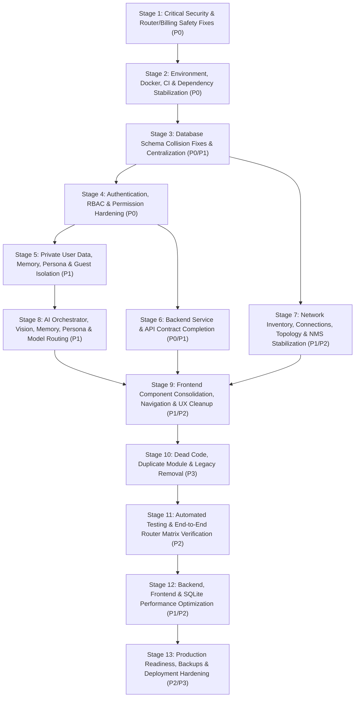

# PHASE 15 — STEP-BY-STEP REFACTORING & IMPLEMENTATION ROADMAP (`15_IMPLEMENTATION_ROADMAP.md`)

**Audit Date**: 2026-11-08  
**Target Workspace**: `/home/Lingga/Documents/project/Network_AI_Agent`  
**Execution Principle**: Phased, low-risk, verifiable engineering execution across 13 sequential stages, ensuring zero regression at every checkpoint.

---

## 1. Visual Execution Roadmap

---

## 2. Detailed 13-Stage Implementation Plan

### Stage 1 — Critical Security & Safety Fixes (`REC-01`, `REC-03`, `REC-05`)
1. **Tujuan**: Immediately eliminate unauthenticated remote command execution on network routers, unauthenticated server file access, `lingga_admin` privilege escalation in chat form submissions, billing webhook signature bypass, and destructive RouterOS NAT masquerade rollbacks.
2. **Pekerjaan yang dilakukan**:
   - Fix `core/orchestrator.py:221-233` (`BUG-01`) by passing authenticated `user_id` via `AIRAContext` and removing the `"lingga_admin"` fallback.
   - Require mandatory HMAC signature verification in `api/routers/billing.py:84-87` and `core/billing/service.py:34, 239` (`BUG-02`), and gate `POST /api/v1/billing/simulate-mock` (`BUG-03`) behind `require_platform_admin` and non-production env check.
   - Fix `agents/akane/config_engine.py:72-74` (`BUG-05`) to tag planned NAT rules with a unique `comment="aira-op-<id>"` rather than removing `[find action=masquerade]`, and fix line `147` (`BUG-29`) to write `masked_data` to `{operation_id}.json`.
   - Remove `os.getenv("SSH_PASSWORD")` fallback for ad-hoc hosts in `agents/akane/connection_manager.py:200, 387` and enforce `validate_network_target()` in `tools/network/diagnostics.py:24, 66, 130`.
3. **Dependency terhadap tahap sebelumnya**: None (Immediate first step).
4. **Risiko**: Low — targets isolated critical vulnerabilities without altering database schemas.
5. **Strategi pengujian**: Unit tests for `Orchestrator.route()` form submission, `BillingService.process_payment_webhook(signature=None)`, and `generate_rollback_for_command()`.
6. **Kriteria selesai (Acceptance Criteria)**:
   - Unsigned billing webhooks return `401 Unauthorized`.
   - Regular users calling `/api/v1/billing/simulate-mock` receive `403 Forbidden`.
   - `[Form Submission...]` chat turns never execute under `lingga_admin`.
   - NAT masquerade rollback never generates `[find action=masquerade]`.

---

### Stage 2 — Environment, Configuration & Dependency Stabilization (`REC-08`, `REC-16`)
1. **Tujuan**: Restore parity between `.venv`, `requirements.txt`, `requirements-web.txt`, `Dockerfile`, and `.github/workflows/ci.yml`, and break upward layer inversions (`core` -> `api`/`mcp_servers`).
2. **Pekerjaan yang dilakukan**:
   - Install both `requirements.txt` and `requirements-web.txt` in `Dockerfile:29-30`, `.github/workflows/ci.yml:26`, and local `.venv`.
   - Fix `.github/workflows/ci.yml:64` from `npm test -- --run` to `npm test`.
   - Add `AIRA_ECOSYSTEM/database/*.db*`, `workspace/*`, and `uploads/*` to `.dockerignore` and `.gitignore`; untrack `database/*.db.old`.
   - Document all 14 missing environment variables in `.env.example`.
   - Break upward imports: move `get_current_user_context` to `core/tenant/auth_deps.py` and move `mask_sensitive_data`/`validate_network_target` to `core/security/network_safety.py`.
3. **Dependency terhadap tahap sebelumnya**: Stage 1.
4. **Risiko**: Low.
5. **Strategi pengujian**: Run `pytest`, `cd AIRA_ECOSYSTEM/app/frontend && npm test`, and `docker build`.
6. **Kriteria selesai (Acceptance Criteria)**:
   - `pytest` and `npm test` run with exit code `0`.
   - `core.nms` can be imported without triggering `mcp_servers/network/server.py`.
   - Zero `.db` or `.db.old` files are included in the Docker build context.

---

### Stage 3 — Database Centralization & Schema Collision Migration (`REC-04`, `REC-11`, `REC-12`)
1. **Tujuan**: Resolve all SQLite table/column collisions in `topology.db`, encrypt plaintext secrets at rest, and eliminate split-brain storage across devices, incidents, and models.
2. **Pekerjaan yang dilakukan**:
   - Rename Edge Gateway's raw metric table in `core/edge_gateway/db.py:85` to `nms_edge_raw_metrics` (`BUG-06`).
   - Align `NmsHistoricalMetricsService` (`metrics_service.py:96-148`) and `historical_intelligence.py:142` to `nms_device_metrics.polled_at` (`BUG-07`).
   - Fix `model_cost_mult_json` column name in `core/tenant/token_quota_service.py:630-660` (`BUG-08`) and `'GUEST'` tier constraint in `core/tenant/db.py:212, 753`.
   - Fix `nms_incidents.opened_at` (`BUG-20`), `topology_snapshots.nodes_json`/`created_at`, `topology_edges.source_node_id`/`target_node_id`, and `nms_incidents` table name in `route_history.py:1378`.
   - Add `core/security/encryption.py` (`SecretVault`) to encrypt `credentials.secret`, `models.api_key`, and `operational_users.mfa_secret`.
   - Unify `InventoryStore` and `InventoryManager` device records, retire `model_registry.db` (`BUG-30`), and replace `ProactiveIncidentEngine` with `MultiTenantIncidentEngine`.
3. **Dependency terhadap tahap sebelumnya**: Stage 2.
4. **Risiko**: Medium (schema & data migration — requires backup before migration).
5. **Strategi pengujian**: Run migration against a copy of operational DBs and verify all 80+ tables initialize and query without `sqlite3.OperationalError`.
6. **Kriteria selesai (Acceptance Criteria)**:
   - `GET /api/nms/metrics/query`, `GET /api/intelligence/metrics/history`, `PUT /api/v1/admin/tokens/plan-policy`, and `POST /api/intelligence/history` return `200 OK`.
   - All secrets in SQLite are stored encrypted (`enc:v1:...`).

---

### Stage 4 — Authentication, RBAC & Permission Hardening (`REC-01`, `REC-02`, `REC-21`)
1. **Tujuan**: Enforce authentication and fine-grained RBAC across all 34 REST routers and both WebSocket endpoints.
2. **Pekerjaan yang dilakukan**:
   - Add `Depends(require_permission(...))` / `Depends(get_current_authenticated_user)` to all 13 unauthenticated routers and `POST /api/reset`; remove duplicate `files.router` mount at `api/main.py:103`.
   - Authenticate `WS /ws/chat/{session_id}` and `WS /ws/nms` using token query parameter/subprotocol and verify session ownership.
   - Fix `require_platform_admin` (`admin_platform.py:62` — `BUG-04`), prevent non-Superadmin assignment of `grp_super_admin` (`user_management.py:98-184`), replace `require_topology_admin` (`topology.py:58-92`) with RBAC permissions, and fix group `DENY` rule precedence (`manager.py:1054` — `BUG-28`).
   - Add write permissions to mutating routes in `devices.py`, `models.py`, `logs.py`, `operations.py`, `network_intelligence.py`, and `personalization.py`; remove `bypass_approval` from `playbooks.py:33`.
   - Remove router-level `devices.read` from `/enroll`, `/heartbeat`, and `/telemetry` in `api/routers/gateways.py:25` (`BUG-15`).
   - Restrict `X-Forwarded-For` trust in `api/routers/auth.py:76` to trusted proxies and fix IPv4-mapped IPv6 SSRF checks in `core/security/ssrf_validator.py:55`.
3. **Dependency terhadap tahap sebelumnya**: Stage 3.
4. **Risiko**: Medium (frontend WebSocket calls must include `?token=...`).
5. **Strategi pengujian**: Automated RBAC matrix test across all 34 routers for unauthenticated, `READ_ONLY`, `MEMBER`, `NOC_ENGINEER`, `ADMIN`, and `SUPER_ADMIN` contexts.
6. **Kriteria selesai (Acceptance Criteria)**:
   - Zero unauthenticated access to protected REST or WebSocket endpoints.
   - `READ_ONLY` users receive `403 Forbidden` on all mutating endpoints.
   - Edge gateways can enroll and send heartbeats/telemetry using gateway tokens.

---

### Stage 5 — User Data Isolation & Guest Mode Cleanup (`REC-09`, `REC-10`)
1. **Tujuan**: Guarantee strict per-user isolation for memories, personas, chat sessions, GPS coordinates, workspace files, and token quotas, and remove residual guest backdoors.
2. **Pekerjaan yang dilakukan**:
   - Route `agents/rei/auto_extract.py` and `core/brain.py:233` through `UserMemoryService` (`topology.db:user_memories` scoped by `user_id` — `BUG-25`).
   - Route `/api/persona/*` and `PersonaEngine` through `UserPersonaService` (`topology.db:user_personas`).
   - Remove `self._last_session_id` fallback in `core/location/service.py:202` (`BUG-26`).
   - Remove `X-Guest-ID: gst_...` spoofing from `core/tenant/auth_deps.py:20-37`.
   - Wire `TokenQuotaService` check and deduction into `api/routers/chat.py` and `api/routers/ws.py` (`BUG-27`) and unify `DEFAULT_PLAN_LIMITS` with `PLAN_CATALOG`.
   - Wire `core/tenant/workspace_service.py` into `api/routers/files.py` for per-tenant/per-user workspace directory isolation.
3. **Dependency terhadap tahap sebelumnya**: Stage 4.
4. **Risiko**: Low-Medium.
5. **Strategi pengujian**: Multi-user isolation tests verifying User A's chat facts, persona, GPS, files, and quota never leak to User B.
6. **Kriteria selesai (Acceptance Criteria)**:
   - Zero cross-user fact, persona, or GPS leakage.
   - Every chat turn records usage in `operational_token_usage_ledger` and blocks when balance is `0`.

---

### Stage 6 — Backend Service & API Completion (`REC-06`, `REC-07`)
1. **Tujuan**: Fix all missing backend endpoints called by the frontend (`404`s), shadowed routes, and runtime `TypeError`/`AttributeError` bugs in backend services.
2. **Pekerjaan yang dilakukan**:
   - Implement `POST /api/v1/auth/change-password`, `POST /api/v1/auth/sessions/revoke-others`, `POST /api/voice/synthesize`, and `POST /api/voice/transcribe` (`BUG-19`).
   - Reorder `/actions/policy` above `/actions/{action_id}` in `api/routers/network_intelligence.py:1556 vs 1586` (`BUG-13`) and remove duplicate `/permissions/simulate` in `admin_platform.py:385` (`BUG-14`).
   - Fix `log_store.get_log_by_id()` in `api/routers/logs.py:44-55` (`BUG-33`).
   - Fix `ChangeImpactEngine`, `RiskAssessmentEngine`, `OperationalDecisionEngine` (`.score`), and `OperationalSchedulerEngine` cron day-of-week (`BUG-23`, `BUG-24`, `BUG-35`, `BUG-36`).
3. **Dependency terhadap tahap sebelumnya**: Stage 4.
4. **Risiko**: Low.
5. **Strategi pengujian**: Endpoint tests for all newly added and unshadowed routes.
6. **Kriteria selesai (Acceptance Criteria)**:
   - `GET /api/intelligence/actions/policy` returns `200 OK`.
   - Self-service password change, session revocation, and voice synthesis endpoints return `200 OK`.

---

### Stage 7 — Network Inventory, Connections, Topology & NMS Stabilization (`REC-06`, `REC-15`, `REC-19`)
1. **Tujuan**: Stabilize live network operations, NMS multi-threaded polling, Edge Gateway health/telemetry, and Network Intelligence investigation.
2. **Pekerjaan yang dilakukan**:
   - Fix `NetworkInvestigator.investigate_natural_language()` (`investigator.py:732, 776` — `BUG-10`), `evidence_service.py:1241` (`BUG-21`), and `auto_orchestrator.py:384` (`BUG-22`).
   - Fix `CanonicalNetworkRegistry._fetch_nms_statuses()` (`canonical_network.py:500` — `BUG-31`) and `TopologyEngine._emit_topology_event()` (`topology_engine.py:4946` — `BUG-32`).
   - Fix Edge Gateway `calendar.timegm()` (`ingestion.py:199` — `BUG-16`), Linux `ping -c` (`collector.py:105` — `BUG-17`), and all 5 `TelemetryType` handlers (`ingestion.py:295` — `BUG-18`).
   -Fix SNMP `ifIndex` OID suffix matching in `tools/snmp/monitor.py:172-194` and regex matching in `mcp_servers/network/server.py:507` (`BUG-37`).
   - Wire `HardenedNmsScheduler` and `AlertEngine` (`core/nms/`) into `NmsEngine`, and change `strict_live` default to `True` in `api/routers/network_intelligence.py:247`.
3. **Dependency terhadap tahap sebelumnya**: Stage 3.
4. **Risiko**: Medium.
5. **Strategi pengujian**: Run RouterOS v6/v7 fixture tests, NMS polling tests, and Edge Gateway telemetry ingestion tests.
6. **Kriteria selesai (Acceptance Criteria)**:
   - `POST /api/intelligence/investigate` completes without error.
   - Edge gateways report `ONLINE` after heartbeat in UTC+7.
   - NMS polls devices concurrently using `HardenedNmsScheduler`.

---

### Stage 8 — AI Orchestrator, Tools, Memory, Persona & Model Routing Stabilization (`REC-06`, `REC-11`)
1. **Tujuan**: Fix multimodal Vision LLM crashes, clean up fictional model seeds, and connect YUKI background voice events.
2. **Pekerjaan yang dilakukan**:
   - Fix `VisionResult` instantiation at `core/file_processing/vision_llm.py:93` (`BUG-09`).
   - Replace the 13 fictional model IDs in `core/model_store.py:42-198` (`_BUILTIN_SEED`) with valid OpenRouter/Ollama model IDs.
   - Subscribe to `EventNames.VOICE_LISTENING_STOP` or route background voice transcripts cleanly to the active session.
3. **Dependency terhadap tahap sebelumnya**: Stage 5.
4. **Risiko**: Low.
5. **Strategi pengujian**: Unit test `analyze_image_with_vision()` with mock LLM response and verify `VisionResult.description` is returned.
6. **Kriteria selesai (Acceptance Criteria)**:
   - Vision LLM image analysis succeeds without `TypeError`.
   - All seeded models in `model_router.db` correspond to real provider model IDs.

---

### Stage 9 — Frontend Component Consolidation, Navigation & UX Cleanup (`REC-07`, `REC-14`, `REC-17`, `REC-24`)
1. **Tujuan**: Fix all frontend runtime crashes, connect orphaned pages, introduce URL routing, and consolidate duplicate UI components.
2. **Pekerjaan yang dilakukan**:
   - Fix `refreshAll()` -> `fetchAllData()` in `src/pages/NmsPage.jsx:972` (`BUG-11`).
   - Fix `SettingsPage.jsx:160` (`api.settings.entitlementsSummary()`), `api.js:449` (`/preferences`), `SettingsPage.jsx` `RAW_TABS` (`"subscription"`, `"token_usage"` — `BUG-38`), and memory importance scale (`0.0–1.0`).
   - Fix `TopologyPage.jsx:833` (`onMenuClick`), `#link-gradient-physical` (`L1341`), `TopologyEdgeInspector.jsx:153,221`, and `InfrastructurePage.jsx` double header bar (`BUG-39`).
   - Fix `DecisionsPage.jsx:30` (`rollback_readiness` — `BUG-40`), `App.jsx:332` (`isOnChatPage` — `BUG-43`), `MobileNav.jsx:50` RBAC filtering, and `AuthContext.jsx:289` bidirectional permission aliases.
   - Add navigation links for `OperationsPage`, `GatewaysPage`, `DecisionsPage`, and `CustomerPortalPage`, and introduce URL routing (`react-router-dom`).
   - Consolidate `BootScreen`, `Hero`/`DynamicHero`, and `SettingsPage` dead persona modals (`REC-24`).
3. **Dependency terhadap tahap sebelumnya**: Stages 6, 7, 8.
4. **Risiko**: Low-Medium.
5. **Strategi pengujian**: Frontend unit tests (`npm test`), production build (`npm run build`), and interactive page navigation checks.
6. **Kriteria selesai (Acceptance Criteria)**:
   - Zero `ReferenceError` or `404` console errors across all 18 pages.
   - Browser Back/Forward and `F5` reload preserve current page/tab.

---

### Stage 10 — Dead Code & Legacy Removal (`REC-20`, `REC-23`)
1. **Tujuan**: Remove all 42 confirmed dead/unused files, legacy backup folders, and generational duplicates.
2. **Pekerjaan yang dilakukan**:
   - Remove `_legacy_backup_20260910_143345/` (27 files), `scratch/*.py` (7 files), and 15 unused backend `.py` files (`core/persona.py`, `core/attachment/main.py`, `agents/yuki/tts_engine.py`, `agents/rei/settings_tools.py`, `core/bootstrap_superadmin.py`, `core/tenant/{context,entitlement_service}.py`, `agents/hikari/`).
   - Remove all 20 unimported files in `app/frontend/src/` (`src/service.js`, `src/capabilities/CapabilityHeroRow (1).jsx`, `src/components/workspace/WorkspacePage.jsx`, `src/pages/dio/DioPreviewPage.jsx`, `src/hooks/useAiraSocket.js`, `src/theme/*.js`, etc.).
3. **Dependency terhadap tahap sebelumnya**: Stage 9.
4. **Risiko**: Low (all files verified via AST & import-graph reachability).
5. **Strategi pengujian**: Run full `pytest` suite, `npm test`, and `npm run build` after removal.
6. **Kriteria selesai (Acceptance Criteria)**:
   - Zero broken imports; all tests and builds pass cleanly.

---

### Stage 11 — Automated Testing & E2E Verification (`REC-22`)
1. **Tujuan**: Close the testing gap between isolated unit tests and real FastAPI/React integration flows.
2. **Pekerjaan yang dilakukan**:
   - Create `AIRA_ECOSYSTEM/tests/test_router_auth_matrix.py` testing all 34 routers via `TestClient(app)`.
   - Fix `AIRA_ECOSYSTEM/test_events_manual.py:33` (`asyncio.run()`).
   - Add frontend component tests covering page mounts and API client contracts.
3. **Dependency terhadap tahap sebelumnya**: Stage 10.
4. **Risiko**: Low.
5. **Strategi pengujian**: Execute full backend + frontend test suites in GitHub Actions CI.
6. **Kriteria selesai (Acceptance Criteria)**:
   - 100% of routers covered by automated auth/RBAC tests; CI passes green.

---

### Stage 12 — Performance Optimization (`REC-13`, `REC-18`, `REC-25`)
1. **Tujuan**: Eliminate SQLite write-on-read lock contention, N+1 query loops, event-loop blocking uploads, and per-token React re-renders.
2. **Pekerjaan yang dilakukan**:
   - Remove per-request `UPDATE operational_user_sessions` from `IdentityManager.validate_session_token()` (`core/tenant/manager.py:1032`).
   - Refactor `DynamicHealthScoringEngine.score_tenant()` to read cached scores on `GET` requests and batch writes; eliminate N+1 loops in `ServiceIntelligenceEngine`, `MultiTenantIncidentEngine`, and `OperationalSchedulerEngine`.
   - Offload `AttachmentService.ingest_upload()` to `asyncio.to_thread()` in `api/routers/attachments.py`.
   - Wire `batcherRef.current.push(event)` in `ChatRuntimeContext.jsx:253` (`BUG-44`), deduplicate `/api/connections` polling, and lazy-load `MermaidBlock`/`MapBlock` in `Markdown.jsx`.
3. **Dependency terhadap tahap sebelumnya**: Stage 11.
4. **Risiko**: Low.
5. **Strategi pengujian**: Load/soak test (`scripts/soak_test.py`) with concurrent `GET` and `POST` requests.
6. **Kriteria selesai (Acceptance Criteria)**:
   - Zero `sqlite3.OperationalError: database is locked` under 50 concurrent requests; chat streaming updates batched at 60fps.

---

### Stage 13 — Production Readiness & Deployment Hardening (`REC-25`, `REC-26`)
1. **Tujuan**: Finalize production Docker Compose stack, Nginx reverse-proxy configuration, crash-consistent SQLite backups, and table retention pruning.
2. **Pekerjaan yang dilakukan**:
   - Update `scripts/backup_restore.py` to use `sqlite3.Connection.backup()` across all active databases.
   - Schedule daily retention pruning for `operational_health_scores` and `operational_gateway_heartbeats` in `core/governance/retention_engine.py`.
   - Update `public/service-worker.js` to use Network-First for `/index.html` (`BUG-41`).
   - Add Nginx / frontend container service to `docker-compose.yml` and proxy `/api/`, `/ws/`, and `/health` in `deploy/nginx/aira_customer_portal.conf`.
3. **Dependency terhadap tahap sebelumnya**: Stage 12.
4. **Risiko**: Low.
5. **Strategi pengujian**: Execute `scripts/production_readiness_check.py`, `docker compose up --build`, and backup/restore verification.
6. **Kriteria selesai (Acceptance Criteria)**:
   - Full containerized stack starts cleanly, passes health checks, and completes online backup/restore without corruption.
