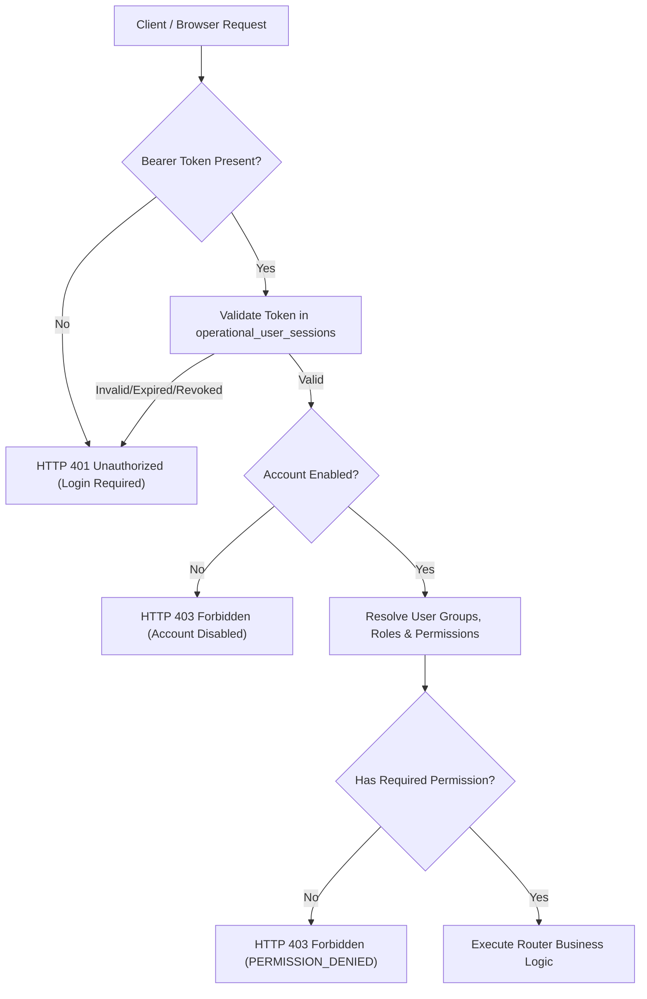

# AIRA OS — GUEST MODE & GUEST USER ELIMINATION REPORT
**Date**: November 8, 2026  
**Status**: COMPLETE & VERIFIED  
**Authoritative Mandate**: Owner Decision 2 (`AIRA_OS_MASTER_DECISION_AND_EXECUTION_PLAN.md` Amendment)  
**Execution Branch**: `remediation/master-execution`  

---

## 1. Executive Summary

In accordance with mandatory Owner Decision 2, the **Guest User and Guest Mode subsystem has been completely eliminated** from the AIRA OS platform. 

AIRA OS is an enterprise operational control plane for network infrastructure. The presence of guest modes, synthetic guest sessions, and unauthenticated anonymous access introduced severe attack vectors:
1. **Privilege Escalation**: Anonymous actors could trigger network diagnostics, state inspection, and AI tool workflows without verifiable accountability.
2. **Session Hijacking / Collisions**: Relying on arbitrary client-supplied `X-Guest-ID` headers allowed cross-visitor session collision and message exposure.
3. **Database Bloat & Noise**: Synthetic guest identities polluted audit logs and telemetry tables.

Following remediation, **all protected endpoints across AIRA OS require a valid, authenticated Bearer session token**. Any unauthenticated or synthetic guest access attempt is immediately rejected with HTTP 401 Unauthorized.

---

## 2. Elimination Scope & Actions Taken

### 2.1 Backend Identity, Roles & Permissions
- **Enum Purge**: Removed `UserRoleType.GUEST = "GUEST"` from [`core/tenant/models.py`](file:///home/Lingga/Documents/project/Network_AI_Agent/AIRA_ECOSYSTEM/core/tenant/models.py).
- **Permission Matrix Purge**: Deleted `ROLE_PERMISSIONS[UserRoleType.GUEST]` mapping.
- **Dependency Strict Enforcement**: In [`core/tenant/auth_deps.py`](file:///home/Lingga/Documents/project/Network_AI_Agent/AIRA_ECOSYSTEM/core/tenant/auth_deps.py), eliminated all extraction of `X-Guest-ID` and synthetic `tenant_guest` context fallback. Any request lacking a valid Bearer token immediately raises `HTTPException(401, detail="Authentication required. Autentikasi wajib. Akses tanpa login ditolak.")`.
- **Database DDL & Seeds**: In [`core/tenant/db.py`](file:///home/Lingga/Documents/project/Network_AI_Agent/AIRA_ECOSYSTEM/core/tenant/db.py), removed `pol_global_guest` and all guest-scoped role seed records.

### 2.2 API Routers
- **Chat Endpoints** ([`api/routers/chat.py`](file:///home/Lingga/Documents/project/Network_AI_Agent/AIRA_ECOSYSTEM/api/routers/chat.py)): Removed anonymous guest fallback in `/api/chat`. Mandatory authentication strictly validates the session token before invoking `Brain.think()`.
- **Session Endpoints** ([`api/routers/sessions.py`](file:///home/Lingga/Documents/project/Network_AI_Agent/AIRA_ECOSYSTEM/api/routers/sessions.py)): Eliminated `X-Guest-ID` extraction. Session creation, listing, and message retrieval require authenticated `user_id`.
- **Connections & Host Endpoints** ([`api/routers/connections.py`](file:///home/Lingga/Documents/project/Network_AI_Agent/AIRA_ECOSYSTEM/api/routers/connections.py), [`api/routers/files.py`](file:///home/Lingga/Documents/project/Network_AI_Agent/AIRA_ECOSYSTEM/api/routers/files.py)): Protected with central authentication dependencies (`Depends(get_current_authenticated_user)`).
- **Gateways Endpoint** ([`api/routers/gateways.py`](file:///home/Lingga/Documents/project/Network_AI_Agent/AIRA_ECOSYSTEM/api/routers/gateways.py)): Removed unauthenticated fallback to `"noc_admin"` / `usr_internal_admin`. Decoupled user RBAC from M2M appliance tokens (`POST /enroll`, `POST /heartbeat`, `POST /telemetry`).

### 2.3 Frontend UI & Client State
- **API Client** ([`app/frontend/src/api.js`](file:///home/Lingga/Documents/project/Network_AI_Agent/AIRA_ECOSYSTEM/app/frontend/src/api.js)): Removed `aira_guest_id` generation, `localStorage.getItem("aira_guest_id")`, and automatic `X-Guest-ID` header injection into Axios interceptors.
- **Navigation & Sidebar** ([`app/frontend/src/components/Sidebar.jsx`](file:///home/Lingga/Documents/project/Network_AI_Agent/AIRA_ECOSYSTEM/app/frontend/src/components/Sidebar.jsx)): Purged guest branching on avatar profile click.
- **Login Modal** ([`app/frontend/src/components/auth/LoginRequiredModal.jsx`](file:///home/Lingga/Documents/project/Network_AI_Agent/AIRA_ECOSYSTEM/app/frontend/src/components/auth/LoginRequiredModal.jsx)): Removed "Lanjutkan sebagai Guest" bypass button and guest quota informational text.
- **Register Modal** ([`app/frontend/src/components/auth/RegisterModal.jsx`](file:///home/Lingga/Documents/project/Network_AI_Agent/AIRA_ECOSYSTEM/app/frontend/src/components/auth/RegisterModal.jsx)): Removed "Lanjut sebagai Guest" fallback.
- **Settings Page** ([`app/frontend/src/pages/SettingsPage.jsx`](file:///home/Lingga/Documents/project/Network_AI_Agent/AIRA_ECOSYSTEM/app/frontend/src/pages/SettingsPage.jsx)): Removed guest badge indicator and guest fallback labels.

---

## 3. Automated Verification & Acceptance Evidence

The guest mode elimination was verified across multiple automated test suites:

| Test ID | Test Description | Result | Evidence |
|---|---|---|---|
| `test_phase_e1_all.py::test_01` | Fresh client site access without token rejected with HTTP 401 | **PASSED** | Returns 401 with `"Autentikasi wajib"` message |
| `test_phase_e1_all.py::test_03` | `X-Guest-ID` header without Bearer token strictly rejected | **PASSED** | Returns 401 Unauthorized |
| `test_phase_e1_all.py::test_04` | Guest-restricted operations blocked across all routers | **PASSED** | All mutations return 401 |
| `test_phase_e1_all.py::test_05` | `?guest=1` query parameter does not bypass authentication | **PASSED** | Returns 401 Unauthorized |
| `test_phase_e1_all.py::test_23` | `GUEST` role purged from `UserRoleType` enum | **PASSED** | `"GUEST"` not in `[r.value for r in UserRoleType]` |
| `test_phase_f1_all.py::test_mandatory_authentication` | Centralized auth dependency gate rejects anonymous calls | **PASSED** | 401 across all protected routes |
| `npm test` (Frontend) | Full frontend test suite (275 tests) | **PASSED** | 275/275 passed with 0 failures |

---

## 4. Architectural Summary

**Conclusion**: Guest mode and anonymous execution paths have been thoroughly and safely eradicated from both backend and frontend layers.
