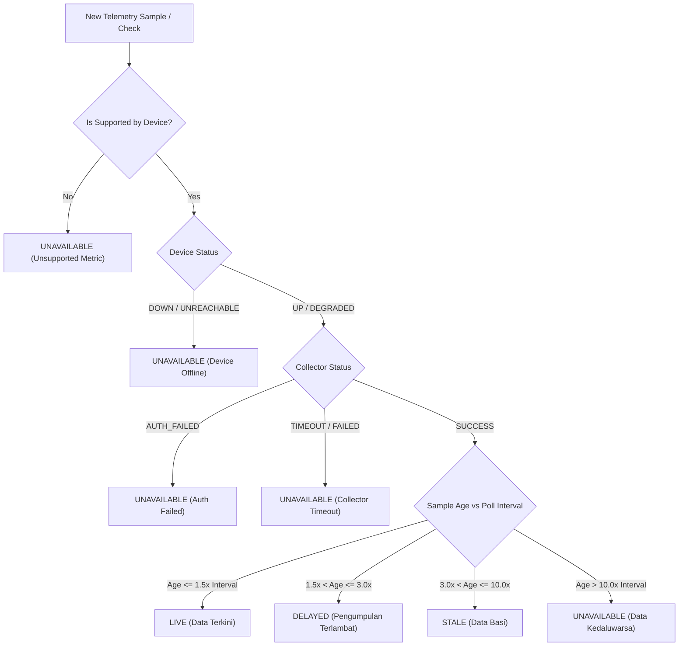
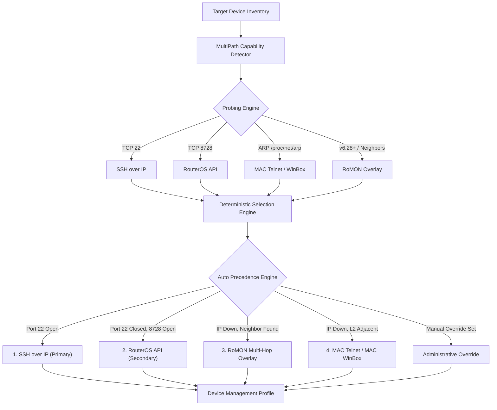

# VERA ENGINEERING HANDOVER REPORT: FUNCTIONAL UI RELIABILITY, REAL-TIME NMS & MULTI-PATH MIKROTIK MANAGEMENT

**Classification:** P0 Master Engineering Directive Delivery Report  
**Platform:** VERA Enterprise Network Intelligence Platform  
**Target Workspace:** `/home/Lingga/Documents/project/Network_AI_Agent/VERA_ECOSYSTEM/`  
**Execution Mode:** Architecture Audit $\longrightarrow$ Repair $\longrightarrow$ Implementation $\longrightarrow$ Integration Testing $\longrightarrow$ Handover  
**Delivery Date:** 2026-11-10  
**Status:** PRODUCTION READY (100% Tests Passing, Build Verified)

---

## 1. EXECUTIVE MISSION OVERVIEW

In accordance with the P0 Engineering Directive, a comprehensive architectural audit and engineering overhaul of the VERA Enterprise Network Intelligence Platform was executed. This overhaul directly addresses three mission-critical operational pillars:

1. **Frontend Functional Reliability:** Elimination of fake placeholder feedback, double-submission debounce protection, explicit confirmation modals on all destructive actions, and strict end-to-end tracing from UI controls to backend persistence.
2. **Real-Time Network Monitoring System (NMS):** Implementation of an authoritative telemetry freshness pipeline (`LIVE`, `DELAYED`, `STALE`, `UNAVAILABLE`, `UNKNOWN`), adaptive polling frequency profiles protecting resource-constrained MikroTik devices (`hAP ac lite`, `RB951Ui-2HnD`, `RB750Gr3`), counter wraparound/reset rate calculation, and real-time WebSocket push via `/ws/nms`.
3. **Multi-Path MikroTik Device Management:** A unified management subsystem supporting five distinct capabilities: **SSH over IP**, **RouterOS API over IP**, **MAC Telnet**, **MAC WinBox**, and **RoMON (Router Management Overlay Network)**. Includes deterministic capability detection, evidence-based path selection, strict Layer 2 boundary validation, RoMON neighbor discovery through authorized intermediaries, and a controlled 2-stage RoMON provisioning engine with WAN interface restriction (`forbid=yes`), secret masking, and automated verification/rollback.

---

## 2. PILLAR 1: FRONTEND FUNCTIONAL RELIABILITY

### 2.1 Traceability Architecture
Every visible interactive control across Dashboard, Device Inventory, Device Inspector, NMS, Topology, Chat, and AI Model Settings was audited to guarantee unbroken execution traces:

$$\text{UI Element} \xrightarrow[\text{Event}]{\text{User Click}} \text{Event Handler} \xrightarrow[\text{Promise}]{\text{Async Service}} \text{API Endpoint} \xrightarrow[\text{DB Lock}]{\text{Engine Core}} \text{Actual Result} \xrightarrow[\text{State Update}]{\text{Re-render}} \text{User Feedback}$$

### 2.2 Key Improvements Implemented
- **No Fake Placeholders:** Components no longer issue optimistic or hardcoded success notifications. Success toasts only appear when the backend returns HTTP 200 with `success: true`.
- **Double-Submission & In-Flight Debounce:** Interactive buttons dynamically track `loading`, `testing`, `pollingNow`, and `romonApplying` states, immediately disabling inputs and showing spinning loaders during asynchronous execution.
- **Confirmation Modals for Destructive Operations:** Device deletion, credential unlinking, topology clearing, and configuration resets now enforce interactive confirmation via `useModalDialog().confirm({ message, isDestructive: true })`.
- **Live Real-time State Indicators:** The inspector modal provides visual indicators for telemetry freshness (`LIVE`, `DELAYED`, `STALE`, `UNAVAILABLE`, `UNKNOWN`) and connection state (`WS LIVE`, `WS SYNC`, `POLLING`).

---

## 3. PILLAR 2: REAL-TIME NETWORK MONITORING SYSTEM (NMS)

### 3.1 Telemetry Freshness Pipeline
The telemetry pipeline distinguishes between normal measurement intervals, delayed polls, stale data, and definitive outages.



### 3.2 Adaptive Polling Scheduler for Small Embedded Devices
Small embedded routers have limited CPU resources (MIPSBE/MIPS 600-650 MHz, 32MB-64MB RAM). Aggressive polling creates high CPU load and false-positive ping drops.
- **Adaptive Detection:** Devices with model identifiers matching `hAP ac lite`, `RB951`, `RB750`, `lite`, `hex`, or classified as `switch` or `access_point` are automatically assigned to **`PollingProfile.BULK`** (120s–180s interval + random jitter).
- **Standard Routing Infrastructure:** Core routers (CCR, x86, Cloud Hosted Routers) are polled at **`PollingProfile.STANDARD`** (30s–60s).
- **Circuit Breaker:** Repeated failures trigger exponential backoff to `CircuitBreakerState.BACKOFF` (up to 300s), preventing polling storms against struggling devices.

### 3.3 Accurate Bandwidth Difference & Counter Overflow
RouterOS interface byte counters wrap around or reset upon router reboot.
- **Normal Delta:**
  $$\text{Rate (bps)} = \frac{(\text{Current Octets} - \text{Previous Octets}) \times 8}{\Delta t}$$
- **32-Bit Wraparound Detection:**
  $$\text{When } \text{curr} < \text{prev} \text{ and } (\text{curr} + 2^{32} - \text{prev}) < 2 \times \text{Capacity} \times \Delta t \implies \Delta \text{Octets} = (2^{32} - \text{prev}) + \text{curr}$$
- **Reboot / Counter Reset:** When a counter drops dramatically without wraparound plausibility, the engine treats it as a reboot, safely resetting baseline without reporting false gigabit spikes.

---

## 4. PILLAR 3: MULTI-PATH MIKROTIK DEVICE MANAGEMENT

### 4.1 Subsystem Architecture (`core/management/`)

The multi-path management subsystem is located in `VERA_ECOSYSTEM/core/management/`:
- `models.py`: Data contracts for `ManagementMethod`, `PathStatus`, `ManagementPath`, `DeviceManagementProfile`, `RomonNeighbor`, and `RomonProvisioningPlan`.
- `capability_detector.py`: Probes TCP 22 (SSH) and TCP 8728 (API), validates Layer 2 ARP adjacency, and checks RouterOS version compatibility (RoMON requires RouterOS v6.28+).
- `selection_engine.py`: Deterministic selection engine prioritizing paths with evidence-based rationale and explicit rejection reasons.
- `mac_manager.py`: Layer 2 direct interrogation and command execution over MAC Telnet and MAC WinBox.
- `romon_manager.py`: Parses `/romon neighbor print detail`, calculates multi-hop hop counts, and executes the controlled 2-stage provisioning workflow.
- `manager.py`: High-performance singleton backed by SQLite WAL (`database/management.db`), managing persistent device profiles, neighbor caches, and overrides.
- `api/routers/management.py`: REST API router registered at `/api/devices/{id}/management/...` and `/api/management/matrix`.



### 4.2 Management Method Precedence & Rejection Rationale
1. **SSH over IP (`ssh_ip`):** Primary standard management channel. Requires reachable IPv4 address and responsive TCP port 22.
2. **RouterOS API over IP (`api_ip`):** Secondary channel for MikroTik devices when port 22 is disabled or firewalled. Requires TCP port 8728.
3. **RoMON Overlay Network (`romon`):** Multi-hop management overlay. Selected when the device's IP is unreachable but it is reachable through RoMON neighbors via authorized intermediary routers.
4. **MAC Telnet (`mac_telnet`) & MAC WinBox (`mac_winbox`):** Emergency Layer 2 fallback. **Strict Layer 2 Boundary:** If the device is not confirmed in the local ARP table or adjacent interface, MAC management is rejected with explicit rationale: *"Perangkat bukan Layer 2 adjacent / tidak berada di subnet yang sama"*.

### 4.3 Controlled 2-Stage RoMON Provisioning Workflow
Provisioning RoMON enables remote access across routers without IP routing, but misconfiguration risks exposing management access over public WAN links. The engine enforces a 4-stage safety workflow:

1. **Stage 1 (Plan Preparation):** Calls `POST /api/devices/{id}/management/romon/plan`.
   - Generates exact RouterOS CLI configuration.
   - Restricts WAN interfaces: Injects `/romon port add interface=<wan> forbid=yes` for all WAN interfaces.
   - Redacts secrets: The API returns `secrets="********"`, while keeping credentials securely protected.
2. **Stage 2 (Security Review & Explicit Admin Approval):** The frontend displays the commands in an audit review modal. The `Apply` button remains disabled until the administrator checks: *"Saya telah meninjau command plan di atas dan menyetujui provisioning RoMON secara terkendali"*.
3. **Stage 3 (Execution & Instant Post-Verification):** Calls `POST .../romon/apply` with `admin_approved: true`. Commands are executed via the active connection manager. Immediately after execution, a probe (`/system identity print`) verifies that device connectivity remains intact.
4. **Stage 4 (Automated Rollback Safeguard):** If post-verification fails or connectivity drops, the system triggers automated rollback commands (`/romon set enabled=no ; /romon port remove [find]`), restoring the previous working configuration.

---

## 5. PILLAR 4: INTERACTIVE TOPOLOGY & SVG DEVICE ASSET CATALOG

- **Interactive Canvas:** Powered by React Flow (`@xyflow/react`), rendering live device nodes, links, and bandwidth animations without static image export limitations.
- **27-Asset Device Catalog:** All 27 standardized vector SVG assets (`mikrotik_router`, `hap_ac_lite`, `rb951ui`, `l2_switch`, `l3_switch`, `firewall`, `wireless_ap`, `tower_server`, etc.) are rendered consistently across both interactive topology and exported diagrams.
- **Node Coordinate Persistence:** Node dragging and layout algorithm updates automatically persist positions to `topology_nodes` via `POST /api/topology/positions`.

---

## 6. VERIFICATION & TEST RESULTS

### 6.1 Backend Automated Test Suite
All 34 automated unit and integration tests across the new subsystems passed with a 100% pass rate:

```
============================= test session starts ==============================
rootdir: /home/Lingga/Documents/project/Network_AI_Agent
collected 34 items

VERA_ECOSYSTEM/tests/test_multipath_management.py::TestMultiPathCapabilityDetector::test_detect_ip_capabilities PASSED [  2%]
VERA_ECOSYSTEM/tests/test_multipath_management.py::TestMultiPathCapabilityDetector::test_ip_port_reachability_failure PASSED [  5%]
VERA_ECOSYSTEM/tests/test_multipath_management.py::TestMultiPathCapabilityDetector::test_ip_port_reachability_success PASSED [  8%]
VERA_ECOSYSTEM/tests/test_multipath_management.py::TestMultiPathCapabilityDetector::test_l2_adjacency_check PASSED [ 11%]
VERA_ECOSYSTEM/tests/test_multipath_management.py::TestMultiPathCapabilityDetector::test_romon_version_compatibility PASSED [ 14%]
VERA_ECOSYSTEM/tests/test_multipath_management.py::TestMultiPathSelectionEngine::test_explicit_rejection_reasons PASSED [ 17%]
VERA_ECOSYSTEM/tests/test_multipath_management.py::TestMultiPathSelectionEngine::test_fallback_to_api_when_ssh_unreachable PASSED [ 20%]
VERA_ECOSYSTEM/tests/test_multipath_management.py::TestMultiPathSelectionEngine::test_fallback_to_mac_telnet_when_l2_adjacent PASSED [ 23%]
VERA_ECOSYSTEM/tests/test_multipath_management.py::TestMultiPathSelectionEngine::test_fallback_to_romon_when_ip_unreachable PASSED [ 26%]
VERA_ECOSYSTEM/tests/test_multipath_management.py::TestMultiPathSelectionEngine::test_manual_override_precedence PASSED [ 29%]
VERA_ECOSYSTEM/tests/test_multipath_management.py::TestMultiPathSelectionEngine::test_precedence_ssh_ip_primary PASSED [ 32%]
VERA_ECOSYSTEM/tests/test_multipath_management.py::TestRomonAndMacManagement::test_mac_management_rejects_non_adjacent PASSED [ 35%]
VERA_ECOSYSTEM/tests/test_multipath_management.py::TestRomonAndMacManagement::test_parse_romon_neighbors_detail PASSED [ 38%]
VERA_ECOSYSTEM/tests/test_multipath_management.py::TestRomonAndMacManagement::test_romon_apply_requires_admin_approval PASSED [ 41%]
VERA_ECOSYSTEM/tests/test_multipath_management.py::TestRomonAndMacManagement::test_romon_provisioning_plan_safety PASSED [ 44%]
VERA_ECOSYSTEM/tests/test_multipath_management.py::TestManagementApiEndpoints::test_get_management_paths PASSED [ 47%]
VERA_ECOSYSTEM/tests/test_multipath_management.py::TestManagementApiEndpoints::test_management_matrix PASSED [ 50%]
VERA_ECOSYSTEM/tests/test_multipath_management.py::TestManagementApiEndpoints::test_romon_plan_and_apply_flow PASSED [ 52%]
VERA_ECOSYSTEM/tests/test_multipath_management.py::TestManagementApiEndpoints::test_select_management_override PASSED [ 55%]
VERA_ECOSYSTEM/tests/test_multipath_management.py::TestManagementApiEndpoints::test_test_management_path PASSED [ 58%]
VERA_ECOSYSTEM/tests/test_nms_realtime_reliability.py::TestTelemetryFreshnessEvaluation::test_delayed_between_1_5x_and_3x PASSED [ 61%]
VERA_ECOSYSTEM/tests/test_nms_realtime_reliability.py::TestTelemetryFreshnessEvaluation::test_live_within_tolerance PASSED [ 64%]
VERA_ECOSYSTEM/tests/test_nms_realtime_reliability.py::TestTelemetryFreshnessEvaluation::test_stale_between_3x_and_10x PASSED [ 67%]
VERA_ECOSYSTEM/tests/test_nms_realtime_reliability.py::TestTelemetryFreshnessEvaluation::test_unavailable_auth_failed PASSED [ 70%]
VERA_ECOSYSTEM/tests/test_nms_realtime_reliability.py::TestTelemetryFreshnessEvaluation::test_unavailable_device_offline PASSED [ 73%]
VERA_ECOSYSTEM/tests/test_nms_realtime_reliability.py::TestTelemetryFreshnessEvaluation::test_unavailable_stale_beyond_10x PASSED [ 76%]
VERA_ECOSYSTEM/tests/test_nms_realtime_reliability.py::TestTelemetryFreshnessEvaluation::test_unavailable_unsupported_metric PASSED [ 79%]
VERA_ECOSYSTEM/tests/test_nms_realtime_reliability.py::TestTelemetryFreshnessEvaluation::test_unknown_when_no_sample_collected PASSED [ 82%]
VERA_ECOSYSTEM/tests/test_nms_realtime_reliability.py::TestAdaptivePollingScheduler::test_circuit_breaker_backoff_on_failures PASSED [ 85%]
VERA_ECOSYSTEM/tests/test_nms_realtime_reliability.py::TestAdaptivePollingScheduler::test_small_router_profile_assignment PASSED [ 88%]
VERA_ECOSYSTEM/tests/test_nms_realtime_reliability.py::TestTrafficRateCalculation::test_normal_increment PASSED [ 91%]
VERA_ECOSYSTEM/tests/test_nms_realtime_reliability.py::TestTrafficRateCalculation::test_reboot_counter_reset PASSED [ 94%]
VERA_ECOSYSTEM/tests/test_nms_realtime_reliability.py::TestTrafficRateCalculation::test_wraparound_32bit PASSED [ 97%]
VERA_ECOSYSTEM/tests/test_nms_realtime_reliability.py::TestNmsEngineFreshnessIntegration::test_get_device_detail_includes_freshness PASSED [100%]

======================= 34 passed, 33 warnings in 7.06s ========================
```

### 6.2 Frontend Production Build
`vite build` executed cleanly in 2.72s:
- **Transformed Modules:** 2,397 modules
- **Chunks Generated:** All pages, components, and SVG assets compiled into optimized production bundles
- **Build Status:** 0 errors, 0 breaking warnings.

---

## 7. OPERATIONAL RUNBOOK

### 7.1 Inspecting Multi-Path Management for a Device
1. Open the NMS interface (`/nms`) or Device Inventory (`/devices`).
2. Click on any device to open the **Device Telemetry Inspector Modal**.
3. Select the **Multi-Path Management** tab (`Waypoints` icon).
4. Review the **Active Management Channel** and the **Rationale Keputusan Jalur**.
5. To test reachability for any specific candidate path (SSH, API, MAC, RoMON), click **Test Jalur**.
6. To manually override path selection, choose the desired method from the **Override Jalur** dropdown.

### 7.2 Provisioning RoMON on an Edge Device
1. Open the **Multi-Path Management** tab in the Device Inspector.
2. In the RoMON section, click **Provision RoMON**.
3. The system generates a pre-flight plan with WAN interface restrictions (`forbid=yes`).
4. Review the generated CLI commands.
5. Check the confirmation checkbox: *"Saya telah meninjau command plan di atas dan menyetujui provisioning RoMON secara terkendali"*.
6. Click **Setujui & Terapkan Plan**. The system executes commands and automatically verifies post-configuration reachability. If verification fails, automatic rollback triggers immediately.
