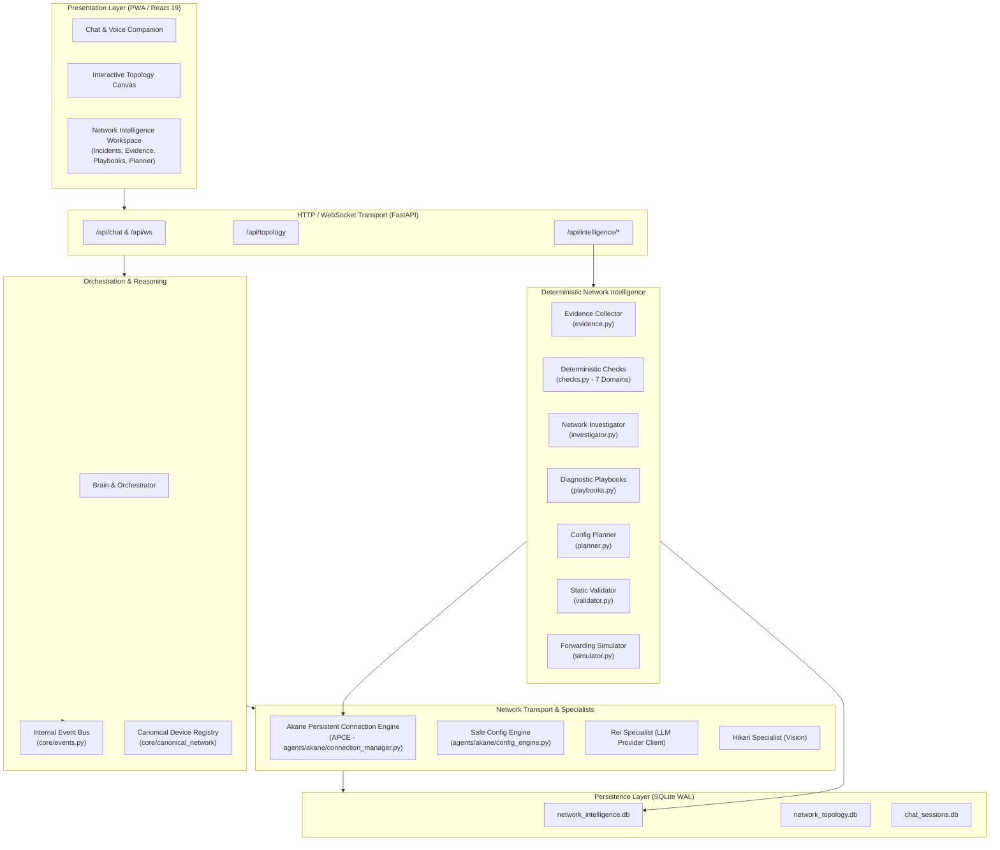

# AIRA OS — System Architecture & Layered Reference
## Authoritative Architecture Specification for the Network Engineering Copilot

---

## 1. System Overview

AIRA OS is structured into six strictly decoupled layers:
```
AIRA_ECOSYSTEM/
├── app/frontend/       React 19 / Vite PWA (Presentation layer)
├── api/                FastAPI REST routers + WebSocket (HTTP transport)
├── core/               Brain, orchestrator, task classifier, logger, event bus
│   ├── network_intelligence/  Deterministic network copilot engines
│   └── canonical_network/     Canonical device registry & identity
├── agents/             Specialist agents: Akane (Network), Rei (Research), Hikari (Vision), Yuki (Voice)
├── mcp_servers/        Model Context Protocol servers (Network MCP)
└── database/           SQLite databases (WAL mode, single-writer)
```

---

## 2. Layered Architecture Diagram



---

## 3. Network Intelligence Pipeline

All diagnostic operations enforce a deterministic, unidirectional pipeline:

$$\text{Evidence Intake} \longrightarrow \text{Correlation \& Checks} \longrightarrow \text{Hypothesis Ranking} \longrightarrow \text{Decision Engine} \longrightarrow \text{Playbook Execution}$$

### Pipeline Invariants:
1. **Evidence Precedes Hypotheses**: The system never formulates root causes without collected evidence. If collection fails, status is `INSUFFICIENT_EVIDENCE`.
2. **Deterministic Rules Over Generative Speculation**: Findings are calculated via exact algorithms (IPv4 Longest Prefix Match, rule order traversal, subnet containment).
3. **Decoupled Mutation**: The investigation and diagnostic playbooks do not import or call `SafeConfigEngine.apply_change`.
4. **Transparent Data-Plane Disclosures**: Static simulation reports explicitly disclose unmodeled behaviors (FastTrack, hardware offload, conntrack).

---

## 4. Akane Persistent Connection Engine (APCE)

Network device connectivity is managed by `ConnectionManager` (`agents/akane/connection_manager.py`):
- **Session Pooling**: Maintains persistent SSH sessions per target router to eliminate connection handshake overhead.
- **Single-Flight Serialization**: Target-level `asyncio.Lock` ensures only one command is dispatched to a given router at any time.
- **Storm Prevention**: Bounded retries with exponential backoff (2s, 4s, 8s, 16s, 30s) prevent cascading failures during router outages.
- **Security Interceptor**: Every command is validated against `validate_readonly_command()` before transmission.

---

## 5. Architectural Invariants (Non-Negotiable)

1. **Frontend PWA Purity**: `app/frontend` contains zero network parsing or business logic. All calculations occur in Python backend engines.
2. **Single Internal Event System**: `core/events.py` is the only event dispatch mechanism in the application.
3. **Isolated LLM Gateway**: `agents/rei/provider_client.py` is the single point of egress to external LLM providers (Ollama, OpenRouter).
4. **Structured Persistence**: All state is stored in SQLite tables with WAL mode in `database/`. No ad-hoc JSON or flat files for persistent state.
