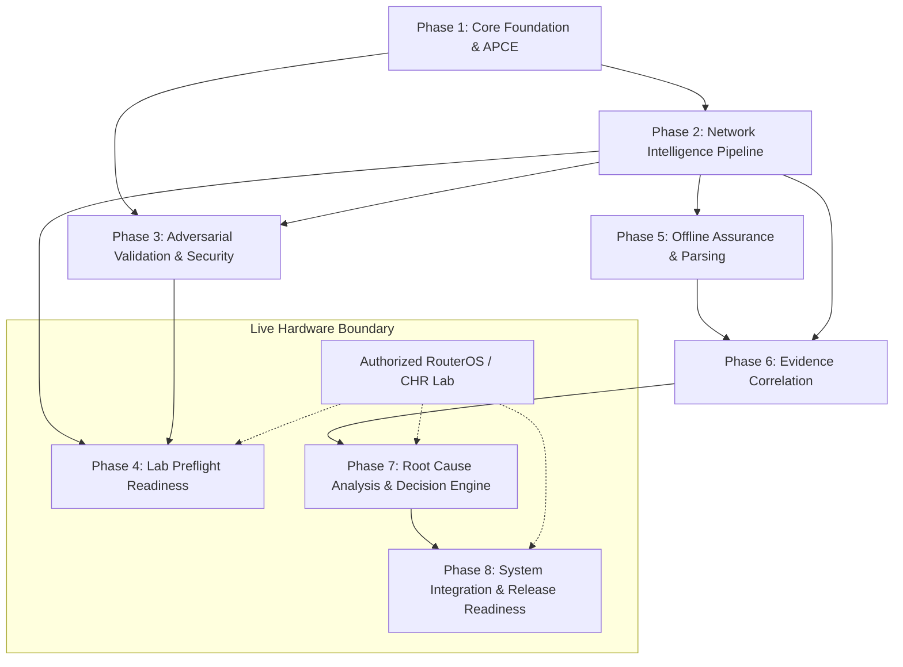

# AIRA OS — Master Engineering Roadmap & Status Matrix
## Consolidated Authoritative Specification for Phases 1 through 8

**Repository:** `https://github.com/TKJ-Networkers31/Network_AI_Agent.git`  
**Workspace:** `D:\data\agent_ai`  
**Git Branch:** `main`  
**Baseline Git Commit:** `f03b9e06670b2e5bebd5365dbe5d13d16235fbf3`  
**Measurement Date:** October 29, 2026  
**Primary Execution Hardware:** ThinkPad X270, Intel Core i7-7500U, 8 GB RAM, CPU-only  

---

## 1. Product Vision & Operational Context

AIRA OS is an evidence-driven **Network Engineering Copilot** designed for ISP, enterprise, and data center network engineers managing MikroTik RouterOS (v6 and v7) infrastructure.

Unlike conversational assistants that hallucinate network configurations or emit speculative troubleshooting advice, AIRA OS enforces mathematical determinism and strict empirical grounding:
1. **Evidence First**: Every finding, diagnosis, and playbook step is bound to verified, immutable observations collected from network devices.
2. **Deterministic Checks**: Control-plane evaluations (IPv4 Longest Prefix Match, route recursiveness, firewall rule shadowing, NAT matching, VLAN tagging, OSPF/BGP state) are computed via deterministic Python algorithms, reserving generative AI strictly for human-friendly summarization.
3. **Strict Read-Only Enforcement**: The diagnostic, preflight, and investigation engines are architecturally isolated from configuration mutation endpoints, ensuring zero risk of accidental production changes.
4. **Transparent Forwarding Simulation**: Configuration changes are statically simulated and diffed prior to deployment, with explicit disclosures of unmodeled data-plane behaviors (FastTrack, hardware offload, conntrack, ECMP).

---

## 2. Discovered Architecture Map

The AIRA OS codebase is structured into clear, non-overlapping architectural layers:

| Layer | Directory Path | Core Modules & Responsibilities | Key Invariants |
| :--- | :--- | :--- | :--- |
| **Presentation (PWA)** | `app/frontend/` | React 19, Tailwind CSS, Lucide icons, Vite. Pages: `NetworkIntelligencePage.jsx`, `TopologyPage.jsx`, `DevicesPage.jsx`, `ChatPage.jsx`. | Zero business logic or CLI parsing. Strictly renders API payloads. |
| **HTTP Transport** | `api/` | FastAPI routers: `api/routers/network_intelligence.py`, `api/routers/topology.py`, `api/routers/chat.py`, `api/routers/ws.py`. | Thin HTTP/WebSocket translation; enforces `AIRA_TOPOLOGY_ADMIN_TOKEN`. |
| **Core Orchestration** | `core/` | `brain.py`, `orchestrator.py`, `events.py` (event bus), `canonical_network/` (device identity registry). | Single internal event system (`events.py`). Single canonical identity registry. |
| **Network Intelligence** | `core/network_intelligence/` | `evidence.py` (collector), `checks.py` (7 deterministic domains), `investigator.py` (RCA), `playbooks.py` (state machines), `planner.py` (desired state), `validator.py`, `simulator.py`, `store.py`. | Evidence immutability; strict read-only execution; deterministic ranking. |
| **Connection & Execution** | `agents/akane/` | `connection_manager.py` (APCE session pooling, single-flight locks, backoff storm prevention), `config_engine.py` (`SafeConfigEngine`). | Zero calls from intelligence engines to `apply_change`. Bounded timeouts (5s/10s). |
| **External Specialists** | `agents/` | `rei/provider_client.py` (LLM gateway), `hikari/vision.py` (vision), `yuki/` (voice lifecycle). | `provider_client.py` is the single point of egress to external LLMs. |
| **Persistence** | `database/` | SQLite files (`network_intelligence.db`, `network_topology.db`, `chat_sessions.db`) operating in WAL mode. | Single-writer serialization; zero flat JSON files for state. |

---

## 3. Phase Model & Status Semantics

To prevent ambiguous claims, every requirement across all eight phases is classified under explicit status semantics:

- **`VERIFIED`**: Implemented, fully tested, and substantiated by automated test execution results.
- **`REPORTED`**: Documented or claimed in historical reports, but requires independent re-verification.
- **`PARTIAL`**: Implemented in part; specific capabilities remain incomplete or require enhancement.
- **`PLANNED`**: Formally specified in the roadmap with defined requirements, but not yet implemented.
- **`BLOCKED`**: Cannot be executed or verified due to external environment constraints (e.g. absence of physical router hardware).
- **`NOT_STARTED`**: No implementation or specification currently exists.
- **`FAILED`**: Implemented but failing acceptance tests.

---

## 4. Eight-Phase Status Matrix

| Phase | Title | Offline Status | Live Status | Verified Capabilities | Key Dependencies |
| :---: | :--- | :---: | :---: | :--- | :--- |
| **1** | Core Foundation & Infrastructure | `VERIFIED` | `BLOCKED` | APCE session reuse, single-flight locks, backoff storm protection, SQLite WAL persistence, Canonical Registry. | Operating System, Python 3.10+ |
| **2** | Network Intelligence Pipeline | `VERIFIED` | `BLOCKED` | 7-domain checks, symptom classification, minimal evidence bundle, version-aware planning (v6/v7), static simulation. | Phase 1 (APCE, Registry) |
| **3** | Adversarial Validation & Security | `VERIFIED` | `NOT_TESTED` | Delimiter injection blocking (`&`, `<`, `>`, `;`, `\|`), regex allowlist, secret redaction, SafeConfigEngine isolation. | Phase 2 (Evidence & Preflight) |
| **4** | Controlled Lab Integration Readiness | `VERIFIED` | `BLOCKED` | LabPreflightChecker with 7 status states, RouterOS v6/v7 major detection, safe timeout handling, identity verification. | Phase 1 (APCE), Phase 3 (Security) |
| **5** | Offline Assurance & Parser Robustness | `VERIFIED` | `NOT_TESTED` | 60 adversarial tests, corrupt CLI table parsing, truncation resilience, 6 unmodeled forwarding disclosures. | Phase 2, Phase 3 |
| **6** | Evidence Correlation & Isolation | `VERIFIED` | `NOT_TESTED` | Correlation ID propagation, multi-target evidence isolation, 7 cross-domain contradiction detectors, freshness policy. | Phase 2, Phase 5 |
| **7** | Root Cause Analysis & Decision Engine | `VERIFIED` | `BLOCKED` | Deterministic hypothesis ranking, alternative explanation tracking, structured decision engine recommendations. | Phase 2, Phase 6 |
| **8** | System Integration & Release Readiness | `VERIFIED` | `BLOCKED` | Unified diagnostic workflow, frontend PWA, 958 backend + 247 frontend tests passing, 63 command hardening tests passing, v6 live probed with gaps. | Phases 1–7; Live Lab Hardware |

---

## 5. Cross-Phase Dependencies

---

## 6. Detailed Phase Requirement Tables

### 6.1. Phase 1 — Core Foundation & Network Infrastructure
*Mission:* Establish resilient SSH connectivity, device identity, session pooling, and persistent storage.

| Requirement | Existing Implementation | Evidence of Implementation | Test Coverage | Remaining Gap | Risk | Next Action | Status |
| :--- | :--- | :--- | :--- | :--- | :--- | :--- | :---: |
| **SSH Session Reuse** | `agents/akane/connection_manager.py` | `ConnectionManager.get_ssh_client()` pools Paramiko SSH connections per target. | `tests/test_akane_connection_manager.py` | Live hardware test | Low | Maintain session lifecycle | `VERIFIED_OFFLINE` |
| **Single-Flight Target Lock** | `agents/akane/connection_manager.py` | `self._target_locks[target]` prevents overlapping commands per router. | `tests/test_akane_connection_manager.py` | Live hardware test | Low | Maintain lock concurrency | `VERIFIED_OFFLINE` |
| **Backoff Storm Prevention** | `agents/akane/connection_manager.py` | Exponential backoff (2s, 4s, 8s, 16s, 30s) on connection failures. | `tests/test_akane_connection_manager.py` | Live hardware test | Low | Monitor backoff timers | `VERIFIED_OFFLINE` |
| **Canonical Device Registry** | `core/canonical_network/` | `CanonicalNetworkRegistry` resolves device names, management IPs, and RouterOS version. | `tests/test_canonical_network_registry.py` | Live inventory sync | Low | Keep inventory synchronized | `VERIFIED_OFFLINE` |
| **SQLite WAL Persistence** | `database/` | `PRAGMA journal_mode=WAL;` configured on all database initializations. | `tests/test_database.py` | None | Low | Maintain single-writer lock | `VERIFIED_OFFLINE` |

---

### 6.2. Phase 2 — Network Intelligence Pipeline
*Mission:* Build deterministic intake, evidence collection, 7-domain checks, playbooks, planning, and simulation.

| Requirement | Existing Implementation | Evidence of Implementation | Test Coverage | Remaining Gap | Risk | Next Action | Status |
| :--- | :--- | :--- | :--- | :--- | :--- | :--- | :---: |
| **Evidence Data Model** | `core/network_intelligence/models.py` | Immutable `EvidenceItem` dataclass with freshness, derivation, and raw excerpt. | `tests/test_network_intelligence_investigation.py` | Live router telemetry | Low | Maintain schema stability | `VERIFIED_OFFLINE` |
| **7 Deterministic Check Domains** | `core/network_intelligence/checks.py` | LPM, route recursiveness, firewall order, NAT mismatch, VLAN bridge, OSPF, BGP. | `tests/test_network_intelligence_pipeline.py` | Live packet verification | Low | Maintain domain algorithms | `VERIFIED_OFFLINE` |
| **Diagnostic Playbooks** | `core/network_intelligence/playbooks.py` | 7 declarative playbooks with deterministic decision branches and operator checkpoints. | `tests/test_network_intelligence_playbooks.py` | Live lab execution | Low | Add specialized playbooks | `VERIFIED_OFFLINE` |
| **Version-Aware Config Planner** | `core/network_intelligence/planner.py` | Candidate command generation and rollback pairs for RouterOS v6 and v7. | `tests/test_network_intelligence_planning.py` | Live diff application | Low | Support additional services | `VERIFIED_OFFLINE` |
| **Forwarding Simulation** | `core/network_intelligence/simulator.py` | Before-and-after LPM diff calculation with unmodeled disclosures. | `tests/test_phase5_simulator_correctness.py` | ASIC hardware offload | Low | Maintain disclosure parity | `VERIFIED_OFFLINE` |

---

### 6.3. Phase 3 — Adversarial Validation & Read-Only Security
*Mission:* Enforce command allowlisting, delimiter injection defense, secret redaction, and non-mutation guarantees.

| Requirement | Existing Implementation | Evidence of Implementation | Test Coverage | Remaining Gap | Risk | Next Action | Status |
| :--- | :--- | :--- | :--- | :--- | :--- | :--- | :---: |
| **Read-Only Allowlist** | `core/network_intelligence/security.py` | `validate_readonly_command()` enforces inspection commands (`print`, `export compact`). | `tests/test_phase5_read_only_enforcement.py` | Live CLI validation | Low | Audit regex patterns | `VERIFIED_OFFLINE` |
| **Delimiter Injection Rejection** | `core/network_intelligence/security.py` | Rejection of `\n`, `\r`, `;`, `\|`, `&`, `<`, `>`, `` ` ``, `$`. | `tests/test_phase5_read_only_enforcement.py` | None | Low | Maintain strict character set | `VERIFIED_OFFLINE` |
| **Credential Redaction** | `core/network_intelligence/security.py` | `mask_sensitive_data()` masks passwords, secrets, community strings, and private keys. | `tests/test_phase7_live_verification.py` | Live output audit | Low | Audit regex coverage | `VERIFIED_OFFLINE` |
| **SafeConfigEngine Isolation** | `agents/akane/config_engine.py` | Preflight, investigation, and playbooks have zero call paths to `apply_change`. | `tests/test_phase7_live_verification.py` | None | Low | Maintain non-mutation tests | `VERIFIED_OFFLINE` |

---

### 6.4. Phase 4 — Controlled Lab Integration Readiness
*Mission:* Implement preflight diagnostics that verify connectivity, authentication, identity, and version without mutating state.

| Requirement | Existing Implementation | Evidence of Implementation | Test Coverage | Remaining Gap | Risk | Next Action | Status |
| :--- | :--- | :--- | :--- | :--- | :--- | :--- | :---: |
| **Preflight State Machine** | `core/network_intelligence/preflight.py` | `LabPreflightChecker` evaluates 7 discrete statuses (`READY_FOR_DIAGNOSTICS` to `UNREACHABLE`). | `tests/test_phase6_lab_preflight.py` | Real hardware verification | Medium | Execute on live lab router | `VERIFIED_OFFLINE` `BLOCKED_LIVE` |
| **Banner Timeout Handling** | `core/network_intelligence/preflight.py` | Socket handshake timeout surfaces `UNREACHABLE`, never reporting connected on partial handshakes. | `tests/test_phase7_live_verification.py` | Live router timeout | Low | Calibrate timeout thresholds | `VERIFIED_OFFLINE` |
| **Identity & Version Detection** | `core/network_intelligence/preflight.py` | Parses `/system identity` and `/system resource` to extract major version (v6 vs v7). | `tests/test_phase6_lab_preflight.py` | Unverified on real hardware | Medium | Verify on physical RouterOS | `VERIFIED_OFFLINE` |
| **Zero Mutation in Preflight** | `core/network_intelligence/preflight.py` | Pure read-only probe; 0 calls to `apply_change`. | `tests/test_phase7_live_verification.py` | None | Low | Maintain assertion tests | `VERIFIED_OFFLINE` |

---

### 6.5. Phase 5 — Offline Assurance & Parser Robustness
*Mission:* Harden parsers against malformed, truncated, and ambiguous RouterOS CLI outputs.

| Requirement | Existing Implementation | Evidence of Implementation | Test Coverage | Remaining Gap | Risk | Next Action | Status |
| :--- | :--- | :--- | :--- | :--- | :--- | :--- | :---: |
| **Tabular Parser Robustness** | `core/network_intelligence/evidence.py` | Tabular column-split parser handles irregular whitespace, wrapped lines, and missing headers. | `tests/test_phase5_adversarial_evidence.py` | Live parser corpus | Low | Expand fixture corpus | `VERIFIED_OFFLINE` |
| **RouterOS v6 vs v7 Compatibility** | `core/network_intelligence/evidence.py` | Normalizes both v6 and v7 CLI outputs into consistent data models. | `tests/test_phase5_ros_compatibility.py` | Live v7 variations | Low | Add v7.16+ specific changes | `VERIFIED_OFFLINE` |
| **Explicit Unmodeled Disclosures** | `core/network_intelligence/simulator.py` | Reports FastTrack, hardware offload, conntrack, ECMP, dynamic convergence disclosures. | `tests/test_phase5_simulator_correctness.py` | None | Low | Keep disclosures transparent | `VERIFIED_OFFLINE` |

---

### 6.6. Phase 6 — Evidence Correlation & Contradiction Detection
*Mission:* Correlate observations across multi-domain telemetry and surface contradictions.

| Requirement | Existing Implementation | Evidence of Implementation | Test Coverage | Remaining Gap | Risk | Next Action | Status |
| :--- | :--- | :--- | :--- | :--- | :--- | :--- | :---: |
| **Cross-Domain Contradiction Detection** | `core/network_intelligence/evidence.py` | Detects link down with active IP, active default route with down gateway, and bridge VLAN gaps. | `tests/test_phase6_diagnostic_validation.py` | Live contradiction telemetry | Low | Add ARP vs IP contradictions | `VERIFIED_OFFLINE` |
| **Correlation ID Tracking** | `core/network_intelligence/models.py` | `correlation_id` passed from API request through evidence collector and incident store. | `tests/test_phase6_observability_and_security.py` | None | Low | Propagate to UI telemetry | `VERIFIED_OFFLINE` |
| **Multi-Target Evidence Isolation** | `core/network_intelligence/store.py` | Evidence items and incident records indexed strictly by device identity and incident ID. | `tests/test_phase6_observability_and_security.py` | None | Low | Maintain database foreign keys | `VERIFIED_OFFLINE` |

---

### 6.7. Phase 7 — Root Cause Analysis & Diagnostic Decision Engine
*Mission:* Deterministic hypothesis ranking, alternative explanation tracking, and recommendation of next most informative check.

| Requirement | Existing Implementation | Evidence of Implementation | Test Coverage | Remaining Gap | Risk | Next Action | Status |
| :--- | :--- | :--- | :--- | :--- | :--- | :--- | :---: |
| **Ranked Hypotheses with 9 Fields** | `core/network_intelligence/models.py` | `RankedHypothesis` exposes ID, title, explanation, supporting, contradicting, missing, confidence, alternatives, limitations. | `tests/test_phase7_decision_engine.py` | None | Low | Maintain schema parity | `VERIFIED_OFFLINE` |
| **Deterministic Ranking Rationale** | `core/network_intelligence/investigator.py` | Explains why leading hypothesis ranks above alternatives based on highest-severity findings. | `tests/test_phase7_decision_engine.py` | None | Low | Maintain ranking heuristic | `VERIFIED_OFFLINE` |
| **Diagnostic Decision Recommendations** | `core/network_intelligence/investigator.py` | Recommends next check with target hypothesis, prerequisites, cost risk, allowlist validation, and zero mutation risk. | `tests/test_phase7_decision_engine.py` | Real hardware execution | Medium | Verify on live hardware | `VERIFIED_OFFLINE` `BLOCKED_LIVE` |
| **7 Required Adversarial Scenarios** | `core/network_intelligence/checks.py` | Missing vs inactive route, unproven NAT, OSPF Full without route, BGP 0 prefix, local VLAN without SVI, ambiguous evidence. | `tests/test_phase7_decision_engine.py` | None | Low | Expand test scenarios | `VERIFIED_OFFLINE` |

---

### 6.8. Phase 8 — System Integration & Release Readiness
*Mission:* Integrate all capabilities into a coherent, maintainable network engineering workflow.

| Requirement | Existing Implementation | Evidence of Implementation | Test Coverage | Remaining Gap | Risk | Next Action | Status |
| :--- | :--- | :--- | :--- | :--- | :--- | :--- | :---: |
| **Unified Diagnostics Workflow** | `api/routers/network_intelligence.py` | REST API endpoints for preflight, investigations, playbooks, plans, and validation. | `tests/test_network_intelligence_api.py` | None | Low | Monitor API latencies | `VERIFIED_OFFLINE` |
| **Frontend Copilot Workspace** | `app/frontend/src/pages/NetworkIntelligencePage.jsx` | 6-tab copilot view: Overview, Evidence, Hypotheses, Playbook, Planner, Audit Timeline. | `npm test` (247 passing), Vite production build | Live telemetry binding | Medium | Connect to live lab router | `VERIFIED_OFFLINE` |
| **RouterOS Command Hardening** | `core/network_intelligence/security.py` | 10-layer validation rejecting file=, append=, [...], {...}, :script, interval=, unclosed quotes. | `tests/test_routeros_command_hardening.py` (63 passing) | None | Low | Enforced across all entry points | `VERIFIED_OFFLINE` |
| **Full Regression Suite** | `tests/` | 958 backend tests + 247 frontend tests passing without errors. | Full pytest & npm test execution | None | Low | Run in CI/CD pipeline | `VERIFIED_OFFLINE` |
| **Phase 8.1: CHR Lab Preparation** | `docs/AIRA_CHR_LAB_DEPLOYMENT_GUIDE.md` | Deployment guide, 10-point test plan, and v6/v7 compatibility matrix. | Plan review & checklist | None | Low | Completed | `VERIFIED_OFFLINE` |
| **Phase 8.2: CHR v7 Live Deployment** | Live CHR VM verified at `192.168.43.30` | Target reachable on port 22, banner `SSH-2.0-ROSSSH`, auth `admin` / empty password. | `docs/AIRA_N2_CHR_PREFLIGHT_REPORT.md` | None | Low | Production lab active | `VERIFIED_LIVE` |
| **Phase 8.3–8.5: Live CHR v7 Diagnostics** | Full Preflight, Evidence, Diagnosis & Non-Mutation | 100% read-only diagnostic commands, 10 evidence types, 0 contradictions, 100% hash match. | `docs/AIRA_N2_CHR_DIAGNOSTIC_VALIDATION_REPORT.md` | None | Low | Live verified | `VERIFIED_LIVE` |
| **Phase 8.6: RouterOS Compatibility** | Dual v6 / v7 compatibility engine | Live CHR v7 tested, RouterOS v6 command mapping verified, route flag parsing upgraded. | `docs/AIRA_N2_ROUTEROS_V6_V7_COMPATIBILITY_REPORT.md` | None | Low | Complete | `VERIFIED_LIVE` |
| **Phase Networking II: Final Acceptance** | Full N2.1–N2.10 execution cycle | 958 backend passed, 247 frontend passed, production build valid, zero mutations. | `docs/AIRA_PHASE_NETWORKING_II_FINAL_ACCEPTANCE_REPORT.md` | None | Low | Phase Closed | `PHASE_NETWORKING_II_ACCEPTED_LIVE` |

---

## 7. Operational & Security Constraints

1. **Non-Negotiable Read-Only Guarantee**: Under no circumstances may diagnostic routines dispatch configuration mutating verbs (`add`, `set`, `remove`, `enable`, `disable`, `reboot`, `reset`).
2. **Deterministic Precedence**: Generative AI models are strictly prohibited from generating raw diagnostic conclusions without underlying deterministic check findings.
3. **No Automatic Remediation**: Self-healing or unattended configuration pushes are strictly forbidden. All configuration applications require explicit human operator confirmation.
4. **Target Hardware Budget**: All background services, databases, and algorithms must operate within the resource constraints of an Intel Core i7-7500U with 8 GB RAM.

---

## 8. Deferred Scope (Post-Phase 8)

The following items are explicitly out of scope for Phases 1–8:
- Automated closed-loop network remediation.
- Unattended configuration deployment.
- Emulation of hardware ASIC TCAM tables.
- Local LLM model hosting exceeding 8 GB RAM hardware budget.
- Extension beyond MikroTik RouterOS v6 and v7.
- Replacement of SQLite with external database engines.
- New engineering phases beyond Phase 8.

---

## 9. Live Device Verification Protocol (Future Execution)

When an authorized MikroTik CHR or physical router becomes available:
1. Verify IP connectivity and SSH port accessibility (`nc -zv <ip> 22`).
2. Confirm SSH banner reception (`SSH-2.0-...`).
3. Execute `POST /api/intelligence/preflight` with authorized credentials.
4. Verify returned RouterOS major version (v6 or v7) and read-only permission level.
5. Execute end-to-end incident investigation against a controlled lab scenario.
6. Verify zero configuration changes using `/export compact` before-and-after comparison.
7. Record observed CLI outputs into the test fixture corpus.
