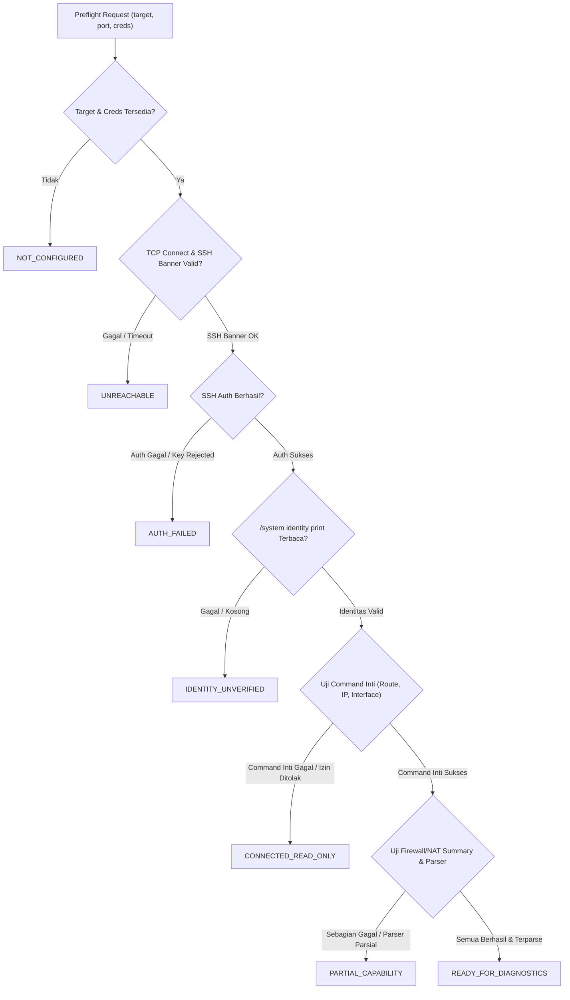

# AIRA OS — Phase 6 Lab Connection Preflight & Capability Audit

**Document:** `docs/AIRA_PHASE6_LAB_PREFLIGHT.md`  
**Subsystem:** Network Intelligence Preflight Diagnostic Engine (`LabPreflightChecker`)  
**Workspace:** `D:\data\agent_ai`  
**Implementation File:** `AIRA_ECOSYSTEM/core/network_intelligence/preflight.py`  
**API Endpoint:** `POST /api/intelligence/preflight`  

---

## 1. Executive Mission & Security Philosophy

Dalam integrasi operasional dan lab networking MikroTik, salah satu kesalahan paling umum pada automation tools adalah mengasumsikan bahwa jika port TCP 22 terbuka, maka perangkat otomatis siap untuk investigasi diagnostik.

Stage 1 Phase 6 memperkenalkan **`LabPreflightChecker`**, sebuah engine diagnostik non-invasif yang:
1. Menjalankan pemeriksaan bertingkat: **Reachability → SSH Handshake/Banner → Authentication → Identity/OS Version → Diagnostic Command Allowlist → Parser Completeness**.
2. Memisahkan secara ketat 7 status preflight operasional.
3. Menolak secara mutlak penyimpanan atau penulisan password/private key ke log atau respons.
4. Menjalankan hanya command read-only yang diizinkan oleh backend allowlist.

---

## 2. Definisi 7 Status Preflight Operasional

| Status Preflight | Kondisi Teknis | Tindakan AIRA | Dampak Investigasi |
| :--- | :--- | :--- | :--- |
| **`NOT_CONFIGURED`** | Target device string kosong, tidak ditemukan di inventory, dan tidak ada credential SSH eksplisit. | Menghentikan preflight sebelum membuka soket. | `BLOCKED`: Konfigurasi target belum lengkap. |
| **`UNREACHABLE`** | TCP handshake gagal, connection refused, port tertutup, atau soket timeout saat membaca banner SSH (`SSH-2.0-...`). | Mencatat kegagalan transport tanpa mencoba autentikasi. | `BLOCKED`: Target offline atau terhalang firewall transit. |
| **`AUTH_FAILED`** | Soket SSH terbuka dan banner terbaca, namun username, password, atau SSH private key ditolak oleh router. | Mencatat kegagalan kredensial tanpa membocorkan secret. | `BLOCKED`: Hak autentikasi ditolak. |
| **`IDENTITY_UNVERIFIED`** | Sesi SSH berhasil login, namun command `/system identity print` menghasilkan output kosong, error, atau timeout. | Menolak mengasumsikan identitas perangkat. | `BLOCKED`: Perangkat tidak dapat diidentifikasi secara unik. |
| **`CONNECTED_READ_ONLY`** | Sesi terhubung dan identitas valid, namun satu atau lebih command diagnostik inti (`/interface`, `/ip address`, `/ip route`) gagal (misal dibatasi izin router). | Membatasi cakupan dan menandai keterbatasan akses. | `PARTIAL`: Diagnosis terbatas pada domain yang izinnya tersedia. |
| **`PARTIAL_CAPABILITY`** | Command inti berhasil, tetapi command opsional (seperti inspection firewall filter count atau NAT count) ditolak izinnya, atau sebagian parser tabel tidak lengkap. | Mengizinkan investigasi dengan peringatan bahwa bukti tertentu tidak lengkap. | `PARTIAL_CAPABILITY`: Bukti yang hilang akan berstatus `UNAVAILABLE`. |
| **`READY_FOR_DIAGNOSTICS`** | Seluruh command diagnostik inti dan pelengkap lulus allowlist, berhasil dieksekusi dengan prompt valid, dan seluruh normalizer tabel memvalidasi output. | Mengizinkan investigasi insiden dan playbook otomatis dijalankan. | `FULL_READINESS`: Siap investigasi end-to-end. |

---

## 3. Alur Verifikasi Bertingkat (Multi-Stage Evaluation)



---

## 4. Baterai Pengujian Diagnostic Command & Hak Akses Minimum

Setiap command yang diuji pada preflight diverifikasi terlebih dahulu oleh `validate_readonly_command()`:

| Command RouterOS | Observation Type | Tingkat Kritis | Group / Policy Diperlukan |
| :--- | :--- | :--- | :--- |
| `/system identity print` | `identity` | **CRITICAL** | `read` |
| `/system resource print` | `resources` | **CRITICAL** | `read` |
| `/interface print brief` | `interfaces` | **CRITICAL** | `read` |
| `/ip address print detail` | `ip_addresses` | **CRITICAL** | `read` |
| `/ip route print` | `routes` | **CRITICAL** | `read` |
| `/ip firewall filter print count-only` | `firewall_filter` | OPTIONAL | `read` |
| `/ip firewall nat print count-only` | `nat_rules` | OPTIONAL | `read` |

> [!IMPORTANT]
> AIRA tidak pernah mengirim command mutatif (`/system reboot`, `/user add`, `/ip address set`, dll).
> Jika hak akses router membatasi pembacaan firewall (`/ip firewall`), status preflight diturunkan ke `PARTIAL_CAPABILITY` dan investigasi terkait packet drop otomatis mengeluarkan status `INSUFFICIENT_EVIDENCE`.

---

## 5. Parameter Kualitas Output & Observabilitas

Preflight mengumpulkan profil operasional berikut:
- **`avg_latency_ms`**: Rata-rata waktu round-trip eksekusi command diagnostik via transport SSH.
- **`prompt_mismatches`**: Deteksi jika prompt RouterOS (`[admin@MikroTik] >`) tidak cocok sempurna atau terputus sebelum batas timeout.
- **`truncated_count`**: Deteksi jika output terpotong oleh buffer atau terminal pager.
- **`parser_completeness`**: Daftar tabel yang berhasil dinormalisasi ke data terstruktur vs tabel yang gagal dibaca.
- **`correlation_id`**: Identifier pelacakan unik (`preflight_...`) yang menghubungkan hasil preflight dengan log audit tanpa mencatat rahasia.

---

## 6. Spesifikasi REST API

### Request: `POST /api/intelligence/preflight`
Headers: `Authorization: Bearer <token>`
```json
{
  "target": "192.168.88.1",
  "username": "aira-audit",
  "port": 22,
  "timeout": 4.0
}
```

### Response Example (`UNREACHABLE`):
```json
{
  "success": true,
  "preflight": {
    "target": "192.168.88.1",
    "status": "UNREACHABLE",
    "reachability": false,
    "authenticated": false,
    "identity": null,
    "routeros_version": null,
    "ros_major_version": null,
    "effective_permissions": [],
    "allowed_commands_tested": [],
    "rejected_commands": [],
    "output_quality": {},
    "parser_completeness": {},
    "correlation_id": "preflight_8a91fc0d12",
    "duration_ms": 3004.12,
    "message": "Koneksi jaringan gagal ke 192.168.88.1:22: Handshake soket atau pembacaan banner SSH mengalami timeout",
    "limitations": "Perangkat mati, port SSH tertutup, atau terhalang firewall jaringan."
  }
}
```
