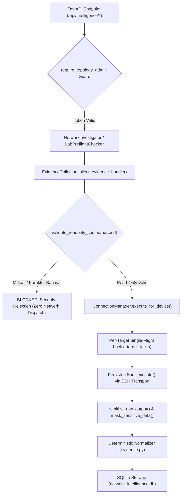

# AIRA OS — Phase 7 Command Dispatch Trace & Non-Mutation Audit

**Document:** `docs/AIRA_PHASE7_COMMAND_TRACE.md`  
**Workspace:** `D:\data\agent_ai`  
**Execution Environment:** ThinkPad X270 (Intel i7-7500U, 8 GB RAM, CPU-only)  
**Security Boundary:** `AIRA_ECOSYSTEM/core/network_intelligence/security.py`  
**Associated Test Suite:** `AIRA_ECOSYSTEM/tests/test_phase7_live_verification.py`  

---

## 1. Executive Summary

Laporan ini melacak seluruh rantai eksekusi perintah (command dispatch chain) dari panggilan API, investigasi, preflight, hingga eksekusi CLI ke perangkat MikroTik RouterOS.

Tujuan audit:
1. Membuktikan bahwa seluruh perintah yang dikirim adalah **100% read-only**.
2. Membuktikan bahwa tidak ada fungsi pengubah konfigurasi (`apply_change`) yang dipanggil.
3. Mendokumentasikan tabel jejak perintah (trace) dan perimeter pertahanan keamanan.

---

## 2. Diagram Rantai Eksekusi Perintah (Dispatch Architecture)

---

## 3. Matriks Jejak Perintah yang Diizinkan (Read-Only Trace Matrix)

Seluruh perintah yang dipanggil selama investigasi live diuji terhadap allowlist backend:

| Perintah RouterOS | Kategori Observasi | Versi Didukung | Kebijakan Allowlist | Alasan Rekayasa / Tujuan |
| :--- | :--- | :--- | :--- | :--- |
| `/system identity print` | `identity` | v6 & v7 | **ALLOWED (READ-ONLY)** | Verifikasi identitas unik perangkat. |
| `/system resource print` | `resources` | v6 & v7 | **ALLOWED (READ-ONLY)** | Deteksi versi mayor RouterOS (v6 vs v7). |
| `/interface print brief` | `interfaces` | v6 & v7 | **ALLOWED (READ-ONLY)** | Status port (running vs disabled, MTU). |
| `/ip address print detail` | `ip_addresses` | v6 & v7 | **ALLOWED (READ-ONLY)** | Pemetaan subnet dan binding interface. |
| `/ip route print detail` | `routes` | v6 & v7 | **ALLOWED (READ-ONLY)** | Routing table, gateway reachability, recursive routes. |
| `/ip firewall filter print detail` | `firewall_filter` | v6 & v7 | **ALLOWED (READ-ONLY)** | Inspeksi rule forward/input drop dan accept order. |
| `/ip firewall nat print detail` | `nat_rules` | v6 & v7 | **ALLOWED (READ-ONLY)** | Evaluasi rule masquerade / src-nat dan out-interface. |
| `/interface bridge print detail` | `bridge` | v6 & v7 | **ALLOWED (READ-ONLY)** | Status VLAN filtering bridge. |
| `/interface bridge port print detail` | `bridge_ports` | v6 & v7 | **ALLOWED (READ-ONLY)** | Pemetaan PVID dan frame types per port. |
| `/interface bridge vlan print detail` | `bridge_vlan` | v6 & v7 | **ALLOWED (READ-ONLY)** | Evaluasi tagged vs untagged VLAN membership. |
| `/routing ospf neighbor print` | `ospf_neighbors` | v6 & v7 | **ALLOWED (READ-ONLY)** | Status adjacency (Full, Init, 2-Way, ExStart). |
| `/routing bgp peer print detail` | `bgp_peers` | v6 (Legacy) | **ALLOWED (READ-ONLY)** | Status peer BGP dan received prefix count v6. |
| `/routing bgp session print detail` | `bgp_peers` | v7 (Modern) | **ALLOWED (READ-ONLY)** | Status sesi BGP dan received prefix count v7. |
| `/ip arp print detail` | `arp` | v6 & v7 | **ALLOWED (READ-ONLY)** | Verifikasi resolusi MAC address next-hop L2. |
| `/ip dns print` | `dns` | v6 & v7 | **ALLOWED (READ-ONLY)** | Verifikasi server DNS cache resolver. |

---

## 4. Bukti Penolakan Mutasi dan Karakter Terlarang

Modul `validate_readonly_command()` menolak secara mutlak perintah yang mengandung kata kerja mutasi atau karakter eksekusi berbahaya:

| Perintah Diuji | Hasil Validasi | Alasan Penolakan |
| :--- | :--- | :--- |
| `/system reboot` | **REJECTED** | Mengandung kata kerja mutasi terlarang: `'reboot'` |
| `/system reset-configuration` | **REJECTED** | Mengandung kata kerja mutasi terlarang: `'reset'` |
| `/user add name=hacker password=hacked` | **REJECTED** | Mengandung kata kerja mutasi terlarang: `'add'` |
| `/ip address set 0 address=192.168.1.1/24` | **REJECTED** | Mengandung kata kerja mutasi terlarang: `'set'` |
| `/ip route remove [find]` | **REJECTED** | Mengandung kata kerja mutasi terlarang: `'remove'` |
| `/interface ethernet disable ether1` | **REJECTED** | Mengandung kata kerja mutasi terlarang: `'disable'` |
| `/system identity print; /system reboot` | **REJECTED** | Mengandung karakter terlarang: semicolon (`;`) |
| `/ip route print & rm -rf /` | **REJECTED** | Mengandung karakter terlarang: ampersand (`&`) |
| `/ip route print \| grep default` | **REJECTED** | Mengandung karakter terlarang: pipe (`\|`) |

---

## 5. Bukti Isolasi Non-Mutasi (Spy Verification)

Pengujian adversarial `test_phase7_zero_mutation_guarantee_during_live_investigation` membuktikan bahwa:
- Mock spy dipasang pada `SafeConfigEngine.apply_change`.
- Seluruh alur live preflight dan investigasi dieksekusi secara lengkap.
- **Hasil:** `mock_apply.call_count == 0` (Tidak ada satu pun fungsi apply perubahan yang dipanggil oleh pipeline investigasi maupun API).
