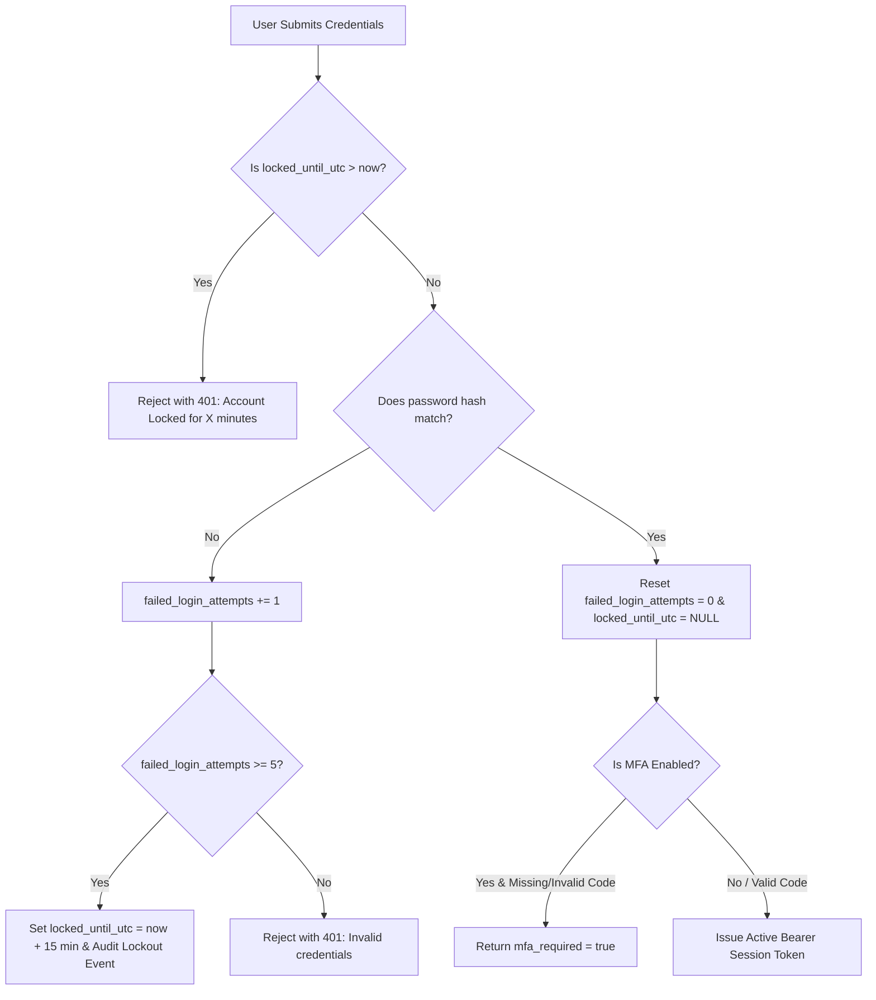

# AIRA OS — Authentication, Identity & Persistent Session Architecture
**Document Reference:** `docs/AUTHENTICATION_AND_SESSION.md`  
**Phase:** Phase E — Dual-Site Platform, Identity, Superadmin, Subscriptions & NOC  
**Status:** Implemented & Verified

---

## 1. Overview

AIRA OS provides enterprise-grade identity, authentication, session persistence, and multi-factor authentication (MFA) across both Client and Admin sites.

Key security foundations:
- **Zero Plaintext Passwords:** Cryptographic password hashing using PBKDF2-HMAC-SHA256 with 100,000 iterations and a 16-byte cryptographically random salt per user.
- **Brute-Force & Rate-Limiting Protection:** 5 consecutive failed login attempts trigger an automatic 15-minute account lockout.
- **Persistent Sessions:** Bearer session tokens with SHA-256 token hashing in the database, 24-hour expiration, and explicit revocation support.
- **Multi-Factor Authentication (MFA):** RFC 6238 Time-Based One-Time Password (TOTP) algorithm compatible with Google Authenticator, Authy, and hardware authenticators.
- **First-Time Mandatory Password Change:** Forced credential rotation for initial bootstrap accounts (e.g. `lingga_admin`).
- **Superadmin Impersonation:** Regulated and tamper-evident user impersonation requiring a mandatory audited justification.

---

## 2. Password Hashing Architecture

Passwords are never stored in plaintext. In `AIRA_ECOSYSTEM/core/tenant/manager.py`:
```python
def _hash_password(password: str, salt: str) -> str:
    """PBKDF2-HMAC-SHA256 password derivation with 100,000 iterations and random salt."""
    return hashlib.pbkdf2_hmac(
        "sha256",
        password.encode("utf-8"),
        salt.encode("utf-8"),
        100_000,
    ).hex()
```

Every user in `operational_users` possesses an independent, random 16-byte hex salt:
```sql
ALTER TABLE operational_users ADD COLUMN password_hash TEXT;
ALTER TABLE operational_users ADD COLUMN salt TEXT;
```

---

## 3. Account Lockout & Rate-Limiting Engine

To protect against brute-force attacks and credential stuffing, `IdentityManager.authenticate_user_detailed` tracks failed login attempts and sets lockout timestamps:



---

## 4. Multi-Factor Authentication (MFA / RFC 6238 TOTP)

The MFA engine (`core/security/mfa.py`) implements the standardized RFC 6238 Time-Based One-Time Password algorithm with zero third-party dependencies:
- **Secret Generation:** 20-byte cryptographically secure pseudo-random bytes encoded in Base32.
- **Time Step:** Standard 30 seconds.
- **Code Length:** Standard 6 digits.
- **Time Drift Window:** Window of $\pm 1$ time-step (allowing $\pm 30$ seconds clock discrepancy) to prevent legitimate user lockouts.
- **QR Code URI:** Formats standard `otpauth://totp/AIRA OS:{username}?secret={secret}&issuer=AIRA OS` strings for scanning.

### API Endpoints
- `GET /api/v1/auth/mfa/setup`: Generates a fresh secret and QR URI.
- `POST /api/v1/auth/mfa/verify`: Verifies a user-supplied 6-digit code and activates MFA on the account.
- `POST /api/v1/auth/mfa/disable`: Deactivates MFA (requires authenticated session).

---

## 5. Persistent Session Management

When a user successfully authenticates:
1. A cryptographically random raw bearer token is generated: `aira_tok_<32_random_bytes>`.
2. The raw token is hashed via SHA-256 before being stored in `operational_user_sessions`:
   ```sql
   INSERT INTO operational_user_sessions (session_id, user_id, tenant_id, is_internal, token_hash, status, created_at, expires_at_utc)
   VALUES (?, ?, ?, ?, ?, 'ACTIVE', ?, ?);
   ```
3. Raw tokens are never logged or stored in the database.
4. On every API request, `get_current_user_context` computes the SHA-256 digest of the Bearer token, verifies that the session is `ACTIVE`, and verifies that `expires_at_utc` is in the future.
5. On logout (`POST /api/v1/auth/logout`), the session is transitioned to `REVOKED`.

---

## 6. Superadmin Impersonation

Superadmin operators can impersonate any customer user account for real-time troubleshooting, bug reproduction, or support assistance:
- **Privilege Requirement:** Caller must hold `PLATFORM_SUPER_ADMIN` or `SUPERADMIN` role.
- **Mandatory Justification:** The caller MUST supply a non-empty `reason` string (e.g. ticket number or incident ID).
- **Audit Logging:** An immutable record is immediately written to `operational_audit_log` detailing:
  - Superadmin User ID
  - Target User ID & Target Username
  - Justification reason
  - Source IP address & timestamp
- **Bounded Lifetime:** Impersonation sessions have an automatic 2-hour maximum lifetime.
