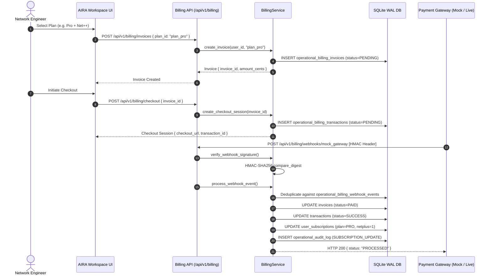

# AIRA OS — Billing Foundation & Payment Gateway Architecture
**Document Reference:** `docs/BILLING_FOUNDATION.md`  
**Phase:** Phase E — Dual-Site Platform, Identity, Superadmin, Subscriptions & NOC  
**Status:** Implemented & Verified

---

## 1. Overview & Strategy

AIRA OS implements a production-ready, modular billing foundation capable of interfacing with modern payment gateways (e.g. Midtrans, Stripe, Xendit) while operating safely in development and test environments using an idempotent **Mock Gateway**.

In strict accordance with Directive Section 6:
> **"Jangan mengklaim pembayaran asli sudah berjalan sebelum payment gateway benar-benar diintegrasikan dan diuji. Pada fase ini, bangun fondasi billing dan integrasinya."**

All financial entities (Products, Plans, Invoices, Transactions, Webhook Events) are tracked authoritatively in SQLite with strict ACID transactional guarantees.

---

## 2. Product Catalog & Pricing Plans

The billing schema defines two primary products:
1. `prod_aira_workspace`: Core AI-native Network Engineering Assistant.
2. `prod_netplus_addon`: Specialized Networking++ operational add-on.

### Active Billing Plans
- `plan_free`: AIRA Free Tier (Rp 0 / month, 100k tokens).
- `plan_pro`: AIRA Pro Tier (Rp 250.000 / month, 2M tokens).
- `plan_enterprise`: AIRA Enterprise (Rp 1.500.000 / month, 10M tokens, Networking++ included).
- `plan_netplus_addon`: Independent Networking++ Add-on (Rp 100.000 / month).

---

## 3. Invoices & Payment Transactions Ledger



---

## 4. Webhook Security: HMAC-SHA256 Signature Verification

Inbound webhook requests are cryptographically verified using HMAC-SHA256 signatures passed in `X-Signature` or `X-Webhook-Signature` HTTP headers:
- The shared secret is configured via `AIRA_BILLING_WEBHOOK_SECRET`.
- The raw binary request payload is hashed against the secret using `hashlib.sha256`.
- `hmac.compare_digest` is used to prevent timing attacks.
- Tampered payloads or invalid signatures return `HTTP 401 Unauthorized` and are rejected before any database state is modified.

---

## 5. Idempotent Fulfillment & Double-Charging Protection

Network retries and multiple gateway webhooks can cause duplicate event delivery. To prevent double activation or duplicate quota crediting:
1. Every incoming webhook event is recorded in `operational_billing_webhook_events`:
   ```sql
   CREATE TABLE IF NOT EXISTS operational_billing_webhook_events (
       event_id TEXT PRIMARY KEY,
       provider_name TEXT NOT NULL,
       event_type TEXT NOT NULL,
       payload_json TEXT NOT NULL,
       signature TEXT,
       processed INTEGER NOT NULL DEFAULT 0,
       error_message TEXT,
       created_at TEXT NOT NULL,
       processed_at TEXT
   );
   ```
2. Before performing fulfillment, the engine checks whether `event_id` exists with `processed = 1`.
3. If already processed, the engine immediately logs the duplicate and returns:
   ```json
   {
     "event_id": "evt_...",
     "status": "ALREADY_PROCESSED",
     "duplicate": true
   }
   ```
4. Only unfulfilled events trigger subscription upgrades and token quota assignments.

---

## 6. Mock Payment Simulation API

For local development, staging environments, and UI demonstrations without live merchant accounts:
- `POST /api/v1/billing/simulate-mock`
- **Request:**
  ```json
  {
    "invoice_id": "inv_9b821af28831",
    "plan_tier": "PRO",
    "has_networking_plus": true
  }
  ```
- **Response:**
  ```json
  {
    "success": true,
    "result": {
      "status": "PROCESSED",
      "invoice_id": "inv_9b821af28831",
      "subscription": {
        "plan_id": "PRO",
        "has_networking_plus": true,
        "token_quota": 2000000,
        "subscription_status": "ACTIVE"
      }
    }
  }
  ```
