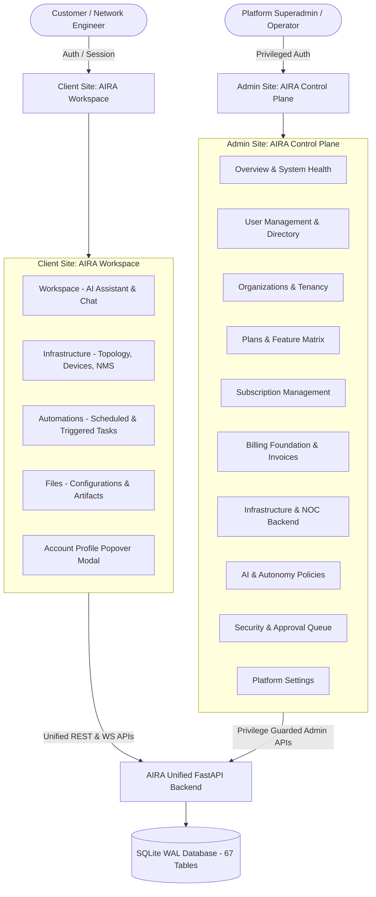

# AIRA OS — Dual-Site Platform Architecture
**Document Reference:** `docs/DUAL_SITE_ARCHITECTURE.md`  
**Phase:** Phase E — Dual-Site Platform, Identity, Superadmin, Subscriptions & NOC  
**Status:** Implemented & Verified

---

## 1. Executive Summary

AIRA OS implements a strict separation of concerns between two distinct digital workspaces:
1. **Client Site — AIRA Workspace** (`app.aira.example.com` / Client Mode)
2. **Admin Site — AIRA Control Plane** (`admin.aira.example.com` / Admin Mode)

Both sites share a unified identity, security, and RBAC database backend (`database/topology.db`) while strictly isolating customer workspaces from platform operational controls.



---

## 2. Client Site — AIRA Workspace

### 2.1 Mission & Product Identity
AIRA Workspace is an AI-native workspace for network engineers and IT infrastructure teams. Rather than presenting a cockpit of dozens of complicated controls, it provides an outcome-oriented interface centered on conversational intelligence, visual infrastructure topology, automated workflows, and artifact inspection.

### 2.2 Primary Navigation Destinations
The primary navigation sidebar has been streamlined into exactly four core destinations:

1. **Workspace (`/workspace` / `/chat`)**:
   - Conversational AI engineering assistant.
   - Intent recognition, command reasoning, diagnostics, and synthesized change sets.
   - Interactive chat session management with search, pin, rename, and delete capabilities.
2. **Infrastructure (`/infrastructure`)**:
   - Comprehensive network management suite.
   - Visual network topology maps, device fleet inventory, live NMS telemetry streaming, and edge gateway status.
3. **Automations (`/automations`)**:
   - Proactive network automations, cron and interval triggers, and Ansible-compatible playbook runs.
4. **Files (`/files`)**:
   - Configuration files, network backups, generated audit reports, and technical artifacts.

### 2.3 Account Profile Popover Area (Bottom-Left Sidebar)
In accordance with Directive Section 2.A (*"Jangan membuat halaman Settings sebagai menu utama tersendiri jika semua pengaturannya dapat dikelompokkan di area profil"*), the dedicated Settings menu item has been removed from the primary navigation.

All personal, security, plan, and preference settings are consolidated within the **Account Profile Modal** accessible by clicking the user badge at the bottom-left of the sidebar:
- **Profile:** Username, email, tenant organization name, role privileges.
- **Account Security:** Password change form, Two-Factor Authentication (MFA / RFC 6238 TOTP) setup and verification.
- **Subscription & Plan:** Active plan tier (`FREE`, `PRO`, `ENTERPRISE`), subscription validity, Networking++ add-on badge, and one-click upgrade options.
- **Token Usage:** Monthly allocation bar, consumed tokens, remaining balance, and tool credit pricing matrix.
- **Preferences:** Interface dark obsidian theme, real-time soundscapes, and proactive telemetry toggles.
- **Sign Out:** Secure session termination and token revocation.

---

## 3. Admin Site — AIRA Control Plane

### 3.1 Mission & Architectural Governance
The AIRA Control Plane is a dedicated operational cockpit for platform administrators, infrastructure operators, and Superadmins. It provides oversight of all tenant organizations, subscription lifecycles, billing transactions, security approvals, and backend infrastructure services.

### 3.2 The 10 Core Control Plane Modules
The Control Plane provides an authoritative horizontal subnav exposing 10 dedicated management modules:

| # | Module | Core Capabilities | Underlying API / Endpoint |
|---|---|---|---|
| **1** | **Overview** | Platform health (100% operational), registered users, active subscriptions, Networking++ adoption, backend worker status. | `/api/v1/admin/users`, `/api/v1/admin/subscriptions` |
| **2** | **User Management** | Complete user directory, email, organization, plan tier, account suspension, and Superadmin audited impersonation trigger. | `GET /api/v1/admin/users`, `POST /api/v1/admin/impersonate` |
| **3** | **Organizations** | Multi-tenant customer organizations, slugs, tenant status (`ACTIVE`, `MAINTENANCE`, `SUSPENDED`), resource quotas. | `GET /api/v1/admin/tenants` |
| **4** | **Plans & Entitlements** | Feature access matrix across Free, Pro, Enterprise, and Networking++ add-on; default monthly token allocations. | `/api/v1/billing/plans` |
| **5** | **Subscription Management** | Active, pending, and expired subscriptions; manual tier assignment modal; background expiration sweep runner. | `GET /api/v1/admin/subscriptions`, `POST /api/v1/admin/subscriptions/assign`, `POST /api/v1/admin/subscriptions/check-expirations` |
| **6** | **Billing Management** | Invoices ledger, payment transactions ledger, payment provider configuration, mock payment simulation. | `GET /api/v1/admin/billing/invoices`, `GET /api/v1/admin/billing/transactions` |
| **7** | **Infrastructure & NOC** | SQLite WAL transactional engine health, background automation loops, Edge Gateway connection coordination. | `/api/v1/admin/health`, `core/scheduler.py` |
| **8** | **AI & Platform Config** | Token policy configuration per tier (allocation, tool costs, request size, RPM rate limits). | `GET / PUT /api/v1/admin/token-policy` |
| **9** | **Security & AAA** | Centralized Operational Approval Queue (Category B operations: approve/reject), security audit trails. | `GET /api/v1/admin/approvals`, `POST /api/v1/admin/approvals/{id}/resolve` |
| **10** | **Platform Settings** | SMTP email credentials, Google OAuth 2.0 status, notification channels. | `/api/v1/settings` |

---

## 4. RBAC Privilege Boundary & Barrier Enforcement

Customer accounts attempting to access Admin Site routes or administrative APIs are blocked at multiple enforcement layers:
1. **Frontend View Filter:** Navigation groups hide the Control Plane link unless the user's role contains `PLATFORM_SUPER_ADMIN`, `NOC_ADMIN`, or `SUPERADMIN`.
2. **Backend Authentication Barrier (`api/routers/auth.py`):**
   ```python
   if payload.admin_only:
       if not is_internal and not any(r in internal_roles for r in user_roles):
           raise HTTPException(status_code=403, detail="Akses ditolak. AIRA Control Plane memerlukan kredensial staf internal administrator.")
   ```
3. **FastAPI Route Dependency (`require_platform_admin`):**
   Every administrative endpoint under `/api/v1/admin/*` enforces session token validation and verifies that the caller holds an authorized platform role.
