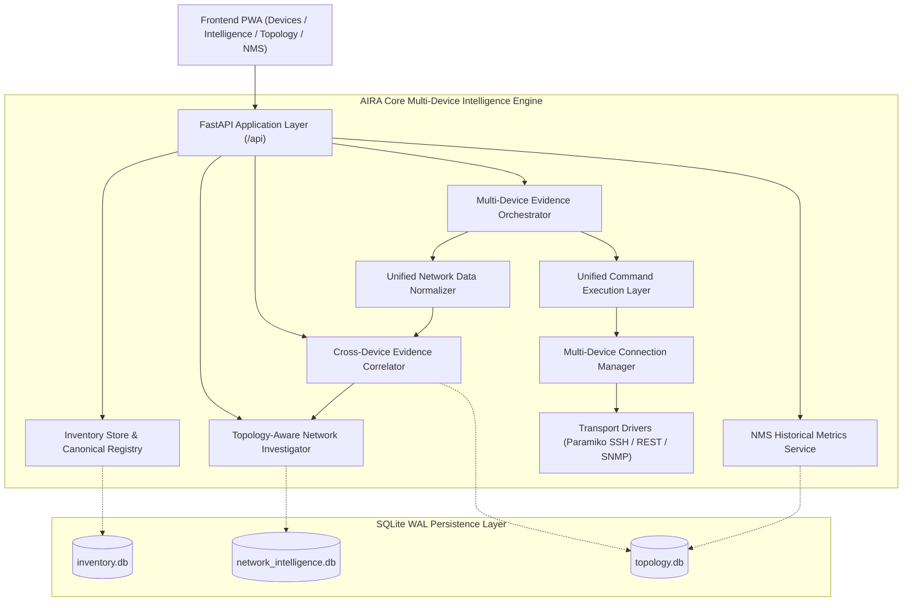

# AIRA OS — Phase Networking III: Multi-Device Network Intelligence Architecture Specification & Implementation Plan

**Document:** `docs/NETWORKING_III/MULTI_DEVICE_ARCHITECTURE.md`  
**Status:** `APPROVED_PROPOSAL`  
**Milestone:** Phase Networking III Architecture Design (Step 2 / N3.0)  
**Target Platform:** AIRA OS — Modular Network Intelligence Platform  
**Author:** Automated Acceptance Engineer & Principal Architect (AIRA OS)

---

## 1. System Philosophy & Objectives

In Phase Networking II, AIRA OS proved that it can safely connect to, inspect, parse, and diagnose a single live RouterOS appliance with strict read-only guarantees. 

Phase Networking III transforms AIRA into a **Multi-Device Network Intelligence Platform**. The fundamental engineering philosophy is:
1. **Separation of Concerns:** Keep device inventory, connection transport, command execution, evidence collection, data modeling, cross-device correlation, diagnostic RCA, and monitoring in clean, decoupled modules.
2. **Deterministic Precedence:** Every hypothesis and relationship must be grounded in observable facts with explicit provenance and confidence grades. Weak or ambiguous evidence must never be promoted to confirmed truth.
3. **Strict Non-Mutation:** Live operations remain 100% read-only.
4. **Hardware & Resource Efficiency:** Bounded concurrency (configurable pool), low-overhead SQLite WAL persistence, and zero memory leaks, optimized for the Intel Core i7-7500U / 8GB RAM host.

---

## 2. Multi-Tiered Architecture Overview

---

## 3. Work Package Specifications

### 3.1 Work Package N3.1: Multi-Device Device Inventory
- **Target File:** `AIRA_ECOSYSTEM/core/inventory_store.py` and `AIRA_ECOSYSTEM/core/canonical_network.py`
- **Scope:**
  - Enhance `CanonicalDevice` to support stable non-IP device UUIDs (`dev_<uuid>`), manufacturer, hardware model, platform, firmware, and user/telemetry separation.
  - Implement batch device lookup (`get_devices_batch(device_ids)`).
  - Ensure discovered metadata (observed identity, MAC, interfaces, version) updates operational fields without clobbering user-defined metadata (custom names, site, tags, notes).
  - Provide validation against duplicate IP/hostname registration.

### 3.2 Work Package N3.2: Multi-Device Connection Manager
- **Target File:** `AIRA_ECOSYSTEM/agents/akane/connection_manager.py`
- **Scope:**
  - Formalize connection state enumeration: `DISCONNECTED`, `CONNECTING`, `CONNECTED`, `AUTHENTICATION_FAILED`, `CONNECTION_TIMEOUT`, `CONNECTION_ERROR`, `SESSION_EXPIRED`, `CLOSING`.
  - Maintain per-device connection lifecycle and concurrency governance:
    - Dedicated host lock per `(host, port, username)`.
    - Maximum concurrent active connections cap (default: 5, configurable).
    - Bounded worker pool for multi-device operations.
  - Ensure failure classification cleanly separates transport/socket timeouts from authentication denials.

### 3.3 Work Package N3.3: Unified Command Execution Layer
- **Target File:** `AIRA_ECOSYSTEM/core/network_intelligence/command_execution.py` (New Module)
- **Scope:**
  - Define `CommandRequest` (device_id, command_str, observation_domain, timeout, request_id).
  - Define `CommandResult` (device_id, command_str, status, duration_ms, raw_output, error_type, truncated, execution_timestamp).
  - Enforce mandatory allowlist validation via `validate_readonly_command()`.
  - Retain complete provenance for every dispatched command.

### 3.4 Work Package N3.4: Multi-Device Evidence Collection
- **Target File:** `AIRA_ECOSYSTEM/core/network_intelligence/multi_device_collector.py` (New Module)
- **Scope:**
  - Orchestrate concurrent, bounded evidence collection across multiple devices using `ThreadPoolExecutor(max_workers=3)`.
  - Support partial collection preservation: failures on device A or observation B do not discard successful observations from device C.
  - Provide `MultiDeviceCollectionSummary` with total, passed, failed, and unsupported metrics.

### 3.5 Work Package N3.5: Unified Network Data Model
- **Target File:** `AIRA_ECOSYSTEM/core/network_intelligence/network_models.py` (New Module)
- **Scope:**
  - Define canonical dataclasses:
    - `NormalizedInterface`: name, type, mac_address, oper_status, admin_status, mtu, speed_bps.
    - `NormalizedIPAddress`: address, prefix_len, interface_name, family, network_cidr.
    - `NormalizedRoute`: dst_prefix, gateway, interface_name, distance, active, dynamic, connect, static, protocol.
    - `NormalizedNeighbor`: local_interface, remote_device_id, remote_device_name, remote_interface, remote_ip, protocol.
    - `NormalizedVLAN`: vlan_id, name, bridge_name, tagged_interfaces, untagged_interfaces.
    - `NormalizedLink`: source_device_id, source_port, target_device_id, target_port, link_type, confidence, evidence_sources.

### 3.6 Work Package N3.6: Cross-Device Evidence Correlation
- **Target File:** `AIRA_ECOSYSTEM/core/network_intelligence/correlation.py` (New Module)
- **Scope:**
  - Correlate observations between pairs of devices:
    - **Rule 1 (Direct Neighbor Protocol):** MNDP / LLDP / CDP observed on both ends $\rightarrow$ `CONFIRMED` / `HIGH`.
    - **Rule 2 (Subnet & Dynamic ARP Adjacency):** Subnet overlap + mutual ARP table entry on respective interfaces $\rightarrow$ `HIGH` (Layer 2 Adjacency).
    - **Rule 3 (Subnet Match Only):** Interfaces share common IP subnet without mutual ARP or neighbor confirmation $\rightarrow$ `MEDIUM` (Candidate Link).
    - **Rule 4 (Routed Next-Hop):** Device A default route gateway matches Device B interface IP $\rightarrow$ `HIGH` (Routed Next-Hop).
  - Confidence Scale: `CONFIRMED` (1.0), `HIGH` (0.8), `MEDIUM` (0.5), `LOW` (0.2), `UNKNOWN` (0.0).
  - Preserve all supporting evidence and alternative hypotheses.

### 3.7 Work Package N3.7: Topology-Aware Diagnostic Foundation
- **Target File:** `AIRA_ECOSYSTEM/core/network_intelligence/investigator.py` (Extension)
- **Scope:**
  - Extend `NetworkInvestigator` to accept `related_device_identities`.
  - Implement multi-device symptom classification:
    - Device-level (e.g. CPU exhaustion, authentication drop).
    - Link-level (e.g. interface down between Device A and Device B).
    - Routing-level (e.g. upstream gateway route dropped on Device B affecting Device A).
    - L2/VLAN-level (e.g. VLAN tag mismatch on trunk).
  - Generate multi-device root cause hypotheses with candidate dependencies.

### 3.8 Work Package N3.8: NMS and Historical Data Foundation
- **Target File:** `AIRA_ECOSYSTEM/core/network_intelligence/metrics_service.py` (New Module)
- **Scope:**
  - Metric collection abstraction wrapping `database/topology.db`.
  - Ingestion API for device metrics (`cpu_load_percent`, `memory_used_percent`, `uptime_seconds`, `latency_ms`) and interface metrics (`rx_rate_bps`, `tx_rate_bps`, `in_errors`, `out_errors`).
  - Historical query service with configurable retention (default: 7 days) and point-in-time sampling.

### 3.9 Work Package N3.9: API and Frontend Integration
- **Target Files:**
  - `AIRA_ECOSYSTEM/api/routers/network_intelligence.py`
  - `AIRA_ECOSYSTEM/app/frontend/src/pages/NetworkIntelligencePage.jsx`
  - `AIRA_ECOSYSTEM/app/frontend/src/api.js`
- **Scope:**
  - REST endpoints:
    - `POST /api/intelligence/devices/batch-collect`
    - `POST /api/intelligence/correlation`
    - `POST /api/intelligence/multi-device-investigation`
    - `GET /api/intelligence/metrics/history`
  - Frontend UI:
    - Multi-device selection bar in Network Intelligence Page.
    - Cross-device correlation findings card.
    - Multi-device topology-aware incident visualization.

### 3.10 Work Package N3.10: Testing, Security & Acceptance
- **Target Files:** `tests/test_networking_iii_*.py`
- **Scope:**
  - Unit tests for all new models, execution envelopes, normalizers, and correlator rules.
  - Integration tests with mock multi-device topologies.
  - Security tests verifying zero command injection or mutation.
  - Full system regression verifying 958+ backend tests and 247 frontend tests pass.

---

## 4. Phased Implementation Plan

```mermaid
flowchart LR
    N3_1["N3.1: Inventory Extension"] --> N3_2["N3.2: Connection Manager"]
    N3_2 --> N3_3["N3.3: Command Execution Layer"]
    N3_3 --> N3_4["N3.4: Multi-Device Evidence Collection"]
    N3_4 --> N3_5["N3.5: Unified Network Data Model"]
    N3_5 --> N3_6["N3.6: Cross-Device Correlator"]
    N3_6 --> N3_7["N3.7: Topology-Aware RCA"]
    N3_7 --> N3_8["N3.8: NMS Historical Foundation"]
    N3_8 --> N3_9["N3.9: API & Frontend Integration"]
    N3_9 --> N3_10["N3.10: Full Validation & Acceptance"]
```

Every work package will be validated incrementally against existing test baselines before advancing to the next.
