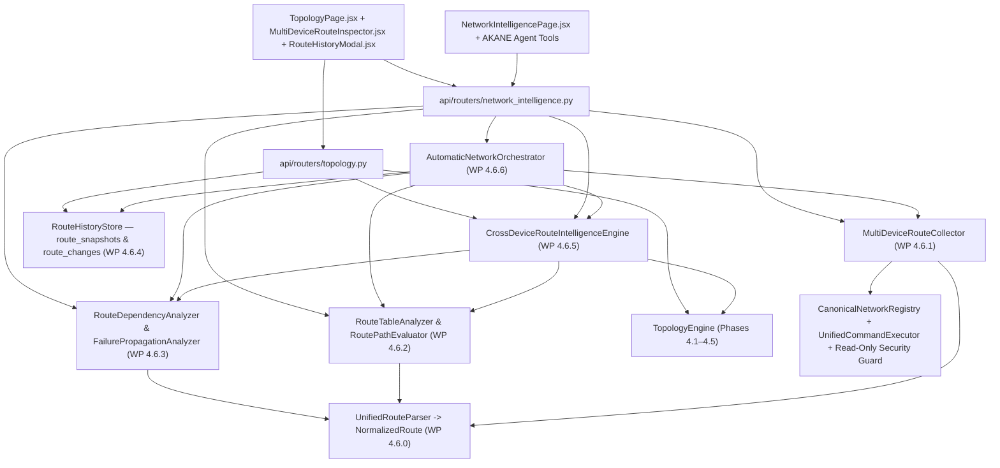

# AIRA OS — Networking IV Final Architecture

## 1. Architectural Purpose

Networking IV transforms AIRA OS from single-router CLI inspection and static topology drawing into an **evidence-based, multi-device network topology and route intelligence platform**. It unifies:

1. **Multi-Layer Topology Engine (Phases 4.1–4.5):**
   - Strictly separates `PHYSICAL_ADJACENCY`, `LAYER2_ADJACENCY`, `LAYER3_REACHABILITY`, and `LOGICAL_RELATIONSHIP` in [topology_models.py](file:///D:/data/agent_ai/AIRA_ECOSYSTEM/core/topology_models.py) and [topology_engine.py](file:///D:/data/agent_ai/AIRA_ECOSYSTEM/core/topology_engine.py).
   - Preserves immutable SHA-256-verified historical topology snapshots (`topology_snapshots`) and audit events (`topology_changes`) in `topology.db`.
2. **Multi-Device Route Analytics & Path Intelligence (Phase 4.6 / WPs 4.6.0–4.6.6):**
   - Normalizes RouterOS v6 and v7 RIB outputs via [`UnifiedRouteParser`](file:///D:/data/agent_ai/AIRA_ECOSYSTEM/core/routing/unified_route_parser.py) into canonical [`NormalizedRoute`](file:///D:/data/agent_ai/AIRA_ECOSYSTEM/core/routing/unified_route_parser.py) records.
   - Collects fleet-wide routing tables concurrently and safely via [`MultiDeviceRouteCollector`](file:///D:/data/agent_ai/AIRA_ECOSYSTEM/core/routing/route_collector.py).
   - Evaluates five-tier forwarding epistemology, LPM selection, VRF isolation, ECMP branches, and multi-hop path reconstruction via [`RouteTableAnalyzer`](file:///D:/data/agent_ai/AIRA_ECOSYSTEM/core/routing/route_analytics.py) and [`RoutePathEvaluator`](file:///D:/data/agent_ai/AIRA_ECOSYSTEM/core/routing/route_analytics.py).
   - Resolves iterative next-hop dependencies and hypothetical failure blast radius via [`RouteDependencyAnalyzer`](file:///D:/data/agent_ai/AIRA_ECOSYSTEM/core/routing/route_dependency.py) and [`FailurePropagationAnalyzer`](file:///D:/data/agent_ai/AIRA_ECOSYSTEM/core/routing/route_dependency.py).
   - Persists immutable historical route snapshots (`route_snapshots`) and semantic route diffs (`route_changes`) via [`RouteHistoryStore`](file:///D:/data/agent_ai/AIRA_ECOSYSTEM/core/routing/route_history.py).
   - Correlates cross-device routing relationships with topology & NMS state via [`CrossDeviceRouteIntelligenceEngine`](file:///D:/data/agent_ai/AIRA_ECOSYSTEM/core/routing/cross_device_routing.py) and renders ephemeral route overlays in [TopologyPage.jsx](file:///D:/data/agent_ai/AIRA_ECOSYSTEM/app/frontend/src/pages/TopologyPage.jsx).
   - Integrates single-pass multi-device diagnosis, DIO requirement validation, ranked epistemic root causes, and read-only verification into [`AutomaticNetworkOrchestrator`](file:///D:/data/agent_ai/AIRA_ECOSYSTEM/core/network_intelligence/auto_orchestrator.py) and [NetworkIntelligencePage.jsx](file:///D:/data/agent_ai/AIRA_ECOSYSTEM/app/frontend/src/pages/NetworkIntelligencePage.jsx).

---

## 2. Layered Component Topology

---

## 3. Core Semantic & Epistemic Invariants

1. **Five-Tier Forwarding Epistemology:**
   - **Tier 1 (RIB Candidate):** Parsed route entry present in `/ip route print` or `/routing route print`.
   - **Tier 2 (Eligible Unicast Route):** Active (`active=True`), not disabled, not unreachable, matching `routing_table`, valid unicast route type.
   - **Tier 3 (Calculated LPM Selection):** Longest prefix match + lowest administrative `distance` + metric tie-break. Explicitly labeled as control-plane calculation, **not** proof of hardware/kernel FIB installation.
   - **Tier 4 (Verified Topology-Aligned Hop):** Next-hop ownership confirmed on a registered `CanonicalDevice` and aligned with an operational `TopologyEngine` adjacency.
   - **Tier 5 (Observed Data-Plane Path):** Reserved for explicit traceroute/telemetry observations; never conflated with control-plane RIB path inference.
2. **Strict Separation of Domains:**
   - Ephemeral `ROUTE_DEPENDENCY` nodes/edges and `TOPOLOGY_ROUTE_OVERLAY` segments (`is_physical_link=False`, `mutates_physical_topology=False`) are **never** persisted as permanent `PHYSICAL_ADJACENCY` or `LAYER2_ADJACENCY` edges in `topology_edges`.
   - Historical route persistence (`route_snapshots`, `route_changes`) is isolated from `topology_snapshots` and `topology_changes`, preserving 100% of historical topology SHA-256 integrity.
3. **100% Read-Only Operational Boundary:**
   - Every command executed or recommended is validated against `validate_readonly_command` in [security.py](file:///D:/data/agent_ai/AIRA_ECOSYSTEM/core/network_intelligence/security.py) and `CommandGuard` in [command_guard.py](file:///D:/data/agent_ai/AIRA_ECOSYSTEM/security/command_guard.py).
   - Configuration plans generated during auto-diagnosis are strictly non-mutating proposals (`auto_remediation_executed=False`).
