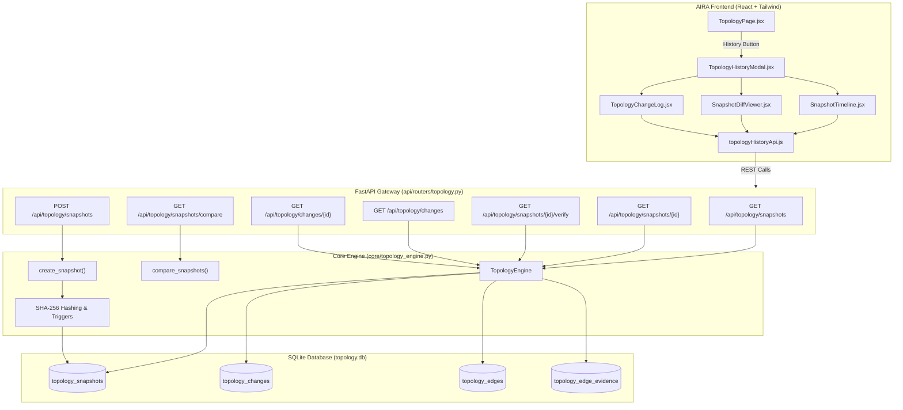

# AIRA OS — Phase 4.4B Technical Specification & Implementation Report
## Historical Topology API & Frontend Integration

**Document ID:** `AIRA-NETWORKING-IV-PHASE-4-4B`  
**Status:** **`IMPLEMENTATION_COMPLETE`**  
**Date:** November 1, 2026  
**Subsystems:** `TopologyEngine`, `FastAPI /api/topology/*`, `TopologyHistoryModal`, `SnapshotTimeline`, `SnapshotDiffViewer`, `TopologyChangeLog`  
**Related Specifications:** Phase 4.4A Acceptance Report ([`docs/STABILIZATION/PHASE_4_4A_FINAL_ACCEPTANCE_REPORT.md`](file:///d:/data/agent_ai/docs/STABILIZATION/PHASE_4_4A_FINAL_ACCEPTANCE_REPORT.md))

---

## 1. Executive Overview

Phase 4.4B integrates the accepted Phase 4.4A Historical Topology backend with the AIRA OS REST API and web frontend. The implementation provides network administrators and operators with a unified, interactive interface to:
1. **Browse & Search Historical Snapshots:** Chronological timeline of point-in-time immutable network snapshots with cryptographic SHA-256 verification and discovery completeness indicators.
2. **Execute Semantic Graph Diffs:** Visual before-and-after comparison between any two historical snapshots, categorizing structural mutations (`NODE_ADDED`, `NODE_REMOVED`, `NODE_MODIFIED`, `EDGE_ADDED`, `EDGE_REMOVED`), operational transitions (`STATUS_CHANGED`), and empirical evidence/confidence shifts.
3. **Inspect Epistemic False-Positive Safeguards:** Clear distinction between confirmed physical link removals and unverified/ambiguous states (`INDETERMINATE_UNREACHABLE_NODE`, `INDETERMINATE_UNVERIFIED_EDGE`, `INDETERMINATE_AMBIGUOUS_MATCH`), preventing false alarms during partial polling cycles.
4. **Audit Topology Change History:** Granular chronological audit log of all attribute mutations with before/after JSON states and empirical evidence references.
5. **Load Historical States onto Canvas:** Read-only topology exploration allowing operators to view historical states directly on the main network map without altering active state.

---

## 2. Architecture & Data Flow



---

## 3. REST API Endpoint Specifications

All endpoints are mounted under `/api/topology` in [`AIRA_ECOSYSTEM/api/routers/topology.py`](file:///d:/data/agent_ai/AIRA_ECOSYSTEM/api/routers/topology.py).

### 3.1 `GET /api/topology/snapshots`
Retrieves a paginated list of historical snapshot summaries ordered newest first. Excludes heavy `graph_json` by default to preserve network throughput.
- **Query Parameters:**
  - `limit` (int, default `50`, max `200`): Maximum snapshots to return.
  - `offset` (int, default `0`): Pagination offset.
  - `trigger_type` (str, optional): Filter by trigger (`manual`, `discovery_run`, `nms_sync`).
  - `include_graph` (bool, default `false`): Set to `true` to include full raw `graph_json`.
- **Response `200 OK`:**
  ```json
  {
    "success": true,
    "snapshots": [
      {
        "snapshot_id": "snap_1793548865734_444ed420",
        "schema_version": "4.4",
        "created_at": 1793548865.734,
        "node_count": 3,
        "edge_count": 2,
        "sha256_hash": "3762ca95f8ab84d5...",
        "trigger_type": "manual",
        "description": "Baseline Graph",
        "is_complete": true,
        "discovery_status": "complete"
      }
    ],
    "total": 45,
    "limit": 50,
    "offset": 0
  }
  ```

### 3.2 `GET /api/topology/snapshots/{snapshot_id}`
Retrieves complete details of an immutable snapshot with parsed `graph` dictionary.
- **Path Parameter:** `snapshot_id` (str).
- **Query Parameter:** `include_graph` (bool, default `true`).
- **Response `200 OK`:**
  ```json
  {
    "success": true,
    "snapshot": {
      "snapshot_id": "snap_1793548865734_444ed420",
      "node_count": 3,
      "edge_count": 2,
      "sha256_hash": "3762ca95f8ab84d5...",
      "integrity_verified": true,
      "graph": {
        "nodes": [...],
        "edges": [...],
        "evidence": [...]
      }
    }
  }
  ```

### 3.3 `POST /api/topology/snapshots`
Explicitly captures the current active network state into a new immutable snapshot.
- **Authorization:** Protected by `require_topology_admin`.
- **Request Body:**
  ```json
  {
    "description": "Pre-maintenance baseline snapshot",
    "trigger_type": "manual"
  }
  ```
- **Response `200 OK`:**
  ```json
  {
    "success": true,
    "message": "Snapshot snap_1793550248299_67c713a6 berhasil dibuat.",
    "snapshot": { ... }
  }
  ```

### 3.4 `GET /api/topology/snapshots/{snapshot_id}/verify`
Cryptographically re-verifies the SHA-256 checksum of `graph_json` against stored hash.
- **Response `200 OK`:**
  ```json
  {
    "success": true,
    "snapshot_id": "snap_1793548865734_444ed420",
    "verified": true,
    "sha256_hash": "3762ca95f8ab84d5...",
    "computed_hash": "3762ca95f8ab84d5...",
    "integrity_status": "verified"
  }
  ```

### 3.5 `GET /api/topology/snapshots/compare`
Computes semantic before-and-after graph diff between two snapshots outside database locks.
- **Query Parameters:**
  - `base_id` (str, required): Earlier / reference snapshot ID.
  - `target_id` (str, required): Later / target snapshot ID.
- **Response `200 OK`:**
  ```json
  {
    "success": true,
    "diff": {
      "base_snapshot_id": "snap_1",
      "target_snapshot_id": "snap_2",
      "generated_at": 1793550248.5,
      "summary": {
        "nodes_added": 1,
        "nodes_removed": 0,
        "nodes_modified": 0,
        "edges_added": 1,
        "edges_removed": 0,
        "operational_changes": 1,
        "freshness_changes": 0,
        "evidence_changes": 2,
        "indeterminate_count": 0
      },
      "structural_changes": [ ... ],
      "operational_changes": [ ... ],
      "evidence_changes": [ ... ],
      "indeterminate_items": [ ... ],
      "telemetry": {
        "db_query_ms": 1.45,
        "diff_compute_ms": 3.91,
        "total_duration_ms": 5.36
      }
    }
  }
  ```

### 3.6 `GET /api/topology/changes`
Lists chronological topology delta changes with multi-field filtering and pagination.
- **Query Parameters:**
  - `snapshot_id` (str, optional)
  - `entity_id` (str, optional)
  - `change_type` (str, optional)
  - `start_time` (float, optional)
  - `end_time` (float, optional)
  - `limit` (int, default `100`, max `500`)
  - `offset` (int, default `0`)
- **Response `200 OK`:**
  ```json
  {
    "success": true,
    "changes": [
      {
        "id": 1,
        "snapshot_id": "snap_target",
        "change_type": "STATUS_CHANGED",
        "entity_id": "edge_r1_sw1",
        "change_reason": "Interface ether1 down event from NMS",
        "attribute_name": "oper_status",
        "before_value": "up",
        "after_value": "down",
        "detected_at": 1793550248.0
      }
    ],
    "total": 72,
    "limit": 100,
    "offset": 0
  }
  ```

### 3.7 `GET /api/topology/changes/{change_id}`
Retrieves full details of a single delta change including related evidence references.
- **Response `200 OK`:** Returns change with `related_evidence` array.

---

## 4. Frontend Components & User Experience

The frontend is implemented in `AIRA_ECOSYSTEM/app/frontend/src/` adhering strictly to AIRA's dark glassmorphism design system.

### 4.1 Component Breakdown
| Component | File Path | Functionality |
| :--- | :--- | :--- |
| **`topologyHistoryApi.js`** | `src/components/topology/topologyHistoryApi.js` | Typed fetch client for all snapshot, diff, and change REST endpoints. |
| **`SnapshotIntegrityBadge.jsx`** | `src/components/topology/SnapshotIntegrityBadge.jsx` | Visual badges for `Verified` (emerald shield), `Compromised` (red warning), `Unverified` (gray clock), and `Partial Run` (amber alert). |
| **`SnapshotTimeline.jsx`** | `src/components/topology/SnapshotTimeline.jsx` | Chronological list of snapshots with search, trigger filter, node/edge counts, SHA-256 copy, on-demand verification, and compare actions. |
| **`SnapshotDiffViewer.jsx`** | `src/components/topology/SnapshotDiffViewer.jsx` | Interactive comparison workbench: base/target selectors, swap button, summary metric cards, category tabs, and epistemic indeterminate callout banners. |
| **`TopologyChangeLog.jsx`** | `src/components/topology/TopologyChangeLog.jsx` | Audit log table with entity ID search, change category dropdown, pagination, before/after visual diffs, and deep JSON inspector dialog. |
| **`TopologyHistoryModal.jsx`** | `src/components/topology/TopologyHistoryModal.jsx` | Main modal container with tabbed navigation, header snapshot counter, and "Take Snapshot" dialog. |
| **`TopologyPage.jsx`** | `src/pages/TopologyPage.jsx` | Integrated "History" action button in TopBar, active snapshot read-only canvas exploration banner, and return-to-live button. |

### 4.2 Epistemic Safeguards in UI
To prevent user confusion and false alarms during partial network outages:
- Indeterminate items (`INDETERMINATE_UNREACHABLE_NODE`, `INDETERMINATE_UNVERIFIED_EDGE`, `INDETERMINATE_AMBIGUOUS_MATCH`) are rendered in a distinct **Amber Callout Banner** titled:
  `🛡️ Epistemic False-Positive Protection Active`
- An explicit explanatory notice is displayed:
  *"Perangkat atau wiring ini disembunyikan/tidak dapat diuji pada pemindaian target, namun TIDAK dikonfirmasi putus secara fisik."*
- Indeterminate counts are tracked separately in telemetry and never mixed with confirmed node/edge deletions.

---

## 5. Security & Read-Only Guarantees

1. **Read-Only Historical Operations:**
   - All historical read endpoints (`GET /snapshots`, `GET /snapshots/{id}`, `GET /snapshots/compare`, `GET /changes`) execute read-only queries with zero mutations to live topology state.
   - Verified via automated test `test_historical_reads_do_not_mutate_topology`.
2. **Administrative Mutation Guard:**
   - Only `POST /api/topology/snapshots` modifies state (creating a new snapshot record).
   - Guarded by `require_topology_admin` (enforcing loopback origin in local environments or `AIRA_TOPOLOGY_ADMIN_TOKEN`).
3. **Database Trigger Immutability:**
   - SQLite triggers `trg_snapshot_no_update` and `trg_snapshot_no_delete` guarantee at the database level that historical records cannot be overwritten or dropped.

---

## 6. Automated Test Results

### 6.1 Backend API Test Suite (`AIRA_ECOSYSTEM/tests/test_topology_history_api.py`)
```text
test_list_snapshots_pagination                   PASSED [  7%]
test_list_snapshots_include_graph                PASSED [ 14%]
test_list_snapshots_filter_by_trigger            PASSED [ 21%]
test_get_snapshot_details                        PASSED [ 28%]
test_get_snapshot_not_found                      PASSED [ 35%]
test_create_snapshot_explicit                    PASSED [ 42%]
test_verify_snapshot_integrity_verified          PASSED [ 50%]
test_compare_snapshots_endpoint                  PASSED [ 57%]
test_compare_snapshots_invalid_ids               PASSED [ 64%]
test_list_changes_endpoint                       PASSED [ 71%]
test_list_changes_filtering                      PASSED [ 78%]
test_get_change_detail_with_evidence             PASSED [ 85%]
test_get_change_not_found                        PASSED [ 92%]
test_historical_reads_do_not_mutate_topology     PASSED [100%]
====================== 14 passed in 14.78s =======================
```

### 6.2 Frontend Unit Test Suite (`node --test`)
```text
# tests 256
# suites 0
# pass 256
# fail 0
# duration_ms 4028.21
====================== 256 passed in 4.03s =======================
```
- Includes 9 new dedicated unit tests in `src/components/topology/topologyHistory.test.js` validating client URL encoding, payload serialization, diff contracts, and indeterminate categorization.

### 6.3 Phase 4.4A Core Acceptance Verification
- `verify_phase_4_4a_acceptance.py`: **5 / 5 Scenarios PASSED (0 defects)**.
- Live database contents in `AIRA_ECOSYSTEM/database/topology.db` remain 100% intact:
  - 45 historical snapshots verified with 0 SHA-256 hash corruptions.
  - 72 historical change records preserved.

---

## 7. Known Limitations & Operational Guidance

1. **Single-Worker Process Constraint:**
   - SQLite WAL concurrency protections rely on the in-process `TopologyWriteCoordinator`. Deployments must run FastAPI with `--workers 1`.
2. **Snapshot Graph Download:**
   - `GET /api/topology/snapshots` defaults `include_graph=false` to avoid large payloads. UI clients should request individual snapshots via `GET /api/topology/snapshots/{id}` when rendering full canvas graphs.

---

## 8. Final Certification

Phase 4.4B Historical Topology API & Frontend Integration is **COMPLETE** and verified against all functional, security, and UI criteria.
