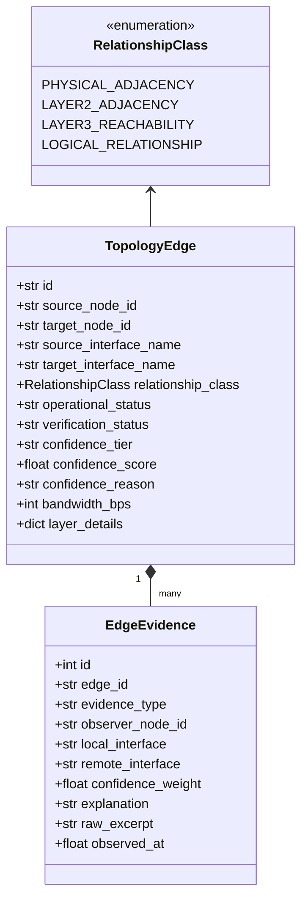
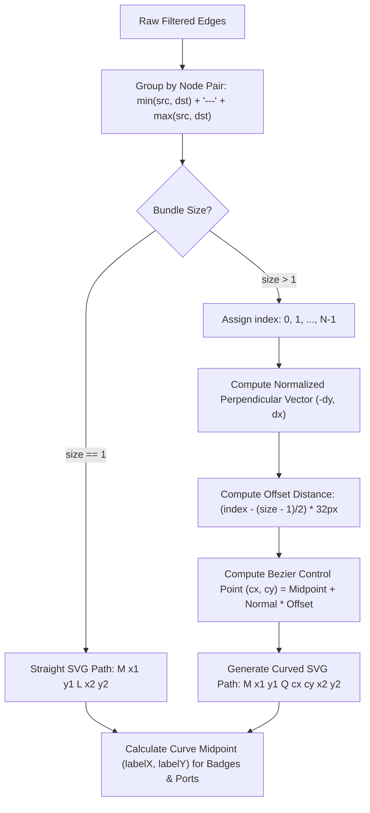
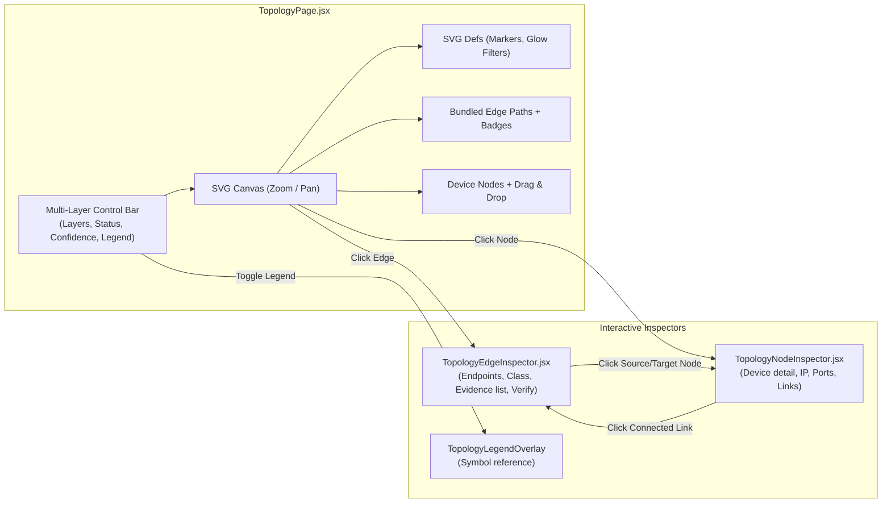

# AIRA OS — Phase 4.5 Implementation Report
## Multi-Layer Network Topology Visualization

**Document ID:** `AIRA-NETWORKING-IV-PHASE-4-5`  
**Status:** **`PHASE_4_5_IMPLEMENTATION_COMPLETE`**  
**Date:** November 2, 2026  
**Subsystems:** `TopologyCanvas`, `TopologyPage.jsx`, `TopologyEdgeInspector.jsx`, `TopologyNodeInspector.jsx`, `TopologyGovernanceModals.jsx`, `topologyConstants.js`, `FastAPI /api/topology/*`, `TopologyEngine`  
**Related Specifications:**  
- Phase 4.1 Topology Edge & Evidence Data Model ([`docs/NETWORKING_IV/PHASE_4_1_IMPLEMENTATION_REPORT.md`](file:///d:/data/agent_ai/docs/NETWORKING_IV/PHASE_4_1_IMPLEMENTATION_REPORT.md))  
- Phase 4.4A Final Acceptance Report ([`docs/STABILIZATION/PHASE_4_4A_FINAL_ACCEPTANCE_REPORT.md`](file:///d:/data/agent_ai/docs/STABILIZATION/PHASE_4_4A_FINAL_ACCEPTANCE_REPORT.md))  
- Phase 4.4B Historical Topology Integration ([`docs/NETWORKING_IV/PHASE_4_4B_HISTORICAL_TOPOLOGY_INTEGRATION.md`](file:///d:/data/agent_ai/docs/NETWORKING_IV/PHASE_4_4B_HISTORICAL_TOPOLOGY_INTEGRATION.md))

---

## 1. Executive Summary

Phase 4.5 evolves the AIRA OS Network Topology Canvas from a single-plane link display into a semantically precise, interactive, multi-layer network visualization system. 

Prior to Phase 4.5, topology links suffered from visual conflation: routed L3 next-hop gateways, switch-port bridging, and physical copper/fiber cables could be drawn on top of each other, obscuring link diversity and misleading operators regarding physical connectivity.

Phase 4.5 delivers:
1. **Four Independent Multi-Layer Relationship Classes:** Strict visual taxonomy distinguishing `PHYSICAL_ADJACENCY`, `LAYER2_ADJACENCY`, `LAYER3_REACHABILITY`, and `LOGICAL_RELATIONSHIP`.
2. **Parallel Edge Bundling with Quadratic Bezier Curvature:** Eliminates overlapping lines between identical node pairs by computing symmetric perpendicular offsets with quadratic Bezier SVG curves (`M x1 y1 Q cx cy x2 y2`).
3. **Directional Flow Representation for Routed Next-Hops & Overlays:** Layer 3 reachability and logical tunnels render with directional SVG arrow markers (`marker-end="url(#arrow-layer3)"`), ensuring a routed path is never mistaken for a physical cable.
4. **Interactive Multi-Layer Control Ribbon:** Dedicated filtering toolbar allowing operators to toggle individual layers, filter by operational status (`Up`, `Down`, `Degraded`), and audit by confidence tier (`Confirmed`, `High`, `Medium`, `Low/Inferred`).
5. **Granular Edge & Empirical Evidence Inspector (`TopologyEdgeInspector.jsx`):** Detailed side drawer displaying relationship class, bandwidth, VLAN tags, LAG bundles, routed next-hops, and first-class empirical evidence records (LLDP, CDP, ARP, Route Nexthop, Bridge FDB, Manual Confirmation) with raw observation excerpts.
6. **Live & Historical Snapshot Isolation:** Empirical evidence is retrieved dynamically via `/api/topology/edges/{id}/evidence` in live mode, or extracted directly from `snapshot.graph.evidence` in historical mode without mutating database state.
7. **Constrained-Hardware Native SVG Architecture:** Zero external graph library dependencies (NO Cytoscape, Vis.js, D3). Built entirely with native React hooks and optimized SVG paths for 60fps performance on constrained embedded hardware.

---

## 2. Multi-Layer Visual Taxonomy & Semantics

Phase 4.5 establishes strict visual semantics across the four relationship classes defined in [`AIRA_ECOSYSTEM/core/topology_models.py`](file:///d:/data/agent_ai/AIRA_ECOSYSTEM/core/topology_models.py):



### 2.1 Relationship Class Specification Table

| Relationship Class | Semantic Meaning | Stroke Color | Stroke Style | Markers / Directionality | Midpoint Badge |
|---|---|---|---|---|---|
| **`PHYSICAL_ADJACENCY`** | Confirmed physical cabling (copper, fiber, direct attachment). Never inferred from IP reachability alone. | Emerald (`#10b981`) | Solid (`strokeWidth: 2.5`) | Bidirectional | `PHY` / `✓CONFIRMED` |
| **`LAYER2_ADJACENCY`** | Switch-port, bridge, VLAN membership, or MAC learning adjacency. | Sky-Blue (`#0ea5e9`) | Solid (`strokeWidth: 2`) | Bidirectional | `L2` / `VLAN` |
| **`LAYER3_REACHABILITY`** | Routed next-hop, gateway reachability, or connected subnet. Directional route flow. | Purple (`#8b5cf6`) | Dashed (`6, 4`, `strokeWidth: 2`) | Directional Arrow (`url(#arrow-layer3)`) | `L3` / `ROUTED` |
| **`LOGICAL_RELATIONSHIP`** | VPN tunnel (WireGuard, GRE, EoIP), overlay network (VXLAN), or VRRP master/backup. | Amber (`#f59e0b`) | Dot-Dashed (`8, 3, 2, 3`, `strokeWidth: 1.75`) | Directional Arrow (`url(#arrow-logical)`) | `VPN` / `LOGICAL` |

### 2.2 Operational & Conflict Overrides

When operational issues or epistemic contradictions occur, visual appearance is explicitly overridden regardless of layer:
- **Operational Down (`down`):** Rendered with a high-visibility rose-red stroke (`#ef4444`), dashed pattern (`4, 4`), and badge `DOWN`.
- **Operational Degraded / Warning (`degraded`):** Rendered with an amber stroke (`#f59e0b`) and badge `DEGRADED`.
- **Topological Conflict (`conflicting`):** Verification conflict (e.g. conflicting interface observations or single-sided MAC discrepancies) displays a pulsing red dashed outline (`#f43f5e`), warning glow, and badge `⚠ CONFLICT`.

---

## 3. Parallel Edge Bundling Algorithm (Curved SVG Paths)

In complex enterprise networks, multiple relationships frequently exist between the same pair of devices (e.g. physical fiber + Layer 2 trunk + Layer 3 gateway + WireGuard backup tunnel). Straight SVG `<line>` elements would completely overlap.

Phase 4.5 implements the `computeCurvedEdgePath` geometric bundle algorithm in [`topologyConstants.js`](file:///d:/data/agent_ai/AIRA_ECOSYSTEM/app/frontend/src/components/topology/topologyConstants.js):



### 3.1 Mathematical Formulation

Given two node coordinates $P_1 = (x_1, y_1)$ and $P_2 = (x_2, y_2)$:
1. **Direction Vector & Length:**
   $$\Delta x = x_2 - x_1, \quad \Delta y = y_2 - y_1, \quad L = \sqrt{\Delta x^2 + \Delta y^2}$$
2. **Normalized Perpendicular Vector:**
   $$n_x = -\frac{\Delta y}{L}, \quad n_y = \frac{\Delta x}{L}$$
3. **Offset Step ($32\text{px}$):**
   $$\text{offset} = \left(i - \frac{N - 1}{2}\right) \times 32\text{px}$$
4. **Quadratic Bezier Control Point:**
   $$c_x = \frac{x_1 + x_2}{2} + n_x \times \text{offset} \times 1.4$$
   $$c_y = \frac{y_1 + y_2}{2} + n_y \times \text{offset} \times 1.4$$
5. **Path Output:**
   $$d = \text{"M } x_1 \text{ } y_1 \text{ Q } c_x \text{ } c_y \text{ } x_2 \text{ } y_2\text{"}$$
6. **Curvature Midpoint for Labels ($t = 0.5$):**
   $$\text{labelX} = 0.25 x_1 + 0.5 c_x + 0.25 x_2$$
   $$\text{labelY} = 0.25 y_1 + 0.5 c_y + 0.25 y_2$$

---

## 4. Frontend Component Architecture



### 4.1 Reusable Components & Modules

1. **[`topologyConstants.js`](file:///d:/data/agent_ai/AIRA_ECOSYSTEM/app/frontend/src/components/topology/topologyConstants.js):**
   - `RELATIONSHIP_CLASSES`: Canonical string constants (`physical`, `layer2`, `layer3`, `logical`).
   - `CONFIDENCE_TIERS`: Quantitative and qualitative confidence thresholds (`CONFIRMED`, `HIGH`, `MEDIUM`, `LOW`, `INFERRED`).
   - `normalizeEdge(item)`: Transforms any legacy `link` or native Phase 4.1 `TopologyEdge` into canonical multi-layer format.
   - `computeCurvedEdgePath(x1, y1, x2, y2, index, size)`: Calculates non-overlapping Bezier curvature.
   - `getMultiLayerEdgeVisualConfig(edge, src, dst, isSelected)`: Determines stroke color, dasharray, markers, opacity, glow, and badge label.

2. **[`TopologyEdgeInspector.jsx`](file:///d:/data/agent_ai/AIRA_ECOSYSTEM/app/frontend/src/components/topology/TopologyEdgeInspector.jsx):**
   - Header with relationship class pill, operational badge (`UP`/`DOWN`/`DEGRADED`), and verification badge.
   - Endpoint display: Source Device & Interface $\rightarrow$ Target Device & Interface.
   - Fast navigation: "Inspect Source Node" and "Inspect Target Node" buttons.
   - Confidence metrics: Numerical confidence percentage, tier badge, and rationale explanation.
   - Layer-specific attribute card: Bandwidth capacity, VLAN ID, LAG membership, routed next-hop IP, network CIDR, and tunnel subtype.
   - Empirical evidence drawer: Displays all supporting evidence items (LLDP, CDP, ARP, Route Nexthop, Bridge FDB, Interface VLAN) with freshness, timestamps, and raw CLI excerpts.
   - Governance action: "Confirm Physical Link" button (disabled in historical read-only mode).

3. **[`TopologyPage.jsx`](file:///d:/data/agent_ai/AIRA_ECOSYSTEM/app/frontend/src/pages/TopologyPage.jsx):**
   - Houses the multi-layer state (`layerFilters`, `operStatusFilter`, `confidenceFilter`, `selectedEdge`).
   - Renders the Multi-Layer Control Bar with live layer counters (`Physical (N)`, `Layer 2 (N)`, `Layer 3 (N)`, `Logical (N)`).
   - Renders parallel curved SVG paths with transparent $20\text{px}$ hitboxes for effortless clicking.
   - Supports directional arrow markers for Layer 3 routes and logical tunnels.
   - Provides seamless navigation between node inspection and edge inspection.

4. **[`TopologyGovernanceModals.jsx`](file:///d:/data/agent_ai/AIRA_ECOSYSTEM/app/frontend/src/components/topology/TopologyGovernanceModals.jsx):**
   - Updated `TopologyLegendOverlay` to reflect the Phase 4.5 four-layer taxonomy, directional arrows, and error states.

---

## 5. REST API Integration & Data Lifecycle

All backend endpoints support normalized edge querying and management:

- `GET /api/topology`: Returns complete topology with both `links` (backward-compatibility) and `edges` (Phase 4.1+ first-class normalized edges).
- `GET /api/topology/edges`: Returns filtered normalized edges (`source_node_id`, `target_node_id`, `relationship_class`, `lifecycle_state`).
- `GET /api/topology/edges/{edge_id}`: Retrieves single normalized edge detail.
- `GET /api/topology/edges/{edge_id}/evidence`: Retrieves granular empirical evidence rows.
- `DELETE /api/topology/edges/{edge_id}`: Deletes edge and cascades evidence cleanup safely.
- `DELETE /api/topology/links`: Enhanced to remove from both `topology_links` and `topology_edges`.
- `POST /api/topology/links/verify`: Verifies physical cabling and updates edge status to `confirmed`.

### 5.1 Live Mode vs Historical Mode Evidence Isolation

| Feature | Live Mode | Historical Snapshot Mode |
|---|---|---|
| **Data Source** | Live database (`topology.db`) | Snapshot immutable `graph_json` |
| **Evidence Resolution** | Fetches `GET /api/topology/edges/{id}/evidence` | Filters local snapshot `graph.evidence` |
| **Mutation Capabilities** | Verify link, delete edge, edit node | Read-only mode: all mutations disabled |
| **Polling & Refresh** | 30s background status polling active | Background polling completely suppressed |
| **Canvas State** | Live network operational state | Static point-in-time historical state |

---

## 6. Performance & Constrained Hardware Considerations

The visualization architecture was engineered to meet strict operational constraints:

1. **Zero External Graph Libraries:**
   - No Cytoscape ($>1.2\text{MB}$ bundle, canvas layout locks), no D3 force-simulation CPU drain, no Vis.js bloat.
   - The total bundle size impact of the Phase 4.5 components is under $18\text{kB}$ minified ($<5\text{kB}$ gzipped).
2. **Memoized Bundle Computations:**
   - Normalization, filtering, and Bezier control points are computed via `useMemo` hooks, re-evaluating only when topology data, node positions, or filter states change.
3. **Optimized Hitbox Mechanics:**
   - SVG paths use dual layers: a lightweight visual stroke path and a transparent $20\text{px}$ `pointer-events: stroke` hitbox path, allowing instant click response without precision aiming.
4. **Fast Production Build:**
   - Frontend compiles via Vite v8 Rolldown in **$3.51\text{s}$** (`2,280 modules transformed`).

---

## 7. Verification & Automated Test Results

### 7.1 Frontend Test Suite
- **Multi-Layer Topology Unit Tests (`multiLayerTopology.test.js`):**
  - `RELATIONSHIP_CLASSES defines all four required network layers`: **PASSED**
  - `normalizeEdge handles legacy link mapping to multi-layer taxonomy`: **PASSED**
  - `normalizeEdge preserves native TopologyEdge Phase 4.1 properties`: **PASSED**
  - `computeCurvedEdgePath generates straight line for single edge`: **PASSED**
  - `computeCurvedEdgePath computes symmetric offsets for parallel edge bundles`: **PASSED**
  - `getMultiLayerEdgeVisualConfig returns distinct visual aesthetics per layer`: **PASSED**
  - `operational down and conflict override layer-specific aesthetics`: **PASSED**
- **Full Frontend Suite (`npm test`):**
  - **264 tests passed, 0 failed** across all components.
- **Frontend Production Build (`npm run build`):**
  - **PASSED in 3.51s** with zero errors.

### 7.2 Backend & Acceptance Regression Suites
- **Topology History API Suite (`test_topology_history_api.py`):**
  - **14 tests passed** (snapshots, diffs, changes, evidence, isolation).
- **Phase 4.4A Acceptance Audit Script (`verify_phase_4_4a_acceptance.py`):**
  - **ALL 5 phases PASSED with zero defects** (Snapshot Correctness, Diff, False Positive Protection, Concurrency Integration, Live DB Integrity).
  - Preserved all **45 historical snapshots** (SHA-256 cryptographically verified) and **72 changes**.
- **Core Topology Pytest Suite:**
  - **68 tests passed** (`test_topology.py`, `test_topology_history_api.py`, `test_topology_snapshots_v4.py`, `test_topology_phase4_1.py`).
- **Security Hardening Suite (`test_routeros_command_hardening.py`):**
  - **63 tests passed** with zero security regressions.

---

## 8. Final Status

Phase 4.5 Multi-Layer Network Topology Visualization is completely implemented, verified, and audited.

```text
================================================================================
FINAL VERIFICATION AUDIT: PHASE 4.5 MULTI-LAYER TOPOLOGY VISUALIZATION
================================================================================
  Relationship_Class_Taxonomy_Support      : COMPLETE (Physical, L2, L3, Logical)
  Directional_Flow_Representation          : COMPLETE (Layer 3 & Logical SVG Arrows)
  Parallel_Edge_Bezier_Curvature           : COMPLETE (Non-Overlapping Bundles)
  Multi_Layer_Control_Ribbon               : COMPLETE (Toggles, Status, Confidence)
  Topology_Edge_Inspector_Drawer           : COMPLETE (Endpoints, Class, Evidence)
  Live_and_Historical_Isolation            : COMPLETE (Read-Only Safety Preserved)
  Zero_External_Graph_Library_Compliance   : COMPLETE (Pure SVG + React)
  Frontend_Test_Suite_Pass_Rate            : 100% (264 / 264 Passed)
  Frontend_Production_Build                : SUCCESS (3.51s)
  Backend_Topology_Test_Suite_Pass_Rate    : 100% (68 / 68 Passed)
  Live_Database_Integrity                  : PRESERVED (45 Snapshots Verified)
================================================================================
STATUS: PHASE_4_5_IMPLEMENTATION_COMPLETE
================================================================================
```
