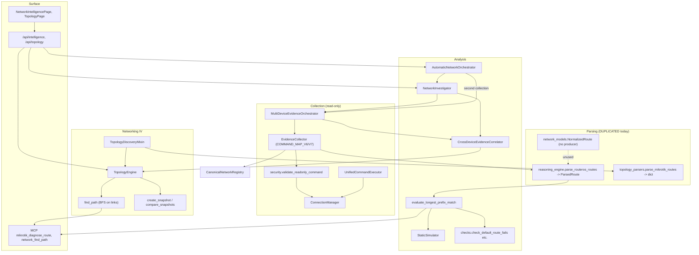
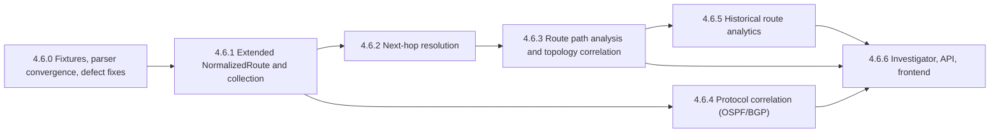

# AIRA OS — Phase 4.6 Route Analytics: Architecture Audit & Blueprint

**Date:** 2026-11-03
**Workspace:** `D:\data\agent_ai`
**Status:** Architecture audit and design only. No production code, schema, migration, or RouterOS changes were made.
**Companion:** [PHASE_4_6_IMPLEMENTATION_PLAN.md](PHASE_4_6_IMPLEMENTATION_PLAN.md)
**Audit verdict:** `PHASE_4_6_ARCHITECTURE_AUDIT_COMPLETE_WITH_GAPS` (see §16)

---

## 0. How to read this document

Every statement is tagged with its evidence basis:

| Tag | Meaning |
|---|---|
| **[CODE]** | Read directly from source in this workspace (file and line given). |
| **[PROBE]** | Measured locally by running existing code (no router contacted). |
| **[FIXTURE]** | Based on files in `AIRA_ECOSYSTEM/tests/fixtures/ros_v6`, `ros_v7`. Their provenance (real capture vs. hand-written) is not recorded in the repo. |
| **[DESIGN]** | A proposal. Not implemented and not measured. |
| **[UNVERIFIED]** | RouterOS behaviour from vendor knowledge that has **not** been confirmed against a lab device in this audit. It must be confirmed with captured fixtures before implementation. |

The probe script is at `brain/<conversation>/scratch/probe_route_parsers.py`. Its two "synthetic detail" samples follow documented RouterOS print layouts but are **not** captured device output.

---

## 1. Existing Architecture Audit

### 1.1 Component inventory (what actually exists)

| Component | Location | Role today | Reusable for 4.6? |
|---|---|---|---|
| `CanonicalDevice`, `CanonicalNetworkRegistry` | `core/canonical_network.py:28` | Device identity, `ros_major_version`, `routes_summary` dict | **Yes.** It is the identity anchor for all route records. |
| `parse_routeros_major_version` | `core/canonical_network.py:167` | Parses the version string | Yes |
| `NormalizedRoute` | `core/network_intelligence/network_models.py:119` | Route dataclass (13 fields) | **Partially.** Nothing outside tests constructs it [CODE: grep]. |
| `NormalizedInterface`, `NormalizedIPAddress`, `NormalizedNeighbor`, `NormalizedLink` | `network_models.py` | Normalized L2/L3 entities with converters | Yes. These are the connected-subnet inputs. |
| `ParsedRoute` + `parse_routeros_routes` | `agents/akane/reasoning_engine.py:30,53` | **Primary route parser** used by evidence, checks, simulator, MCP | Must be replaced or wrapped (defects in §1.4) |
| `evaluate_longest_prefix_match` | `reasoning_engine.py:141` | Single-table LPM with ECMP/recursive hints | Its logic can be reused, but its semantics need fixing (§1.4) |
| `parse_mikrotik_routes` | `core/topology_parsers.py:477` | **Second route parser**, used by topology discovery | Must converge with the first parser (defects in §1.4) |
| `_parse_kv_blocks` | `core/topology_parsers.py` | Multi-line key=value block splitter | **Yes.** It is the correct foundation for `print detail`. |
| `EvidenceCollector` | `core/network_intelligence/evidence.py:114` | Bounded read-only collection, `COMMAND_MAP_V6`/`V7`, `EvidenceItem` provenance | **Yes.** It is the single collection path. |
| `MultiDeviceEvidenceOrchestrator` | `multi_device_collector.py:115` | Thread pool fan-out (`max_concurrency=3`, `timeout_per_cmd=10s`), partial-result handling | **Yes** |
| `CrossDeviceEvidenceCorrelator._correlate_routed_nexthop` | `correlation.py:278` | Maps a gateway IP to the device that owns it | Yes, but it must become multi-route and subnet-aware |
| `reconcile_correlated_relationships_to_engine` | `correlation.py:377` | Writes correlated relationships into TopologyEngine | Yes. It is the only sanctioned writer for route-derived edges. |
| `NetworkInvestigator` | `investigator.py:53` | Single- and multi-device investigations, `IncidentType` taxonomy | **Yes.** Route analysis plugs in here. |
| `AutomaticNetworkOrchestrator` | `auto_orchestrator.py:30` | End-to-end diagnosis pipeline | Yes, but it has defects (§1.5) |
| `UnifiedCommandExecutor` | `command_execution.py:90` | Unified execution with batch | Yes. It sits behind ConnectionManager. |
| `validate_readonly_command`, `APPROVED_PRINT_PREFIXES` | `security.py:54,128` | Allowlist plus defence in depth | **Yes, mandatory.** Gaps are listed in §3. |
| `TopologyEngine.find_path` | `topology_engine.py:4415` | BFS over topology links (not routing) | **No, not for routed paths.** It stays as the topology-only path. |
| `TopologyEngine.create_snapshot` / `compare_snapshots` | `topology_engine.py:831,1095` | Immutable graph snapshot: nodes, edges, evidence, completeness | The pattern is reused. Routes are **not** in the snapshot today. |
| `TopologyEdge` / `EdgeEvidence` / `TopologyChange` | `topology_models.py:829,932,1056` | Four-class relationship model, `RelationshipClass.LAYER3_REACHABILITY` | **Yes** |
| MCP `mikrotik_diagnose_route`, `network_find_path` | `mcp_servers/network/server.py:170,551` | LLM tool surface | Yes. These must be re-pointed to the new engine. |
| `/api/intelligence/*` | `api/routers/network_intelligence.py` | incidents, correlation, multi-device-investigation, auto-diagnose | **Yes.** It is the host for new route endpoints. |
| `NetworkIntelligencePage.jsx` ("Simulasi Forwarding LPM") | frontend | LPM simulation UI | Yes. It is the anchor for the Route Inventory view. |
| `TopologyPage.jsx`, `TopologyEdgeInspector.jsx` | frontend | Four-layer canvas and inspector (Phase 4.5) | **Yes.** It is the host for path overlays. |

### 1.2 Dependency map

### 1.3 Existing route collection capability

| Capability | Status | Evidence |
|---|---|---|
| `/ip route print detail` (v6, v7) | Collected | `evidence.py:38,58` |
| Routing rules: v6 `/ip route rule`, v7 `/routing rule` | Collected, **not parsed** (falls to the generic `raw_length` branch) | `evidence.py:39,59,337` |
| v7 `/routing table print` | Allowlisted, **not collected** | `security.py:84` |
| OSPF neighbors and instance | Collected and parsed (router-id, state) | `evidence.py:491` |
| OSPF routes, LSAs, interface cost/area | **Not collected** | — |
| BGP peers (v6 `peer`, v7 `connection`) | Collected and parsed (state, remote AS, prefix count) | `evidence.py:517` |
| BGP route attributes (AS_PATH, LOCAL_PREF, MED, ORIGIN) | **Not collected or parsed** | — |
| v7 RIB `/routing route print` | **Not allowlisted** | `security.py:54-94` |
| Mangle routing-marks | Collected (`mangle_rules`), not parsed for routing | `evidence.py:42` |
| Interface and IP address (connected subnet basis) | Collected and parsed | `evidence.py:339,380` |
| ARP | Collected and parsed | `evidence.py:548` |

### 1.4 Defects found in existing route logic

These defects already exist in the codebase. Phase 4.6 depends on them being fixed. **None were changed in this audit.**

| # | Defect | Basis | Impact |
|---|---|---|---|
| D1 | `topology_parsers.parse_mikrotik_routes` misreads the committed v6 tabular fixture. The default route becomes `dst='S'`, `gateway_ip='0.0.0.0'`. | **[PROBE on FIXTURE]** | Discovery mis-detects WAN and default-route signals on v6 devices whose flag column contains a space (`A S`). |
| D2 | `parse_mikrotik_routes` reports `connected=False` for v7 `DAc` routes, because the check is case-sensitive on `C`. | **[PROBE on FIXTURE]** | Connected subnets are lost on v7. |
| D3 | `parse_routeros_routes` (detail branch) keeps only the last whitespace token of the flag prefix. For a v6 detail line `0 A S dst-address=…` it records `flags='S'` and `active=False`. A disabled `X S` route becomes indistinguishable from an inactive one. | **[PROBE, synthetic v6 detail]** | An **active default route is reported inactive**, and disabled routes are invisible. Every consumer of `evidence.py` routes is affected. |
| D4 | `parse_routeros_routes` is line-oriented. On wrapped `print detail` records (v7 style) it reads `distance=1` when the record states `distance=110` on a continuation line. It also keeps the `%ether1` suffix in `gateway`. Protocol (`o`, `b`) is never extracted. | **[PROBE, synthetic v7 detail]** | Wrong administrative distance, wrong route selection, and no protocol semantics. |
| D5 | `parse_mikrotik_routes` writes the recursive gateway IP into `interface` (`iface='192.168.1.1'`) when `gateway-status` says `recursive via 192.168.1.1 ether1`. | **[PROBE]** | Interface correlation is wrong for recursive routes. |
| D6 | `evaluate_longest_prefix_match` returns an **inactive** route as `best_route` when no active route covers the target. It reports `matched=True`. | **[PROBE]** + `reasoning_engine.py:170-175` | Claims a forwarding decision that RouterOS would not make. This violates the "no claim from table presence" rule. |
| D7 | The recursive-gateway check excludes `0.0.0.0/0` (`reasoning_engine.py:213`). A gateway resolvable only via the default route is never flagged recursive. | **[CODE]** + **[PROBE]** (`recursive_gateway_candidate=False` for gateway 8.8.8.8) | Recursive dependencies through the default route are missed. |
| D8 | LPM has no routing-table or VRF awareness. Every parsed route is mixed into one table. | **[CODE]** | Policy routing and VRF routes pollute the `main` decision. |
| D9 | `_correlate_routed_nexthop` returns on the **first** matching route only. It also does not check that the gateway lies in one of the source device's connected subnets. | **[CODE]** `correlation.py:290-314` | ECMP and multiple next-hops are lost. A recursive gateway can be mislabelled as a direct adjacency with `HIGH` confidence. |
| D10 | `EvidenceCollector` falls back to `ros_major=7` when the version is unknown (`evidence.py:128,152`). | **[CODE]** | A v6 device of unknown version receives v7 commands, e.g. `/routing rule` instead of `/ip route rule`. |

### 1.5 Other architectural limitations observed

- **L1. Double collection.** `AutomaticNetworkOrchestrator.execute_auto_diagnosis` runs `run_multi_device_investigation`, which collects, then calls `collect_multi_device_bundle` again with the default types (`auto_orchestrator.py:106-116`). That doubles router load. Route Analytics must not add a third pass.
- **L2. Hardcoded fallback gateway.** The auto-plan defaults to `"192.168.43.1"` when `target_ip` is absent (`auto_orchestrator.py:139`). The plan is non-mutating, but it proposes an invented gateway. This is out of 4.6 scope and listed as a risk.
- **L3. `find_path` is not a routed path.** It runs BFS over topology links. It classifies anything other than `routed` or `vpn` as L2, with a default `link_type="physical"` (`topology_engine.py:4460`). It must not be presented as L3 path analysis.
- **L4. Snapshots carry no route data.** `graph_state` contains `nodes`, `edges`, `evidence`, `completeness`, and `metadata` only (`topology_engine.py:970-979`).
- **L5. No route change types.** `TopologyChangeType` has node, edge, and evidence types only (`topology_models.py:571`).
- **L6. `EvidenceItem` provenance is per command, not per route.** `evidence_id`, `source_command`, and `collection_timestamp` exist, but there is no per-record excerpt or line reference.
- **L7. No HTTP endpoint for LPM or path.** LPM and `find_path` are reachable only through MCP and internal callers.

### 1.6 Data duplication risks

1. Three route shapes: `ParsedRoute`, the topology dict, and the unused `NormalizedRoute`. A fourth shape, the `evidence.py` normalized dict, is built by hand from `ParsedRoute`. **Rule for 4.6: `NormalizedRoute` (extended) becomes the only route record. `ParsedRoute` and the topology dict become adapters, then are retired.**
2. Two parsers with diverging bugs (D1–D5). **Rule: one parser module built on `_parse_kv_blocks`, plus a tabular fallback. Both call sites use it.**
3. Two "path" concepts: topology BFS and routing LPM. **Rule: keep both and name them distinctly (`topology_path` vs `route_path`). Never merge their outputs.**
4. `CanonicalDevice.routes_summary` must remain a summary derived from the route records, not a second store.

### 1.7 Existing API contracts that must not break

- `POST /api/intelligence/correlation`, `/multi-device-investigation`, `/auto-diagnose`, `/incidents`.
- MCP `mikrotik_diagnose_route` output keys: `matched`, `best_route`, `all_matches`, `is_ecmp`, `recursive_gateway_candidate`, `observed_facts`, `inferred_hypotheses`, `missing_evidence`, `limits_disclosure`.
- MCP `network_find_path` and `TopologyEngine.find_path` output: `path_found`, `hops`, `path_certainty`, `assumptions`.
- `evidence.py` normalized `routes` dict keys (consumed by `investigator.py:403`, `checks.py`).
- All Phase 4.4B snapshot and change endpoints, and `graph_json` hash semantics.

### 1.8 Existing test coverage relevant to routes

| Suite | What it covers |
|---|---|
| `test_akane_reasoning_engine.py` (7 refs) | `parse_routeros_routes`, LPM on simple tables |
| `test_audit_d_reasoning.py` (4) | ECMP and recursive hints |
| `test_phase5_ros_compatibility.py` (3) | v6/v7 tabular fixtures |
| `test_networking_iii_correlation.py` (2) | `ROUTED_NEXT_HOP` |
| `test_networking_iii_network_models.py` (2) | `NormalizedRoute` dataclass |
| `test_topology_path_explorer.py` | `find_path` BFS |

**Gaps:** no `print detail` fixtures (wrapped or spaced flags), no disabled or inactive route fixtures, no OSPF/BGP route attribute fixtures, no multi-table or VRF fixtures, no recursive-via-default test, no LPM "no active route" test.

---

## 2. Routing Data Model Design

### 2.1 Can the current `NormalizedRoute` represent the requirements?

| Requirement | Current field | Verdict |
|---|---|---|
| Device identity | `device_id` | OK |
| Routing table / instance | `routing_table="main"` | Partial: the default hides "unknown" |
| Destination prefix | `dst_prefix`, `prefix_len` | OK; IPv4 assumed elsewhere |
| Protocol | `protocol="static"` | **Misleading default.** An unknown protocol becomes "static". |
| Gateway / next-hop | `gateway: str` | Insufficient: no split of IP vs interface vs `%iface`, and no ECMP list |
| Interface | `interface_name` | OK |
| Preferred source | — | Missing |
| Administrative distance | `distance=1` | **Misleading default** |
| Metric | — | Missing |
| BGP / OSPF attributes | — | Missing |
| Active | `active=True` | **Misleading default** (D3) |
| Disabled | — | Missing |
| Scope / target-scope | — | Missing |
| Recursive dependency | — | Missing |
| Collection timestamp / provenance | — | Missing |
| RIB vs FIB | — | Missing |

**Conclusion:** extend `NormalizedRoute` instead of adding a new class. Change unsafe defaults to "unknown". Keep `to_dict()` backward compatible by retaining the existing keys.

### 2.2 Proposed extended record [DESIGN]

Field groups. Every field may be `None`, and `None` always means "not observed".

**A. Common (all protocols)**
`device_id`, `routing_table` (`None` means not reported), `address_family` (`ipv4`/`ipv6`), `dst_prefix`, `prefix_len`, `protocol` (enum: `connected`, `static`, `ospf`, `bgp`, `rip`, `dhcp`, `vpn`, `modem`, `copy`, `unknown`), `distance: Optional[int]`, `next_hops: List[NextHop]`, `pref_src: Optional[str]`, `route_type` (`unicast`, `blackhole`, `unreachable`, `prohibit`, `unknown`).

**B. State (kept separate, never derived from each other)**
`rib_active: Optional[bool]` (A flag), `disabled: Optional[bool]` (X), `dynamic: Optional[bool]` (D), `hw_offloaded: Optional[bool]` (v7 H), `ecmp: Optional[bool]` (v7 `+`), `fib_state` (enum: `installed_inferred`, `not_installed_inferred`, `unknown`). See §2.3.

**C. RouterOS-specific (namespaced, never generic)**
`ros.scope`, `ros.target_scope`, `ros.gateway_status_raw` (v6), `ros.immediate_gw` (v7), `ros.routing_mark` (v6), `ros.check_gateway`, `ros.raw_flags`, `ros.version_major`.

**D. Protocol-specific (namespaced; empty unless observed)**
- `ospf.metric`, `ospf.route_type` (`intra-area`/`inter-area`/`ext-1`/`ext-2`/`nssa-*`), `ospf.area`, `ospf.originator` [UNVERIFIED field names per version]
- `bgp.as_path`, `bgp.local_pref`, `bgp.med`, `bgp.origin`, `bgp.next_hop`, `bgp.peer`, `bgp.communities`, `bgp.best` [UNVERIFIED availability per version]

**E. Provenance (mandatory)**
`evidence_id` (links to `EvidenceItem`), `source_command`, `collected_at`, `record_index` (position in the output), `raw_excerpt` (sanitized, bounded), `parser_id` + `parser_version`, `parse_warnings: List[str]`.

**`NextHop`** sub-record: `gateway_ip: Optional[str]`, `gateway_interface: Optional[str]`, `immediate_gw_ip`, `immediate_gw_interface`, `resolution_hint` (`reachable`, `recursive`, `unreachable`, `unknown`, taken from the device's own status text when present), `raw`.

### 2.3 RIB vs FIB distinction

- RouterOS has no CLI command in the current allowlist that dumps the forwarding table directly [UNVERIFIED that any exists]. The **A (active)** flag means the route was selected for the routing table that feeds forwarding. **AIRA must record this as `fib_state="installed_inferred"`, never `installed`.**
- v7 `/routing route print` shows RIB candidates, including non-best routes [UNVERIFIED]. `/ip route print` shows the IP route view. When both are collected, records are stored separately with `view="rib"` or `view="ip_route"`. They are linked by `(table, dst, gateway)` and never merged silently.
- v7 `H` (hw-offloaded) is recorded as an extra observation only. It is not FIB proof for software-forwarded paths.
- UI and API copy must say "selected (active) in routing table". It must not say "forwarding confirmed".

### 2.4 Unavailable fields and unsupported capabilities

- Field level: `None` plus an entry in `parse_warnings` when the parser expected the field but did not find it.
- Device level: `RouteCapabilityReport {device_id, ros_major, observed: [...], unsupported: [...], not_collected: [...], failed: [...]}`. It is attached to every analysis result. "Unsupported" means the command is not valid on that version. "Not collected" means the command was not requested or not allowlisted. These are different states.

---

## 3. RouterOS v6 / v7 Compatibility Matrix

> Allowlist status is **[CODE]**. Command existence and output shape are **[UNVERIFIED]** unless a fixture exists. Every row marked "needs fixture" must receive a captured, sanitized real-device fixture before its parser is accepted.

| Data | RouterOS v6 command | RouterOS v7 command | Allowlisted? | Collected today? | Parser today | Fixture |
|---|---|---|---|---|---|---|
| IP routes | `/ip route print detail` | `/ip route print detail` | Yes | Yes | Defective (D3–D5) | Tabular only; **detail needs fixture** |
| Routing tables | n/a (routing-mark on routes) | `/routing table print` | Yes (v7 prefix) | No | None | Needs fixture |
| Routing rules | `/ip route rule print detail` | `/routing rule print detail` | Yes | Yes | **None** (raw) | v6 and v7 single-line fixtures exist |
| v7 RIB detail | n/a | `/routing route print detail` | **No** | No | None | Needs allowlist review and fixture |
| OSPF neighbors | `/routing ospf neighbor print` | `/routing ospf neighbor print` | Yes | Yes | Regex | Fixtures exist |
| OSPF instance | `/routing ospf instance print detail` | `/routing ospf instance print` | Yes | Yes | None | — |
| OSPF interface (cost, area) | `/routing ospf interface print` | `/routing ospf interface-template print` | Yes | No | None | Needs fixture |
| OSPF routes | `/routing ospf route print` | via `/ip route print detail where ospf` and `/routing route` | **v6: No** | No | None | Needs fixture |
| BGP sessions | `/routing bgp peer print detail` | `/routing bgp connection print detail` (config), `/routing bgp session print` (state) | Yes | Yes (v7: config only) | Regex | Fixtures exist |
| BGP route attributes | `/ip route print detail where bgp` (bgp-as-path, bgp-local-pref, …) | `/routing route print detail where bgp` (bgp.as-path, …) | v6 Yes (prefix), v7 **No** | No | None | Needs fixture |
| BGP advertisements | `/routing bgp advertisements print` | `/routing bgp advertisement print` (if present) | **No** | No | None | Optional |
| Next-hop status | `gateway-status` field | `immediate-gw` field | n/a (part of routes) | Yes | Partial | Needs detail fixture |
| Interfaces / IPs | `/interface print detail`, `/ip address print detail` | same | Yes | Yes | Parsed | Fixtures exist |
| Mangle routing marks | `/ip firewall mangle print detail` | same (`new-routing-mark`) | Yes | Yes | **None** | Needs fixture |

**Known v6 / v7 differences that affect parsing:**
- Flag legends differ: v6 uses uppercase `C`, `S`, `B`=blackhole; v7 uses lowercase `c`, `s`, `b`=bgp and adds `H` and `+`. **Case-folding flags is unsafe** because `b` and `B` mean different things. Flags must be matched per version and per legend.
- v6 tabular output can contain spaces inside the flag column (`A S`). v7 packs flags (`DAc`).
- v6 uses `routing-mark` on routes and rules. v7 uses `routing-table` with explicit tables.
- v6 reports `gateway-status` ("reachable via", "recursive via", "unreachable"). v7 reports `immediate-gw` (`ip%iface`).
- v7 protocol attributes use dotted names (`ospf.metric`, `bgp.as-path`). v6 uses dashed names (`bgp-as-path`) [UNVERIFIED].

**Proposed allowlist additions (require explicit security approval; not done):**
`/routing route print` (v7), `/routing ospf route print` (v6), optionally `/routing bgp advertisements print`. All stay under the existing `print` prefix model, so `file=`, `interval=`, `follow`, `[ ]`, `{ }`, and `:` remain rejected.

**Version handling rule:** if `ros_major` is unknown, the collector first runs `/system resource print` (already allowlisted) to determine the version. It must not default to v7 (fix for D10).

---

## 4. Next-Hop Resolution Engine Design [DESIGN]

### 4.1 Input
- `device_id`, `routing_table` (default: the table a rule lookup selects, otherwise `main`), and one `NormalizedRoute` (or a target IP, which goes through LPM first).
- That device's route records (same table), connected subnets (from `NormalizedIPAddress` + `NormalizedInterface` oper state), and optionally the device's own `NextHop.resolution_hint`.
- The global IP-ownership index, built from collected devices' `NormalizedIPAddress`, and the `CollectionScope` (which devices were collected, partial, or failed).

### 4.2 Output: `NextHopResolution`

| Field | Meaning |
|---|---|
| `status` | `DIRECT_CONNECTED`, `RESOLVED_VIA_ROUTE`, `RECURSIVE_RESOLVED`, `UNRESOLVED`, `UNREACHABLE`, `AMBIGUOUS`, `OUT_OF_SCOPE` |
| `chain` | Ordered list of steps `{route_ref, gateway, matched_connected_subnet?, egress_interface?}` |
| `egress_interface` | Final interface, if determined |
| `next_hop_device_id` | Device owning the gateway IP, if any and if it is in the collected scope |
| `depth` | Recursion depth used |
| `confidence` | `HIGH` / `MEDIUM` / `LOW` / `UNKNOWN`, with `confidence_reasons[]` |
| `evidence_refs` | `evidence_id`s of every route, address, or interface record used |
| `contradictions` | e.g. AIRA's computed result disagrees with the device's own `gateway-status` |
| `explanation` | Human-readable reasoning |

### 4.3 Algorithm

1. If the gateway is an interface (no IP): status `DIRECT_CONNECTED` via that interface. If the interface is down or disabled, status is `UNREACHABLE`.
2. If the gateway IP lies inside a **connected subnet whose interface is up**: status `DIRECT_CONNECTED`. Look up the owner in the IP-ownership index. If the owner is a collected device, set `next_hop_device_id`. If the owner is unknown, record "neighbor not in collected scope", but the status remains direct.
3. Otherwise, run LPM for the gateway IP **in the same table, considering only `rib_active=True` and `disabled=False` routes**. Exclude the route being resolved, so that a route cannot resolve through itself.
   - No match: `UNRESOLVED`.
   - Match is `blackhole`, `unreachable`, or `prohibit`: `UNREACHABLE`.
   - Match is connected: `RESOLVED_VIA_ROUTE`, depth 1.
   - Match has an IP gateway: recurse (step 2 or 3) with depth + 1. The final status is `RECURSIVE_RESOLVED` **only if the chain ends in a connected, up interface**.
4. Several equal best matches (same prefix length and distance, different gateways), or ECMP next-hops: `AMBIGUOUS`. All branches are listed. Each branch may be resolved independently, up to a branch cap of 8.
5. **Loop detection:** keep a visited set of `(table, dst_prefix, gateway)`. A revisit returns `UNRESOLVED` with `contradictions += ["recursive loop"]`.
6. **Maximum depth:** 4 [DESIGN default; configurable 1–8]. Exceeding it returns `UNRESOLVED` with reason `max_depth`. Recursion beyond 2 is rare in practice; 4 leaves margin.
7. **Device's own status:** if v6 `gateway-status` or v7 `immediate-gw` disagrees with the computed result, the device's observation is shown alongside AIRA's computation. Both are kept and a contradiction is recorded. Neither silently wins.
8. **Out of scope:** when the next hop's owner is a known `CanonicalDevice` that was not collected, or failed collection, the status for the onward step is `OUT_OF_SCOPE`. The local resolution is still reported.

**Rule enforced (fix for D7):** a gateway found inside *some* route's prefix is not "resolved". Resolution succeeds only when the chain terminates at a connected, up interface. The default route is a valid resolution step, which fixes the D7 exclusion.

### 4.4 Confidence calculation

The calculation is rule-based, never a numeric blend that hides reasons.

- `HIGH`: every step comes from fresh (<60 s, using the existing `determine_freshness` scale), successfully parsed records. The chain terminates at an up interface. There are no parse warnings or contradictions.
- `MEDIUM`: complete chain, but there are stale records, parse warnings on non-critical fields, or the device-reported status is missing.
- `LOW`: the chain depends on an inferred field such as protocol or distance from a tabular fallback, or there is a contradiction.
- `UNKNOWN`: `UNRESOLVED`, `AMBIGUOUS` without selectable branches, or `OUT_OF_SCOPE` on a required step.

**Incomplete collection** caps confidence at `MEDIUM` for any step that touches a partially collected device. Steps on failed devices are `OUT_OF_SCOPE`, never guessed.

---

## 5. Route Path Analysis Design [DESIGN]

### 5.1 Input and output

**Input:** `source_device_id` (or a source IP resolved through the IP-ownership index), `destination` (IP or prefix), optional `source_ip` (for policy-rule evaluation), `max_hops` (default 16), and optional `snapshot_ref` for historical mode.

**Output: `RoutePathResult`**
- `status`: `COMPLETE`, `INCOMPLETE`, `INDETERMINATE`, `LOOP_DETECTED`, `NO_ROUTE`, or `DESTINATION_CONNECTED`.
- `hops[]`. Each hop contains `device_id`, `table`, `selected_route_ref`, `lpm_candidates[]`, `next_hop_resolution`, `egress_interface`, `segment_kind`, and `topology_edge_refs[]`.
- `segment_kind` per hop transition: `OBSERVED_ROUTE` (from a collected route), `INFERRED_PATH` (derived, e.g. subnet ownership), `CONFIRMED_ADJACENCY` (backed by a Phase 4.5 physical or L2 edge with evidence), or `UNKNOWN_SEGMENT`.
- `unresolved_reasons[]`, `assumptions[]`, `missing_evidence[]`, `capability_report`, `confidence`, `explanation`.
- `reverse_path` (optional, computed when requested) and `asymmetry`: `symmetric`, `asymmetric`, or `undetermined`.

### 5.2 Algorithm

1. **Select the table.** Evaluate the routing rules collected for the source device: v6 `routing-mark` / `/ip route rule`, v7 `/routing rule`. If rules exist and depend on inputs AIRA lacks (packet mark, input interface), mark the path `INDETERMINATE` with an explanation. The `main` table is computed as one *candidate*, never as fact.
2. **LPM** among `rib_active=True`, `disabled=False` routes in the chosen table. Tie-break by longest prefix, then the route RouterOS marked active. Distance is used only to explain why one candidate is active over another. AIRA does not re-run route selection against the device's own choice. If no active route matches, the result is `NO_ROUTE` (fix for D6). Inactive candidates are listed for explanation only.
3. **Resolve the next hop** (§4).
4. **Hand off to the next device** only if `next_hop_device_id` is in the collected scope. Otherwise the hop is followed by an `UNKNOWN_SEGMENT`, the status becomes `INCOMPLETE`, and the reason is "next hop {ip} not in collected scope". **AIRA never invents intermediate devices.**
5. **Terminate** when the destination falls in a connected subnet of the current device (`DESTINATION_CONNECTED` at that hop), at `max_hops`, or on a loop (a repeated `(device, table, dst)` gives `LOOP_DETECTED`).
6. **Correlate topology.** For each transition A → B over interface X, look up Phase 4.5 edges between A and B. A physical or L2 edge on matching interfaces with evidence gives `CONFIRMED_ADJACENCY` plus the `edge_id` and `evidence_id`s. No such edge but a shared subnet gives `INFERRED_PATH`, and the hop is labelled "shared subnet; physical adjacency not established". **No edge is ever created by path analysis.**
7. **Asymmetry** (optional). Run steps 1–6 from the destination-owning device back toward the source IP. If the reverse hops differ in device sequence, the result is `asymmetric`. If either direction is incomplete, the result is `undetermined`.

### 5.3 Claims the engine must never make
- "Traffic reaches the destination." Routing tables do not prove forwarding. Firewall, NAT, and ARP are not evaluated by path analysis. The result always includes `assumptions` stating this.
- "A and B are cabled." Use Phase 4.5 evidence only.
- A COMPLETE status when any hop is `OUT_OF_SCOPE`, `AMBIGUOUS`, or uses a non-`main` table that could not be selected deterministically.

### 5.4 Complexity
Per hop, LPM is a linear scan, `O(R)` over R routes in the table. A prefix trie per (device, table), built once per collection, makes it `O(32)` for IPv4 [DESIGN]. Next-hop recursion is bounded: depth ≤ 4, branches ≤ 8. Path length is ≤ 16 hops. The worst case is `16 × 8 × 4` resolutions per query, each `O(32)` with a trie.

---

## 6. Routing Protocol Intelligence [DESIGN]

| Protocol | Observable via current read-only collection | Requires new collection or allowlist | Must not be inferred |
|---|---|---|---|
| **Connected** | Prefix, interface, active (once D2/D3 are fixed) | — | — |
| **Static** | Prefix, gateway, distance, active, disabled; v6 gateway-status; v7 immediate-gw | Mangle routing marks (parse only) | Reachability of a recursive gateway without resolution |
| **OSPF** | Neighbor router-id and state, instance | Route type, cost/metric, area: `/routing ospf interface(-template)`, v6 `/routing ospf route`, v7 `ospf.*` on routes [UNVERIFIED] | Area of a route when not printed; LSA content |
| **BGP** | Session state, remote AS, prefix count | v6 `bgp-*` route fields (allowlisted prefix); v7 `/routing route print detail` (**not allowlisted**) for AS_PATH, LOCAL_PREF, MED, ORIGIN, NEXT_HOP | Best-path when not flagged; policy effects; any attribute not printed |

**Rules:**
- BGP "best" (selection inside BGP) and route "active" in the routing table (installed over other protocols by distance) are different fields: `bgp.best` and `rib_active`. A BGP-best route can be inactive because an OSPF or static route with lower distance wins. The engine must show both facts.
- Import and export policy effects are reported only as "observed difference": for example, a peer's `prefix-count` against received routes. AIRA must not claim which filter rule caused the difference unless the filter output was collected and matched deterministically.
- OSPF neighbor `Full` is evidence of adjacency on an interface. It is not evidence that a specific prefix was learned from that neighbor unless the route's gateway equals the neighbor address.

---

## 7. Topology Correlation [DESIGN]

| Concept | Representation | Persisted? |
|---|---|---|
| Routed next-hop dependency | `TopologyEdge(relationship_class="layer3", relationship_subtype="routed_next_hop")`, created **only** through `reconcile_correlated_relationships_to_engine`, and **only** when the gateway is in a connected subnet of the source and owned by a collected device. Evidence: `EdgeEvidence(evidence_type="route_next_hop", protocol=<route protocol>)`. | Yes (existing tables; free-text subtype) |
| Connected subnet relationship | `layer3` edge, subtype `connected_subnet`. **Already exists** via `_correlate_subnet_only` / ARP correlation. Reuse it. | Yes (existing) |
| Logical route path | `RoutePathResult` (ephemeral analysis object) with `topology_edge_refs` | **No.** Paths are recomputed, never stored as edges. |
| Recursive dependency | Inside `NextHopResolution.chain` | No |
| Unknown intermediate hop | `segment_kind="UNKNOWN_SEGMENT"`, rendered as a dashed placeholder with no node created | No |

**References:** a path hop references `CanonicalDevice.device_id` (equal to the topology node ID where they are mapped; where they are not, the mapping is attempted through the registry and an unmapped node is reported). It also references `TopologyEdge.id[]`, `EdgeEvidence.id[]`, and the route record's `evidence_id` + `record_index`.

**Invariants (continuing Phase 4.5):**
- A route never creates or promotes a `physical` or `layer2` edge.
- A recursive gateway, i.e. one not in a connected subnet, never creates a `routed_next_hop` edge. This fixes the D9 risk.
- Missing topology evidence downgrades a hop's display to `INFERRED_PATH` / `UNKNOWN_SEGMENT`. It never blocks route analysis.

---

## 8. Historical Route Analytics [DESIGN]

### 8.1 Can current snapshots hold routes?
No. `graph_state` has no route section (L4). Two options:

| Option | Description | Pros | Cons |
|---|---|---|---|
| **A** | Add `routes` (+ `route_capability`) to `graph_state` for new snapshots, with `schema_version="4.6"` | No new table; one hash covers everything | Snapshot size grows, and the oversized-snapshot guard (`test_36_oversized_snapshot_rejection`) may reject large tables. Topology and route collection cadences become coupled. |
| **B** (recommended) | New immutable `route_snapshots` table (same trigger pattern: no UPDATE/DELETE), its own SHA-256 over canonical route JSON, plus an optional `topology_snapshot_id` link | Independent cadence; bounded size; old snapshots untouched | Requires a **schema addition**, which needs explicit approval |

Either option keeps all 45 existing snapshots and their hashes untouched. Old snapshots are treated as `routes: not_captured`, never as "no routes".

### 8.2 Change detection
New change types (an enum addition needing approval): `ROUTE_ADDED`, `ROUTE_REMOVED`, `ROUTE_ACTIVATED`, `ROUTE_DEACTIVATED`, `ROUTE_NEXT_HOP_CHANGED`, `ROUTE_METRIC_CHANGED` (distance or protocol metric), `ROUTE_PROTOCOL_CHANGED`, `ROUTE_PATH_CHANGED` (for saved path queries), and `ROUTE_RECURSION_CHANGED`.

**Identity key:** `(device_id, routing_table, dst_prefix, protocol)`. Next-hops are compared as a set, so ECMP reordering is not a change. If two records share a key (multiple static routes with different gateways and distances), extend the key with the gateway and flag the match as `INDETERMINATE_AMBIGUOUS_MATCH`. This reuses the 4.4A ambiguity pattern.

### 8.3 Rules
- Comparisons run purely on stored snapshots. **They never query a live router.**
- If either side's route capture for a device is partial or failed, REMOVED and DEACTIVATED changes for that device are suppressed and an `INDETERMINATE` entry is emitted. This mirrors the 4.4A incomplete-discovery suppression.
- Path changes compare two `RoutePathResult`s computed from each snapshot's own data, with both completeness states shown.

---

## 9. Network Investigator Integration [DESIGN]

The work extends `NetworkInvestigator`. **No second orchestrator is built.**

| Pipeline step | Existing component reused | Change |
|---|---|---|
| Intent recognition | `classify_symptom` / `IncidentType` | Add `ROUTE_PATH_FAILURE`, `NEXT_HOP_UNREACHABLE`, `ASYMMETRIC_ROUTING` (enum extension) |
| Device and destination resolution | `CanonicalNetworkRegistry.resolve_device`, IP-ownership index | Destination IP to owning device |
| Requirements validation | `INCIDENT_EVIDENCE_REQUIREMENTS`, `preflight.py` | Route requirement sets (below) |
| Read-only collection | `MultiDeviceEvidenceOrchestrator` | **Single pass.** Fixes L1 for route flows. |
| Normalization | New unified parser producing the extended `NormalizedRoute` | Replaces `ParsedRoute` inside `_normalize_observation` |
| RIB/FIB analysis | — | `fib_state` semantics (§2.3) |
| Next-hop resolution | — | §4 |
| Topology correlation | `CrossDeviceEvidenceCorrelator` + TopologyEngine read | Multi-route, subnet-aware (D9) |
| Path analysis | — | §5 |
| Root-cause hypotheses | `RankedHypothesis` | Hypotheses must cite `evidence_refs`. Hypotheses without evidence are not produced. |
| User explanation | Incident report | Observed / inferred / unknown sections already exist; reuse them |

**Evidence requirements:**
- Required for route path: `identity`, `resources` (version), `interfaces`, `ip_addresses`, `routes`, `routing_rules`.
- Optional: `ospf_neighbors`, `bgp_peers`, `arp`, `mangle_rules`, plus protocol route detail when allowlisted.

**Partial collection:** the analysis proceeds on what was collected. Affected hops become `OUT_OF_SCOPE` or `INCOMPLETE`. `InvestigationStatus.EVIDENCE_PARTIAL` is used.

**Failure handling:** a security rejection, timeout, or parse failure becomes an `EvidenceItem` with `state=UNAVAILABLE` (existing behaviour). The analysis never substitutes defaults.

**No-evidence rule:** when no hypothesis meets `LOW` confidence with at least one evidence reference, the result is "insufficient evidence", with a list of exactly which commands or devices would resolve the gap.

---

## 10. Frontend Design [DESIGN]

All views are hosted inside existing pages. There is no new standalone dashboard.

| View | Host | Description |
|---|---|---|
| Route Inventory | `NetworkIntelligencePage` (extends "Simulasi Forwarding LPM") | Per-device table, filterable by table, protocol, and state. Columns show `rib_active`, `disabled`, and `fib_state` as separate badges. |
| Route Detail Inspector | Drawer reused from the `TopologyEdgeInspector` pattern | Common fields, a namespaced RouterOS/OSPF/BGP section, a provenance section (command, time, excerpt), and parse warnings |
| Next-Hop Dependency Explorer | Inside the Route Detail drawer | Vertical chain of resolution steps with status chips |
| Logical Path Visualization | `TopologyPage` canvas overlay | Path hops highlighted on existing nodes; `UNKNOWN_SEGMENT` shown as a dashed, unlabeled connector; hop badges colored by `segment_kind`; reuses the Layer 3 layer toggle |
| Historical Route Comparison | `TopologyHistoryModal` / `SnapshotDiffViewer` | Route change list; `not_captured` / `INDETERMINATE` shown explicitly |
| Route-Based Investigation Evidence | Incident report in `NetworkIntelligencePage` | Each hypothesis links to the route records and path hops it cites |

**Visual vocabulary** (extends Phase 4.5): **Observed** solid; **Inferred** dashed; **Unresolved** amber with a reason tooltip; **Incomplete** gray, hatched; **Historical** purple frame (the existing historical banner style). Every path and dependency has an "Why?" explanation panel built from `explanation`, `assumptions`, and `missing_evidence`.

---

## 11. Resource and Performance Design

Measured facts from code: `max_concurrency=3`, `timeout_per_cmd=10s`, commands run sequentially per device (`multi_device_collector.py:133-134`, `evidence.py:159`). No route-specific benchmark exists. **All targets below are [DESIGN] targets, not measurements.**

| Concern | Design |
|---|---|
| Commands per device (route path) | 6 required (§9). Up to 3 optional (OSPF, BGP, mangle). |
| Collection timeout | Reuse 10 s per command. Total device budget 60 s. |
| Concurrency | Reuse 3 workers (constrained laptop). No new pool. |
| Cache | Per-(device, observation_type) TTL cache matching the existing freshness bands (<60 s fresh). A path query reuses records collected within the TTL rather than re-polling. |
| Large tables | Before a full `print detail`, check size with a count (exact read-only syntax [UNVERIFIED]; the allowlist argument validation must be confirmed). Above a threshold (design: 5,000 routes), switch to **targeted** lookups (`where dst-address=…` / `in`) for path queries. Full inventory is paged in the UI. Full-table BGP collection is out of scope on this hardware. |
| Parsing | Parse once per collected `EvidenceItem`; store the normalized records; never reparse raw text per query. |
| Traversal | Trie per (device, table), built lazily (§5.4). |
| Memory | Design target: ≤ 50 MB for 10 devices × 5,000 routes. Must be measured in WP 4.6.1 before acceptance. |
| Polling | Route data is **not** added to the NMS 30 s poll. Collection is on demand (investigation, user refresh) or by explicit snapshot. |

Targets to measure in WP 4.6.1/4.6.3 (no results claimed): parse time per 1,000 routes, trie build time, path query latency at 10 devices, and peak RSS.

---

## 12. Security and Read-Only Requirements

- All collection goes through `EvidenceCollector` → `validate_readonly_command` → ConnectionManager. **No direct SSH calls from route code.**
- Allowlist additions (§3) are separate, reviewed changes with tests in `test_routeros_command_hardening.py`. `where` filters must pass the existing argument validation. Destination values are validated as IP or CIDR before interpolation.
- No route, interface, firewall, or policy mutation. Route Analytics produces explanations only. It never calls `planner.generate_plan` automatically. The existing auto-plan path (L2) is outside 4.6 and must not be extended.
- Raw excerpts are sanitized with `sanitize_raw_output` (masking + length bound). BGP peer passwords or TCP-MD5 keys can appear in peer config output and are covered by the `secret=` and `password=` patterns. A test must verify this for BGP output fixtures.
- Every route record and analysis step carries `evidence_id` provenance.
- Historical analysis is read-only against SQLite and never contacts devices.

---

## 13. Risks and Limitations

| Risk | Severity | Mitigation |
|---|---|---|
| R1. Parser defects D1–D5 already affect discovery and investigations today | **High** | WP 4.6.1 starts with parser convergence and regression fixtures |
| R2. No captured real-device fixtures for `print detail`, OSPF/BGP route attributes, or v7 RIB | **High** | Capture sanitized fixtures from lab CHR v6 and v7 before implementing parsers |
| R3. FIB not directly observable | Medium | `fib_state="*_inferred"`; UI copy discipline |
| R4. Policy routing / mangle makes table selection non-deterministic | Medium | `INDETERMINATE` with reasons; no guessing |
| R5. Large tables on constrained hardware | Medium | Targeted lookup mode; paging; measured limits |
| R6. Fixing D3/D6 changes outputs consumed by `checks.py`, simulator, and MCP | Medium | Adapter layer and contract tests; staged switch |
| R7. Schema additions (route snapshots, change types) | Medium | Explicit approval gate; additive only |
| R8. `ros_major` unknown defaults to v7 (D10) | Medium | Version probe first |
| R9. Hardcoded fallback gateway in auto-plan (L2) | Low (non-mutating) | Out of scope; report only |

---

## 14. Phased Roadmap (summary)

The detailed plan is in [PHASE_4_6_IMPLEMENTATION_PLAN.md](PHASE_4_6_IMPLEMENTATION_PLAN.md). The sequence was revised against the user's draft based on the dependencies found:

The main revision is a new **4.6.0**. Parser convergence and fixtures must precede the data model, because every later package consumes parsed routes and the current parsers are demonstrably wrong (D1–D5). Protocol correlation (4.6.4) can run in parallel with 4.6.2/4.6.3 once 4.6.1 lands.

---

## 15. Resolved Architecture Decisions (Decisions 1–9)

Following architectural review and lab inspection, all 9 architectural questions are formally resolved:

1. **Decision 1: Real-Device Fixtures Required (v6 & v7)**  
   *Resolution:* APPROVED. Real-device command outputs are strictly mandatory for RouterOS v6 (hAP ac lite / RB952Ui) and v7 (CHR v7.23.8). Synthetic fixtures are prohibited for acceptance. An inspection of inventory confirmed both devices exist; however, both are currently unreachable live across the active host subnet. This is formally classified as a **Validation Gap**; real captures will be imported into 	ests/fixtures/routes/ for WP 4.6.0.
2. **Decision 2: Read-Only Allowlist Expansion**  
   *Resolution:* APPROVED. /routing route print (v7) and /routing ospf route print (v6) are approved for inclusion in APPROVED_PRINT_PREFIXES in core/network_intelligence/security.py. Both commands are strictly observational print variants with zero configuration mutation capability.
3. **Decision 3: Dedicated Immutable Route Snapshots Table (Option B)**  
   *Resolution:* APPROVED. Route snapshots shall be stored in a dedicated, additive, immutable table 
oute_snapshots with an independent SHA-256 hash (
oute_sha256_hash) and a foreign key link to 	opology_snapshots.snapshot_id. Existing historical topology snapshots remain 100% untouched and uncorrupted.
4. **Decision 4: Independent Route Change Enum (RouteChangeType)**  
   *Resolution:* APPROVED. Route changes will be recorded using an independent RouteChangeType enum (ROUTE_ADDED, ROUTE_REMOVED, ROUTE_METRIC_CHANGED, ROUTE_NEXT_HOP_CHANGED, ROUTE_STATUS_CHANGED) stored in a dedicated 
oute_changes table, preserving the existing TopologyChangeType and table contracts.
5. **Decision 5: IPv4-Focused with Forward-Compatible Data Structures**  
   *Resolution:* APPROVED. Phase 4.6 implementation focuses on IPv4 unicast routing. All models (NormalizedRoute, NextHopResolution, RoutePath) use standard CIDR strings and Python's ipaddress library, ensuring seamless forward compatibility with IPv6 (::/0).
6. **Decision 6: Direct Defect Remediation for Inactive Route Selection (D6)**  
   *Resolution:* APPROVED. The bug in mikrotik_diagnose_route where inactive routes were selected as best forwarding routes is to be fixed directly. Forwarding Information Base (FIB) simulation must strictly evaluate ctive=True routes for path selection.
7. **Decision 7: Double Collection Elimination in AutomaticNetworkOrchestrator**  
   *Resolution:* APPROVED FOR WP 4.6.6. The back-to-back invocation of collect_multi_device_bundle in uto_orchestrator.py (lines 106 and 115) is eliminated. uto_orchestrator will collect the bundle once, pass it into 
un_multi_device_investigation(precollected_bundle=mbundle), and reuse the same bundle for cross-device correlation.
8. **Decision 8: Hybrid Ephemeral-First Topology Persistence Policy**  
   *Resolution:* APPROVED. Dynamic next-hop dependencies (
outed_next_hop) and route paths are ephemeral analysis overlays; they are **NEVER** written to 	opology_edges in 	opology.db. Only confirmed, directly connected Layer 3 subnets between devices are persisted under LAYER3_REACHABILITY. Historical route evolution is persisted solely in 
oute_snapshots.
9. **Decision 9: Three-Tier Bounded Processing Architecture (5,000 Route Threshold)**  
   *Resolution:* APPROVED. 
   - **Tier 1 (<= 5,000 routes):** Full table ingestion via /ip route print detail, in-memory Patricia trie LPM.
   - **Tier 2 (5,001–20,000 routes):** Large table warning, 5.0-second execution ceiling, summarized snapshot payload.
   - **Tier 3 (> 20,000 routes / full BGP):** Full table dump prohibited. Preflight count check triggers targeted on-demand prefix ingestion (/ip route print detail where dst-address in <target>), reporting PARTIAL_ROUTE_TABLE_INGESTED.
   - Hard execution bounds: 256 MB memory cap and 15.0-second CLI timeout.

---

## 16. Audit Verdict

**PHASE_4_6_DECISIONS_RESOLVED_WITH_VALIDATION_GAPS**

The architecture audit, dependency map, canonical data model, Next-Hop Resolution engine, Route Path Analyzer, and all 9 architecture decisions are fully resolved and specified.

### Recorded Validation Gap
- Physical RouterOS devices in inventory (dev_chr v7 and dev_r-1 v6) are currently unreachable across the active host network adapter (10.26.213.223 Wi-Fi). Real-device captures cannot be pulled freshly over SSH in this session.
- Sanitized real-device fixtures will be imported to 	ests/fixtures/routes/ as the initial step of WP 4.6.0.
- Synthetic fixtures are strictly prohibited as acceptance evidence.

### Integrity Verification
- Live database 	opology.db remains untouched with all 45 historical snapshots matching baseline manifest hash 9729b243a47b3e8388bbe67dbcb78db002ffbe3d70a1736318bbbdaa879f0fba.
- Production code mutation: Zero. SafeConfigEngine invocations: Zero.
