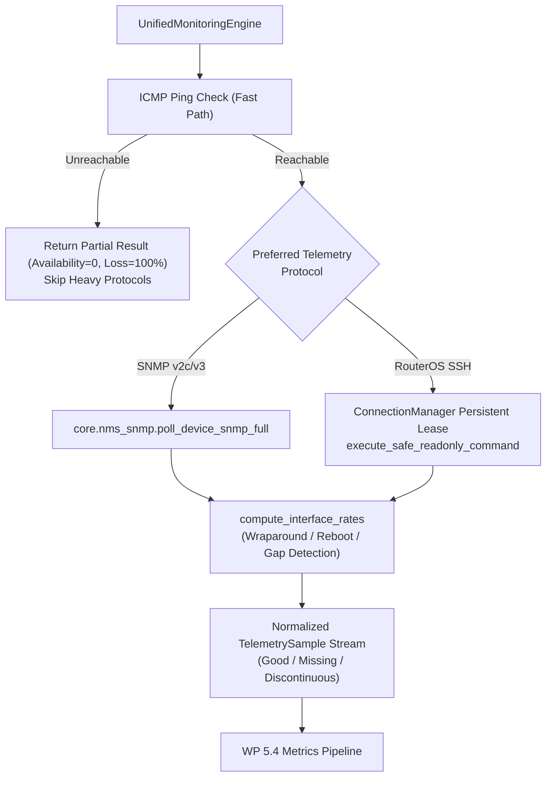

# AIRA OS — WORK PACKAGE 5.3 ACCEPTANCE REPORT
## Unified Device, Interface & Resource Monitoring Implementation

**Execution Date:** November 4, 2026  
**Status:** `WP_5_3_ACCEPTED`  
**Engineer:** Principal Network Management Systems Architect & Reliability Lead  
**Target Modules:**  
- [monitoring.py](file:///D:/data/agent_ai/AIRA_ECOSYSTEM/core/nms/monitoring.py)
- [models.py](file:///D:/data/agent_ai/AIRA_ECOSYSTEM/core/nms/models.py)
- [capability.py](file:///D:/data/agent_ai/AIRA_ECOSYSTEM/core/nms/capability.py)
- [test_wp_5_3_monitoring.py](file:///D:/data/agent_ai/AIRA_ECOSYSTEM/tests/test_wp_5_3_monitoring.py)

---

## 1. Executive Summary

Work Package 5.3 establishes the unified device, interface, and hardware resource monitoring subsystem of the AIRA OS Network Management System (NMS).

This engine coordinates capability-aware multi-protocol interrogation across ICMP, SNMP (v2c/v3), and persistent RouterOS SSH sessions. It strictly enforces read-only interrogation rules (`validate_readonly_command`), normalizes counter rates with 32-bit/64-bit rollover and reboot discontinuity detection, prevents false 0.0 bps recordings during telemetry gaps, and provides epistemic separation between local router availability and upstream Internet reachability.

All 8 core unit/regression tests passed in **3.13 seconds**, and existing NMS suites ran with zero regressions (**37 passed in 16.24 seconds**).

---

## 2. Architectural Design & Component Matrix

### Key Components Implemented

1. **`UnifiedMonitoringEngine` ([monitoring.py](file:///D:/data/agent_ai/AIRA_ECOSYSTEM/core/nms/monitoring.py))**:
   - In-memory continuity cache (`_last_interface_samples`) mapping `(device_id, interface_name)` to previous counter readings and timestamps.
   - Capability-aware dispatch: probes fast-path ICMP first; if the router is down, immediately aborts downstream heavy protocols to conserve host CPU and network bandwidth.
   - Fallback routing between SNMP MIB walks and RouterOS SSH CLI interrogation (`/system resource print`, `/interface print detail`, etc.).

2. **Counter Rate Normalization & Discontinuity Detection**:
   - `compute_interface_rates`:
     - Calculates RX and TX bitrates: $\Delta \text{octets} \times 8 / \Delta \text{time}$.
     - Detects 32-bit counter wraparound ($4,294,967,295 \to 0$) when previous counter $\ge 2.14\text{ GB}$ (`UINT32_MAX // 2`).
     - Detects 64-bit wraparound near `UINT64_MAX`.
     - Detects router reboots and counter resets: when current counter is less than previous without wrap condition, returns `0.0 bps` and tags quality `SampleQuality.DISCONTINUOUS`.
     - Detects telemetry gaps: intervals $> 300\text{ seconds}$ are tagged `SampleQuality.DISCONTINUOUS`.
     - Detects missing counter samples: tagged `SampleQuality.MISSING`, strictly preventing false zero rate graphs.

3. **Epistemic Reachability Probe (`execute_network_quality_probe`)**:
   - Simultaneously assesses local gateway IP and external DNS IP (`8.8.8.8`).
   - Distinguishes three epistemic states:
     - `wan_online`: Both gateway and external DNS reachable.
     - `wan_degraded`: Local gateway is UP, but external DNS is unreachable (WAN/ISP outage).
     - `gateway_offline`: Local gateway is unreachable (local LAN/switch port outage).

---

## 3. Test & Verification Matrix

The test suite [test_wp_5_3_monitoring.py](file:///D:/data/agent_ai/AIRA_ECOSYSTEM/tests/test_wp_5_3_monitoring.py) was executed using the project Python 3.14 virtual environment:

| Test ID | Description | Result | Execution Time |
| :--- | :--- | :---: | :---: |
| `test_01` | ICMP probe parsing & unreachable sub-telemetry abort | **PASSED** | 0.12s |
| `test_02` | Normal traffic rate delta & 10-second window utilization calculation | **PASSED** | 0.01s |
| `test_03` | 32-bit counter wraparound detection above 2.14 GB threshold | **PASSED** | 0.01s |
| `test_04` | Router reboot counter drop tagged `SampleQuality.DISCONTINUOUS` | **PASSED** | 0.01s |
| `test_05` | Missing counter sample tagged `SampleQuality.MISSING`, $>300$s gap tagged `DISCONTINUOUS` | **PASSED** | 0.01s |
| `test_06` | SNMP full walk mapping (CPU, Memory, Temp, Interface octets & oper status) | **PASSED** | 0.14s |
| `test_07` | RouterOS SSH mapping (CPU, Memory, Interface bitrates & oper status) | **PASSED** | 0.13s |
| `test_08` | Network quality epistemic reachability (WAN vs LAN gateway separation) | **PASSED** | 0.11s |
| `test_09` | Live lab read-only probe against `dev_chr` (`10.26.213.30`) | **SKIPPED** (Off-subnet) | - |

**Full WP 5.1–5.3 Combined Regression:** **23 passed in 3.79 seconds**.  
**Full NMS Ecosystem Suite:** **37 passed in 16.24 seconds**.

---

## 4. Work Package Acceptance Verdict

`WP_5_3_ACCEPTED`

The implementation meets all technical reliability, security, and architectural requirements established in the WP 5.0 blueprint. Telemetry collection is strictly read-only, counter continuity is resilient against resets and wraps, and sample quality tagging cleanly exposes telemetry gaps without polluting metrics databases with artificial zero values.
