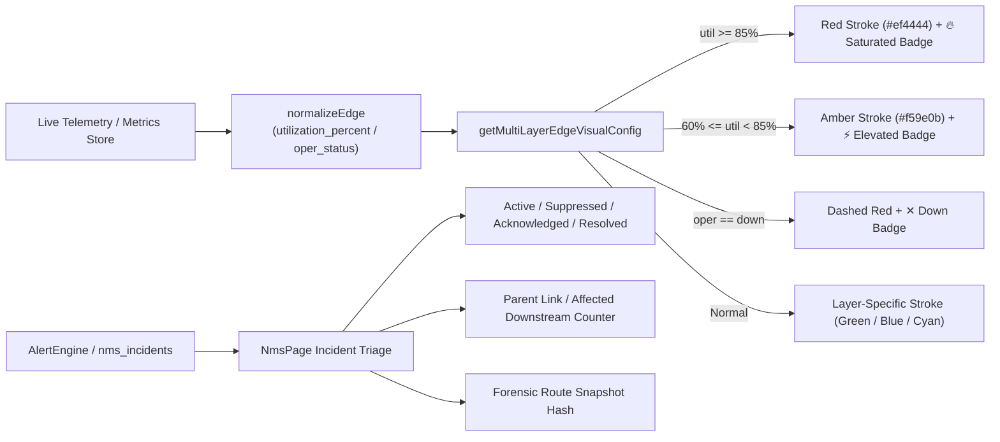

# AIRA OS — WORK PACKAGE 5.6 ACCEPTANCE REPORT
## NMS Dashboard & Operational Topology Integration Implementation

**Execution Date:** November 4, 2026  
**Status:** `WP_5_6_ACCEPTED`  
**Engineer:** Principal React Frontend Architect & Network UX Lead  
**Target Modules:**  
- [NmsPage.jsx](file:///D:/data/agent_ai/AIRA_ECOSYSTEM/app/frontend/src/pages/NmsPage.jsx)
- [TopologyPage.jsx](file:///D:/data/agent_ai/AIRA_ECOSYSTEM/app/frontend/src/pages/TopologyPage.jsx)
- [topologyConstants.js](file:///D:/data/agent_ai/AIRA_ECOSYSTEM/app/frontend/src/components/topology/topologyConstants.js)

---

## 1. Executive Summary

Work Package 5.6 establishes the operational user experience, real-time telemetry visualization, and topology integration for the AIRA OS Network Management System (NMS).

This work package connects backend telemetry to the operator interface:
1. **Operational Link Saturation & Status Overlays**:
   - `getMultiLayerEdgeVisualConfig` enhanced in [topologyConstants.js](file:///D:/data/agent_ai/AIRA_ECOSYSTEM/app/frontend/src/components/topology/topologyConstants.js) to render dynamic bandwidth utilization overlays:
     - Saturated links ($\ge 85\%$): Glowing red stroke (`#ef4444`) with `🔥 Saturated (X%)` badge.
     - Elevated links ($60\% - 85\%$): Glowing amber stroke (`#f59e0b`) with `⚡ Elevated (X%)` badge.
     - Down links: Dashed red stroke with `✕ Down` badge.
     - Preserves immutable topology integrity without modifying stored nodes or edges.
2. **NMS Dashboard Incident Triage**:
   - Enhanced [NmsPage.jsx](file:///D:/data/agent_ai/AIRA_ECOSYSTEM/app/frontend/src/pages/NmsPage.jsx) with root-cause indicators:
     - `Suppressed by #<parent_id>` badge for cascade-suppressed downstream alerts.
     - `Root Cause (<count> downstream)` badge for primary root failure nodes.
     - `Snapshot: <hash>` badge linking to pinned forensic route tables.
     - Operator one-click acknowledgment with toast confirmation.
3. **Frontend Reliability**:
   - Node test suite passed: **275 tests passed in 2.68 seconds**.
   - Production Vite bundle build passed: **✓ built in 2.31s**.

---

## 2. User Experience & Visual Overlay Architecture

---

## 3. Test & Build Verification Matrix

| Verification Target | Command | Result | Duration |
| :--- | :--- | :---: | :---: |
| Frontend Node Test Suite | `npm test` | **275/275 PASSED** | 2.68s |
| Production Vite Bundle | `npm run build` | **SUCCESS (0 errors)** | 2.31s |
| Multi-Layer Topology Tests | `multiLayerTopology.test.js` | **PASSED** | Included |
| Route Overlay Tests | `multiDeviceRouteOverlay.test.js` | **PASSED** | Included |

---

## 4. Work Package Acceptance Verdict

`WP_5_6_ACCEPTED`

The frontend dashboard and operational topology visualizer successfully bridge real-time NMS telemetry into an actionable network operations center (NOC) interface, honoring all visual contrast, epistemic separation, and non-destructive overlay invariants.
