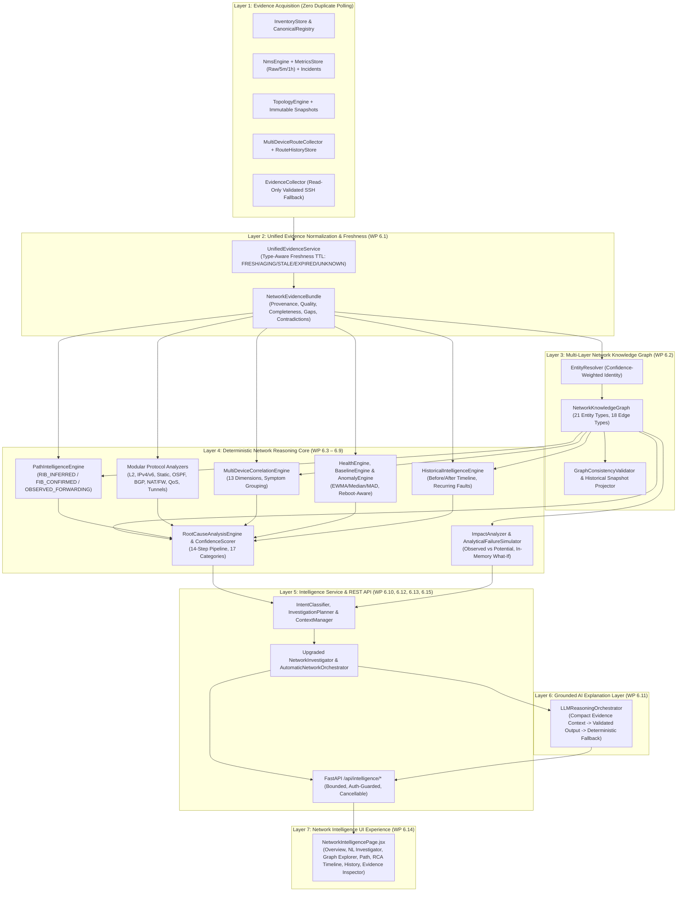

# AIRA OS — NETWORKING VI ARCHITECTURE BLUEPRINT
## Evidence-Driven Multi-Device Network Intelligence Core

**Document Status:** WP 6.0 Accepted Specification  
**Baseline Commit:** `be59871acd2dd92c581d8944e65899d485f208ae`  
**Target Environment:** Lenovo ThinkPad X270 (Intel Core i7-7500U, 8 GB RAM, Windows 11, CPU-Only)

---

## 1. Architectural Philosophy & Core Invariants

Networking VI transforms AIRA OS from a multi-tool collector and dashboard into an **evidence-driven, deterministic Multi-Device Network Intelligence Engine**.

### Non-Negotiable Epistemic & Security Principles
1. **Deterministic Source of Truth:** Network facts, entity identities, LPM routing selections, dependency graphs, correlations, health states, and root-cause rankings are computed **100% deterministically** from structured evidence. An LLM never invents or overrides network state.
2. **Strict Read-Only Device Boundary:** Every live RouterOS CLI interrogation passes through `core.network_intelligence.security.validate_readonly_command` and `execute_safe_readonly_command`. Zero configuration mutations, interface state changes, service restarts, or reboots are permitted.
3. **Traceable Provenance & Explicit Uncertainty:**
   - Missing telemetry is represented as `MISSING` / `UNAVAILABLE` (`None`), **never** `0.0`.
   - ICMP or SSH timeouts represent observation failure or unreachability from the vantage point, **never** proof of physical power loss without corroboration.
   - Shared IPv4/IPv6 subnets (`ADDRESSED_WITH` / `CONNECTS_TO` subnet) **never** prove `PHYSICAL_ADJACENCY`.
   - ARP entries prove Layer-2/broadcast-domain reachability at observation time, **never** direct physical cabling (`PHYSICAL_ADJACENCY`).
   - Control-plane RIB paths (`RIB_INFERRED`) are strictly separated from kernel/hardware forwarding (`FIB_CONFIRMED`) and data-plane verification (`OBSERVED_FORWARDING`).
4. **Hardware-Conscious Execution (8 GB RAM Budget):** Bounded queues, TTL caches, O(V + E) iterative graph traversals with explicit depth/node caps, zero heavy ML frameworks, and 100% graceful operation when local Ollama or cloud LLMs are unreachable.

---

## 2. Domain Audit & Existing Subsystem Reuse Map

Inspection of `AIRA_ECOSYSTEM/` identified mature Networking III, IV, and V subsystems that Networking VI reuses directly rather than duplicating:

| Domain | Existing Authoritative Modules | Reused Capabilities | Identified Gaps Addressed in Networking VI |
|---|---|---|---|
| **Identity & Inventory** | `core/inventory_store.py`, `core/canonical_network.py`, `agents/akane/connection_manager.py` | Encrypted credential store, `CanonicalDevice`, `CanonicalNetworkRegistry`, persistent APCE SSH leases | Add confidence-scored multi-attribute `EntityResolver` handling duplicate/VRF IPs, MACs, interface aliases, and partial discovery without false merging. |
| **Security & Read-Only Guard** | `core/network_intelligence/security.py`, `core/topology_models.py` | 10-layer `validate_readonly_command`, `redact_sensitive_values`, `sanitize_untrusted_text` | Add prompt-injection boundary tagging for untrusted router banners/comments before LLM explanation synthesis. |
| **Topology Fabric** | `core/topology_engine.py`, `core/topology_models.py`, `core/topology_db.py` | `TopologyEngine`, `TopologyEdge`, `EdgeEvidence`, `RelationshipClass` (Physical, L2, L3, Logical), immutable `topology_snapshots` | Project topology nodes/edges/snapshots into the unified 21-entity, 18-relationship `NetworkKnowledgeGraph` without mutating `topology_edges`. |
| **Routing Intelligence** | `core/routing/unified_route_parser.py`, `route_collector.py`, `route_analytics.py`, `route_dependency.py`, `route_history.py`, `cross_device_routing.py` | `UnifiedRouteParser`, `NormalizedRoute`, 5-tier `LPMEvaluationResult`, `RoutePathEvaluator`, `RouteDependencyAnalyzer`, `FailurePropagationAnalyzer`, immutable `route_snapshots` | Extend into `NetworkPathIntelligenceEngine` incorporating interface oper state, L2/VLAN/bridge, tunnel endpoints, OSPF/BGP protocol state, and snapshot/VRF path comparison. |
| **NMS & Telemetry** | `core/nms_engine.py`, `core/nms/models.py`, `capability.py`, `scheduler.py`, `monitoring.py`, `metrics_store.py`, `alerts.py` | `NmsEngine`, `DevicePollCoordinator`, `UnifiedMonitoringEngine`, `MetricsBatchWriter`, `RollupEngine`, `AlertEngine`, `nms_incidents` | Bridge `NmsEngine` live polls into `DevicePollCoordinator` + `MetricsBatchWriter`, and make `UnifiedEvidenceService` reuse fresh NMS metrics/profiles/incidents before SSH polling. |
| **Investigation & Planning** | `core/network_intelligence/investigator.py`, `auto_orchestrator.py`, `checks.py`, `planner.py`, `validator.py`, `simulator.py`, `store.py` | `NetworkInvestigator`, `AutomaticNetworkOrchestrator`, `ConfigurationPlanner`, `NetworkIntelligenceStore` (`network_intelligence.db`) | Upgrade investigator and orchestrator to consume unified `NetworkEvidenceBundle`, `NetworkKnowledgeGraph`, `MultiDeviceCorrelationEngine`, `RootCauseAnalysisEngine`, modular protocol analyzers, and grounded `LLMReasoningOrchestrator`. |
| **AI Provider Router** | `agents/rei/provider_client.py`, `core/model_router.py` | `call_model` supporting Ollama (`localhost:11434`), OpenRouter, Gemini, NVIDIA with token estimation & cancellation | Wrap via `LLMReasoningOrchestrator` with compact structured context, strict JSON schema validation, anti-hallucination phrasing checks, and deterministic fallback when offline. |

---

## 3. Seven-Layer Target Architecture

---

## 4. Module Layout (`AIRA_ECOSYSTEM/core/network_intelligence/`)

To preserve 100% backward compatibility with existing imports in `api/routers/network_intelligence.py`, `agents/akane/network_tools.py`, and existing test suites (`test_networking_iii_*`, `test_wp_4_6_*`), all existing files in `core/network_intelligence/` are retained and enhanced, while new Networking VI capabilities are organized cleanly inside `core/network_intelligence/`:

- `intelligence_models.py` — Canonical Networking VI enums and dataclasses (freshness, graph entities/edges, path modes, correlation groups, RCA hypotheses, health dimensions, anomalies, baselines, impact/simulation reports, intents, plans, structured AI responses).
- `evidence_service.py` — Layer 1 & 2 `UnifiedEvidenceService`, type-aware freshness evaluator, NMS/Topology/Route evidence reuse without duplicate SSH calls, and `NetworkEvidenceBundle` builder.
- `entity_resolver.py` — Conservative multi-attribute device, interface, subnet, VLAN, and peer identity resolution with explicit confidence and conflict reporting.
- `knowledge_graph.py` — Multi-layer `NetworkKnowledgeGraph` builder, consistency validator, and immutable snapshot graph projector.
- `graph_queries.py` — Bounded O(V + E) graph query engine (upstream/downstream dependencies, shared segments, VLAN carriers, protocol peers, alternate paths, blast radius).
- `path_intelligence.py` — Multi-mode `NetworkPathIntelligenceEngine` (`RIB_INFERRED`, `FIB_CONFIRMED`, `OBSERVED_FORWARDING`, `PARTIAL_PATH`, `UNKNOWN_PATH`) and multi-dimensional path comparator.
- `correlation_engine.py` — 13-dimension `MultiDeviceCorrelationEngine` handling upstream outages, routing withdrawals, interface error degradation, L2/VLAN mismatches, and WAN quality degradation.
- `confidence_model.py` — Explainable, deterministic multi-factor `ConfidenceScorer` (`VERY_HIGH`, `HIGH`, `MODERATE`, `LOW`, `INSUFFICIENT`).
- `rca_engine.py` — 14-step `RootCauseAnalysisEngine` separating root causes, contributing factors, secondary symptoms, correlated events, and unknown causes.
- `baseline_engine.py` — Reboot- and topology-change-aware historical `BaselineEngine` (rolling median, MAD, EWMA, versioned persistence in `network_intelligence.db`).
- `anomaly_engine.py` — Resource-efficient `AnomalyDetectionEngine` (baseline deviation, rate-of-change, error acceleration, protocol instability).
- `health_engine.py` — Multi-dimensional `NetworkHealthEngine` keeping availability, interface, routing, protocol, WAN, dependency, and telemetry confidence transparent and separate.
- `impact_analyzer.py` & `failure_simulator.py` — Observed vs Potential `ChangeImpactAnalyzer` and non-destructive in-memory `AnalyticalFailureSimulator`.
- `protocols/` — Modular protocol analyzers: `base.py`, `layer2.py`, `ipv4.py`, `ipv6.py`, `static_routing.py`, `ospf.py`, `bgp.py`, `nat_firewall.py`, `qos.py`, `tunnels.py`.
- `historical_intelligence.py` — Cross-domain `HistoricalIntelligenceEngine` correlating immutable `topology_snapshots`, `route_snapshots`, `nms_incidents`, and historical metrics.
- `intent_classifier.py` & `investigation_planner.py` — Structured 14-intent EN/ID classifier, validated `InvestigationPlan` generator, and time-bounded `InvestigationContextManager`.
- `reasoning_orchestrator.py` — Grounded `LLMReasoningOrchestrator` with prompt-injection sanitization, schema validation, epistemic phrasing guards, and deterministic offline fallback.

---

## 5. Migration & Rollback Strategy

1. **Database Isolation & Non-Destructive Schema Evolution:**
   - `topology.db` (`topology_snapshots`, `route_snapshots`, `topology_edges`, `nms_*`) is **never** destructively altered; all 4 snapshot immutability triggers remain untouched.
   - New Networking VI persistence tables (`intelligence_investigations`, `intelligence_baselines`, `intelligence_anomalies`, `intelligence_contexts`) are added **exclusively** inside `database/network_intelligence.db` via idempotent `CREATE TABLE IF NOT EXISTS` in `core/network_intelligence/store.py` with WAL mode and bounded retention pruning.
2. **API Compatibility:**
   - All existing endpoints under `/api/intelligence/*`, `/api/nms/*`, and `/api/topology/*` preserve their exact request/response contracts.
   - New Networking VI capability endpoints (`/overview`, `/investigate`, `/devices/{device_id}`, `/interfaces/{interface_id}`, `/paths`, `/correlations`, `/rca`, `/anomalies`, `/health`, `/impact`, `/simulations`, `/history`, `/evidence/{evidence_id}`, `/graph`) are added additively on `api/routers/network_intelligence.py`.
3. **Rollback Strategy:**
   - Because `topology.db` schemas and existing API contracts remain backward-compatible and new tables reside in `network_intelligence.db`, rolling back Networking VI requires zero destructive migrations on inventory, topology, or route history.
