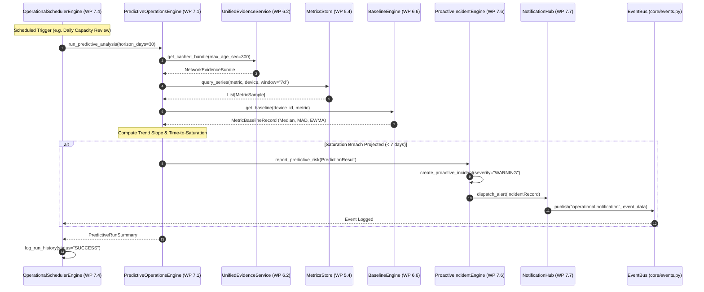

# AIRA OS — NETWORKING VII
# EXISTING CAPABILITY REUSE & INTEGRATION MATRIX
## Technical Audit & Anti-Duplication Proof (WP 7.0)

**Document Version:** 1.0.0  
**Phase:** Phase A — Architecture & Domain Audit  
**Work Package:** WP 7.0  
**Status:** AUTHORITATIVE SPECIFICATION  
**Scope:** Strict verification that Networking VII extends and reuses existing Networking IV, V, VI, and Core components without parallel architecture or duplicate subsystem creation.

---

## 1. Architectural Anti-Duplication Principles

AIRA OS has accumulated substantial, battle-tested engineering assets across Networking IV (Route Intelligence), Networking V (Network Management System), and Networking VI (Network Intelligence Core). 

In accordance with the Principal Architect Directive for Networking VII:
1. **No Parallel Schedulers for Device Polling:** We do NOT build a second device-polling engine. `HardenedNmsScheduler` in `core/nms/scheduler.py` remains the single authority for hardware telemetry polling.
2. **No Parallel Baseline or Anomaly Calculators:** We do NOT re-implement rolling median, MAD, or robust z-score logic. The `BaselineEngine` and `AnomalyEngine` in `core/network_intelligence/` are directly reused and extended for multi-window operations.
3. **No Parallel Graph or Topology Datastores:** `NetworkKnowledgeGraph` and `topology.db` remain the authoritative topology abstractions.
4. **No Parallel Event Systems:** `AIRA_ECOSYSTEM/core/events.py` is the single, thread-safe, correlation-aware EventBus.
5. **No Parallel Route Parsers or Simulators:** `FailureSimulator` and `ImpactAnalyzer` are extended for operational change impact simulation, preserving all underlying graph query logic.

---

## 2. Comprehensive Capability Reuse Matrix

| Operational Capability (Networking VII) | Existing Engine / Component | File Location | Existing Authority | Reuse Strategy in Networking VII | Reason / Anti-Duplication Guarantee |
| :--- | :--- | :--- | :--- | :--- | :--- |
| **Telemetry History & Baseline Data** | `UnifiedEvidenceService` | `core/network_intelligence/evidence_service.py` | Canonical multi-device evidence collector | **Direct Reuse** via `get_cached_bundle()` and `collect_evidence()` | Ensures predictive algorithms consume the exact same normalized evidence as RCA and health engines without re-querying devices. |
| **Statistical Baselines (Median, MAD, EWMA)** | `BaselineEngine` | `core/network_intelligence/baseline_engine.py` | Robust statistical baseline modeler | **Direct Reuse & Extension** | `PredictiveOperationsEngine` uses `BaselineEngine`'s stored median, MAD, and EWMA to establish normal bands across `1h`, `6h`, `24h`, `7d`, and `30d` windows. |
| **Anomaly Detection & Thresholds** | `AnomalyEngine` | `core/network_intelligence/anomaly_engine.py` | Epistemic anomaly detector & explainer | **Direct Reuse** | Proactive Incident Intelligence subscribes to anomalies emitted by `AnomalyEngine`, automatically grouping related anomalies into incidents. |
| **Failure Simulation Primitives** | `FailureSimulator` | `core/network_intelligence/failure_simulator.py` | In-memory analytical failure simulator | **Extension** | `ChangeImpactEngine` uses `FailureSimulator`'s node/edge disabling and alternate-path discovery primitives to simulate planned maintenance changes. |
| **Blast Radius & Downstream Dependency** | `ImpactAnalyzer` | `core/network_intelligence/impact_analyzer.py` | Graph-backed impact analyzer | **Extension** | `ChangeImpactEngine` delegates blast-radius calculations to `ImpactAnalyzer` while enriching the output with business service mappings. |
| **Topology & Knowledge Graph** | `NetworkKnowledgeGraph` | `core/network_intelligence/knowledge_graph.py` | Multi-layer entity-relationship graph | **Direct Reuse & Extension** | Reuses existing graph nodes (`device`, `interface`, `route`, `vlan`, `subnet`) and adds operational entities (`service`, `endpoint`, `maintenance_window`). |
| **Graph Querying & Traversal** | `GraphQueryEngine` | `core/network_intelligence/graph_queries.py` | Deterministic BFS/DFS path search | **Direct Reuse** | `ServiceIntelligenceEngine` calls `GraphQueryEngine` to trace dependencies from service IP endpoints down to physical switchports and router interfaces. |
| **L3 Path & Routing Reasoning** | `NetworkPathIntelligenceEngine` | `core/network_intelligence/path_intelligence.py` | Multi-device hop-by-hop path tracer | **Direct Reuse** | Evaluates secondary/backup transit paths when primary links are severed in pre-change simulations. |
| **Device Polling (SSH / SNMP)** | `HardenedNmsScheduler` | `core/nms/scheduler.py` | Bounded polling concurrency engine | **Strict Decoupling / No Modification** | Hardware polling remains isolated in NMS. The new `OperationalSchedulerEngine` NEVER touches hardware directly; it schedules analytical workflows only. |
| **Telemetry Metrics Store** | `MetricsStore` / SQLite | `core/nms/metrics_store.py` | Time-series metrics storage | **Direct Reuse** | `PredictiveOperationsEngine` queries historical metrics from `MetricsStore` for trend regression and capacity saturation forecasting. |
| **Event Distribution & WebSockets** | `EventBus` & `ws_bridge.py` | `core/events.py`, `api/ws_bridge.py` | Centralized async/sync pub/sub | **Direct Reuse** | All operational events (`job.started`, `job.completed`, `predictive.warning`, `incident.created`, `notification.dispatched`) publish to `EventBus`. |
| **Device Inventory & Identity** | `InventoryStore` & `CanonicalDevice` | `core/inventory_store.py`, `core/network_intelligence/network_models.py` | Hardware identity registry | **Direct Reuse** | `ServiceIntelligenceEngine` and `ChangeImpactEngine` resolve device targets using `CanonicalDevice` IDs and `InventoryStore`. |
| **Read-Only Command Safety** | `validate_readonly_command` & `ConnectionManager` | `core/network_intelligence/security.py`, `agents/akane/connection_manager.py` | Strict command whitelisting | **Direct Reuse** | Guarantees zero write or mutate commands can reach physical routers during any operational check. |
| **Root Cause Analysis (RCA)** | `RootCauseAnalysisEngine` | `core/network_intelligence/rca_engine.py` | Deterministic RCA hypothesis scorer | **Direct Reuse** | Proactive Incident Intelligence attaches RCA hypotheses to incidents when anomalies match degradation patterns. |
| **Persistence Database Engine** | `topology_db.py` | `core/topology_db.py` | SQLite connection manager with WAL | **Direct Reuse** | All 7 new operational tables reside in `topology.db` and leverage existing connection pooling, WAL mode, and transaction helpers. |

---

## 3. Subsystem Interaction and Data Flow

---

## 4. Anti-Duplication Verification Checklist

1. [x] **No Duplicate Schedulers:** Operational scheduler schedules tasks; NMS scheduler polls hardware. Zero overlap.
2. [x] **No Duplicate Graph Implementations:** All service nodes and change simulations use `NetworkKnowledgeGraph`.
3. [x] **No Duplicate Database Engines:** Uses existing `topology.db` with WAL mode and PRAGMA foreign keys.
4. [x] **No Duplicate Metrics Storage:** Reads from `MetricsStore` populated by Networking V.
5. [x] **No Duplicate Route Parsers:** Reuses `UnifiedRouteParser` via `NetworkEvidenceBundle`.
6. [x] **No Duplicate Command Execution:** Uses existing `safe_run_command()` and `ConnectionManager`.
7. [x] **No Duplicate Event Infrastructure:** Publishes directly to `EventBus` (`AIRA_ECOSYSTEM/core/events.py`).
