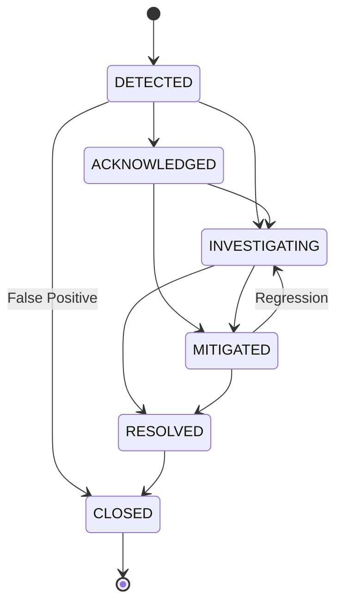

# AIRA OS — NETWORKING VII
# PROACTIVE INCIDENT INTELLIGENCE SPECIFICATION (WP 7.6)

**Module:** `AIRA_ECOSYSTEM/core/operations/incident_engine.py`  
**Data Models:** `AIRA_ECOSYSTEM/core/operations/models.py`  
**Database Table:** `operational_incidents`  
**Phase:** Phase G — Proactive Incident & Notification Intelligence  
**Status:** IMPLEMENTED & SPECIFIED

---

## 1. Overview & Operational Problem

Conventional incident management is reactive: tickets are created *after* users report outages or after circuits hard-fail.

The **Proactive Incident Intelligence Engine** bridges predictive forecasts and anomaly clusters to a formalized incident state machine *prior* to service degradation, orchestrating preventative remediation:
$$\text{Predictive Risk (Warning/Critical)} \longrightarrow \text{Proactive Incident} \longrightarrow \text{Automated Notification} \longrightarrow \text{Preventative Action}$$

---

## 2. Incident State Machine

### Transition Validation Rules:
- Direct transition from `DETECTED` to `RESOLVED` is prohibited (must be `INVESTIGATING` or `MITIGATED`).
- `CLOSED` is a terminal state.
- Transitioning to `RESOLVED` or `CLOSED` automatically stamps `resolved_at` in UTC.
