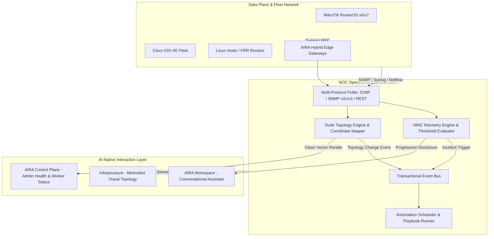

# AIRA OS — NOC Centre & Operational Backend Architecture
**Document Reference:** `docs/NOC_OPERATIONAL_ARCHITECTURE.md`  
**Phase:** Phase E — Dual-Site Platform, Identity, Superadmin, Subscriptions & NOC  
**Status:** Implemented & Verified

---

## 1. Executive Summary

In accordance with Directive Section 7:
> **"Kritik terhadap dashboard feature-heavy bukan berarti fungsi NOC dibuang. Fungsi NOC justru harus tetap hidup sebagai operational backend yang kuat, tetapi tidak membebani tampilan utama pengguna."**

The Network Operations Centre (NOC) capabilities have NOT been removed or simplified into mockups. Instead, the NOC has been restructured into an asynchronous, high-throughput **Operational Backend** that powers the minimalist AI Workspace and the AIRA Control Plane.

---

## 2. Core NOC Subsystems

### 2.1 Multi-Protocol Telemetry Engine (`core/nms_engine.py`)
- Continuously polls monitored network infrastructure across ICMP latency, SNMP interfaces (ifInOctets, ifOutOctets, ifErrors), CPU utilization, and memory headroom.
- Evaluates operational health scores dynamically ($0.0 - 100.0\%$).
- Detects link flapping, interface degradation, and unreachable nodes without manual engineer intervention.

### 2.2 The Dude Native Topology Engine (`core/topology_engine.py`)
- Full bidirectional coordinate mapping between physical network interfaces and visual graph layouts.
- Auto-discovers Layer 2/Layer 3 adjacencies via CDP, LLDP, and ARP tables.
- Computes shortest paths, blast radius impact for planned maintenance, and network bottleneck links.

### 2.3 Hybrid Edge Gateway Fleet (`core/edge_gateway/`)
- Facilitates secure cross-network orchestration across remote customer data centers, cloud VPCs, and isolated lab environments without exposing direct inbound SSH/API ports.
- Manages agent heartbeat synchronization, encrypted reverse tunnels, and local telemetry collection.

### 2.4 Event Bus & Incident Engine (`core/events.py`)
- Publishes operational notifications: `nms.incident_opened`, `topology.node_discovered`, `device.status_changed`.
- Automatically correlates cascading network alarms into single root-cause incidents to prevent alert fatigue.

---

## 3. Progressive Disclosure & AI-First Presentation

The difference between a legacy NOC dashboard and AIRA OS is **how operational intelligence is presented**:

| Operational Event | Legacy NOC Dashboard Behavior | AIRA OS AI-First Behavior |
|---|---|---|
| **Interface Drops Below Bandwidth Threshold** | Flashes dozens of colored cards, badges, and warning popups across the entire screen. | Quietly updates topology status; AI assistant summarizes: *"Interface ether2 on Core-Router-01 experienced 4% packet drop over the past 5 minutes. Would you like me to inspect route traffic?"* |
| **New Router Discovered** | Appends unformatted row to a table with 50 columns. | AI assistant informs engineer: *"Discovered MikroTik CCR2004 via LLDP on port sfp-sfpplus1. Topology has been updated."* |
| **BGP Peer Loss** | Triggers loud alarm sounds and confusing diagnostic graphs. | AI assistant analyzes root cause, verifies alternative routes, and offers single-click diagnostic playbook. |

---

## 4. Control Plane NOC Integration
For platform operators requiring deep telemetry diagnostics:
- **Module 7 (`Infrastructure & NOC`)** in AIRA Control Plane exposes raw backend worker threads, SQLite WAL transaction logs, database latency metrics, queue lengths, and gateway fleet health.
- Full access to historical metrics without polluting the minimalist client workspace.
