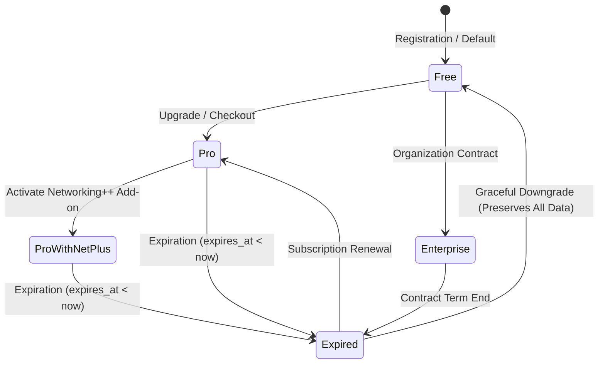

# AIRA OS — User Subscription & Entitlement Lifecycle
**Document Reference:** `docs/USER_SUBSCRIPTION_LIFECYCLE.md`  
**Phase:** Phase E — Dual-Site Platform, Identity, Superadmin, Subscriptions & NOC  
**Status:** Implemented & Verified

---

## 1. Overview & Subscription Philosophy

AIRA OS implements a user-specific subscription model that governs workspace autonomy, concurrent network diagnostics, live telemetry polling rates, and AI reasoning quotas.

Subscriptions are user-centric while maintaining tenancy awareness. Customer accounts receive a default base plan and can independently subscribe to the specialized **Networking++** operational add-on.



---

## 2. Product Tiers & Entitlement Matrix

| Dimension | FREE | PRO | ENTERPRISE |
|---|---|---|---|
| **Monthly Token Allocation** | 100,000 tokens | 2,000,000 tokens | 10,000,000 tokens |
| **Daily Token Limit** | 10,000 tokens | 200,000 tokens | 1,000,000 tokens |
| **Rate Limit** | 30 RPM | 120 RPM | 300 RPM |
| **Site Scope** | Single Site / Lab | Multi-Site Network | Multi-Tenant Global Fleet |
| **Topology Engine** | Standard SVG Topology | Path & Blast Radius Analytics | Full Dude Simulation & Path MTU |
| **NMS Telemetry** | Polled (Manual) | 30s Polling Cycle | 5s Live WebSocket Streaming |
| **Automations** | Manual Actions | Scheduled Intervals | Ansible Playbook Runner |
| **Networking++ Add-on** | Not Available | Optional Add-on (Rp 100.000) | Included |
| **Price (Monthly)** | Rp 0 | Rp 250.000 | Rp 1.500.000 |

### The Networking++ Specialized Add-on
Networking++ is an independent operational capability that unlocks:
- **Topology Intelligence:** Shortest path, alternative link failure impact, and blast radius calculations.
- **NMS Telemetry Live Stream:** Real-time metrics streaming over WebSockets with sub-second threshold alarms.
- **Vendor Configuration Synthesis:** Multi-vendor syntax translation (Cisco IOS-XE, Mikrotik RouterOS v6/v7, Linux FRR, Arista EOS).
- **Ansible-Compatible Playbook Execution:** Remote host fleet configuration, package inventory, and automated security auditing.

---

## 3. Subscription Expiration Engine

### 3.1 Background Expiration Sweeper
The background timer thread in `core/scheduler.py` automatically executes `UserSubscriptionService.check_and_expire_subscriptions()` every 60 seconds.

The query identifies any active subscription that has surpassed its expiration timestamp:
```sql
SELECT s.*, u.username
FROM operational_user_subscriptions s
JOIN operational_users u ON s.user_id = u.user_id
WHERE s.subscription_status = 'ACTIVE'
  AND s.expires_at IS NOT NULL
  AND s.expires_at < ?
```

### 3.2 Non-Destructive Downgrade Policy
In strict compliance with Directive Section 5:
> **"Pastikan konfigurasi, perangkat, atau data yang sudah dibuat oleh user tidak hilang saat subscription berakhir, namun akses ke fitur berbayar dinonaktifkan."**

When an account expires:
1. `subscription_status` transitions to `EXPIRED`.
2. `plan_id` downgrades to `FREE`.
3. `networking_addon_status` transitions to `0` (inactive).
4. `token_quota` drops to the Free allocation (100,000 tokens).
5. **ZERO CUSTOMER DATA DELETION:**
   - Saved router/switch inventory records are **never deleted**.
   - Custom topology layouts and nodes are **never deleted**.
   - Previous configuration backups and diffs are **never deleted**.
   - Custom automation definitions and playbooks are **never deleted**.
   - Historical audit logs and incident records are **never deleted**.
6. The customer retains full read access to view their existing devices and topology, but executing paid operations or Networking++ playbooks requires renewing the subscription.
7. An immutable audit record is appended to `operational_audit_log` detailing the automatic downgrade and confirming data preservation.

---

## 4. Database Schema: `operational_user_subscriptions`

```sql
CREATE TABLE IF NOT EXISTS operational_user_subscriptions (
    subscription_id TEXT PRIMARY KEY,
    user_id TEXT NOT NULL REFERENCES operational_users(user_id) ON DELETE CASCADE,
    tenant_id TEXT NOT NULL REFERENCES operational_tenants(tenant_id) ON DELETE CASCADE,
    plan_id TEXT NOT NULL DEFAULT 'FREE' CHECK(plan_id IN ('FREE', 'PRO', 'ENTERPRISE', 'CUSTOM')),
    subscription_status TEXT NOT NULL DEFAULT 'ACTIVE' CHECK(subscription_status IN ('PENDING', 'ACTIVE', 'EXPIRED', 'SUSPENDED', 'CANCELLED')),
    starts_at TEXT NOT NULL,
    expires_at TEXT,
    renewal_status TEXT NOT NULL DEFAULT 'MANUAL' CHECK(renewal_status IN ('AUTO', 'MANUAL', 'NONE')),
    token_quota INTEGER NOT NULL DEFAULT 100000,
    token_consumed INTEGER NOT NULL DEFAULT 0,
    networking_addon_status INTEGER NOT NULL DEFAULT 0,
    created_at TEXT NOT NULL,
    updated_at TEXT NOT NULL,
    UNIQUE(user_id)
);
```
