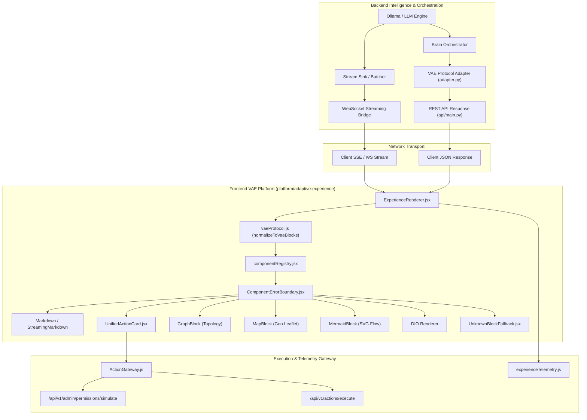

# VERA Adaptive Experience (VAE) — System Architecture

**Document Version:** 1.0.0  
**Status:** Active / Production Ready  
**Platform:** VERA Enterprise Network Intelligence Platform  
**Target Runtime:** Node.js, React, FastAPI, Python 3.15  

---

## 1. System Overview

**VERA Adaptive Experience (VAE)** is the unified presentation, rendering, and interaction architecture for the VERA Enterprise Network Intelligence Platform. It coordinates the lifecycle of AI-generated responses—spanning raw Markdown, streaming tokens, interactive DIO forms, high-precision visual network diagrams, and enterprise remediation action cards.

### Core Architecture Principles

1. **Separation of Concerns:**
   VAE maintains strict separation between:
   - **VAE Component Registry:** UI block presentation mapping (Markdown, Action Cards, Graphs, Maps, Mermaid).
   - **DIO Field Registry:** Dynamic form field schemas and input validation (`core/dio`).
   - **Backend Capability Registry:** Execution engines and tool RBAC authorization.

2. **Protocol Unification:**
   Both streaming deltas and non-streaming responses conform to the deterministic `VaePayload` and `VaeBlock` schemas. Legacy string and DIO outputs are seamlessly adapted via backward-compatible protocol normalizers.

3. **Application Security First:**
   - Authoritative identity derivation from session tokens (no caller-supplied identity spoofing).
   - Strict tenant boundary isolation.
   - Comprehensive SSRF and cloud metadata exfiltration prevention for external media.
   - Complete isolation of SVGs using DOMPurify and off-screen data-URI sandboxing.

---

## 2. Architectural Layers & Data Flow

---

## 3. Subsystem Breakdown

### 3.1 Protocol Layer (`core/vae` & `platform/adaptive-experience/protocol`)
- **Backend Models (`core/vae/models.py`):**
  Defines `VaeBlockType`, `VaeBlock`, and `VaePayload` with Pydantic validation.
- **Protocol Normalizer & Adapter (`core/vae/adapter.py`):**
  Translates legacy `BrainResponse` (text + `interaction_schema`) into standard VAE payload with zero breaking changes.
- **Frontend Protocol Normalizer (`vaeProtocol.js`):**
  Ensures any input—whether plain text, legacy message objects, or structured blocks—is normalized to valid block sequences with fallback UUIDs.

### 3.2 Registry Layer (`platform/adaptive-experience/registry`)
- **Registry Core (`registryCore.js`):**
  Pure JavaScript registry engine decoupling component lookup from JSX compilation, enabling instant Node test coverage.
- **Component Registry (`componentRegistry.jsx`):**
  Binds block types (`markdown`, `text`, `metric-card`, `dio-interaction`, `action-card`, `unified-action-card`, `graph`, `map`, `mermaid`) to React components.
- **Code-Splitting:**
  Heavy visual renderers (`UnifiedActionCard`, `GraphBlock`, `MapBlock`, `MermaidBlock`) are lazy-loaded with `<Suspense>`, preserving sub-2-second build times and minimal bundle size.

### 3.3 Security & Asset Governance Layer
- **P0 Identity Derivation Fix:**
  All permission simulation requests in `user_management.py` derive the effective user authoritatively from the verified session context (`ctx.user_id`). Client-side overrides are prohibited unless the caller possesses verified administrator privileges within the identical tenant.
- **Remote Image Policy (`imagePolicy.js`):**
  Rejects non-HTTP(S) schemes (blocks `javascript:`, `file:`, dangerous `data:` schemes). Blocks SSRF vectors targeting loopback (`127.0.0.0/8`, `localhost`), RFC 1918 private subnets (`10.0.0.0/8`, `172.16.0.0/12`, `192.168.0.0/16`), and cloud instance metadata endpoints (`169.254.169.254`). Enforces `referrerPolicy="no-referrer"`.
- **SVG Pipeline Consolidation (`svgBuilder.js`):**
  Unified SVG sanitizer, bounding box auto-measurer, and XML serializer shared by Markdown and DIO.

### 3.4 Interaction & Action Gateway (`platform/adaptive-experience/interactions`)
- **ActionGateway (`ActionGateway.js`):**
  Centralizes authorization simulation, capability execution, and human-in-the-loop approval decisions with unified error formatting.
- **UnifiedActionCard (`UnifiedActionCard.jsx`):**
  Consolidates command syntax, target devices, risk level badges, pre-flight RBAC simulation, and one-click execution approvals.

### 3.5 Diagnostic Telemetry (`platform/adaptive-experience/telemetry`)
- **ExperienceTelemetry (`experienceTelemetry.js`):**
  In-memory circular event buffer tracking component render timings, fallback occurrences, and interaction submission outcomes.

---

## 4. Streaming Lifecycle Integration

Streaming messages emitted via WebSocket or SSE pass through `IncrementalResponseParser` and `createStreamBatcher`:
1. Incremental text deltas stream directly into `StreamingMarkdown` without block recreation or DOM flicker.
2. Code fences, SVG blocks, and JSON structures are buffered until structurally complete before transitioning to specialized visual renderers.
3. Upon stream completion (`[DONE]`), the final message seamlessly renders via `ExperienceRenderer` with full interactive capabilities.
