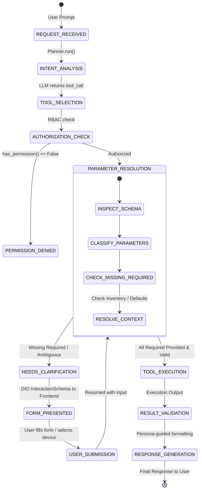

# AIRA OS — DYNAMIC INTERACTION ORCHESTRATOR (DIO) ARCHITECTURE AUDIT
**Date:** 2026-11-05  
**Workspace:** `D:\data\agent_ai`  
**System:** Dynamic Interaction Orchestrator (DIO)  
**Status:** COMPLETE (Phase 2)

---

## 1. System Overview & Core Purpose

The **Dynamic Interaction Orchestrator (DIO)** is AIRA's interactive conversational bridge between autonomous tool execution and human network engineers.

When an AI agent recognizes that:
1. A required tool parameter is **MISSING** (e.g. `interface_name` on a diagnostic tool),
2. A parameter is **AMBIGUOUS** (e.g. 5 routers in inventory and the user simply said "check my router"),
3. An operation requires **CONFIRMATION / APPROVAL** (e.g. dangerous config mutation), or
4. An external browser privilege is needed (e.g. browser GPS for maps),

DIO generates a structured, typed interactive UI schema (`InteractionSchema`) rendered natively in the frontend chat interface, halting execution and waiting for user input without failing or hallucinating fake values.

---

## 2. DIO Execution Flow & State Machine



---

## 3. Parameter Resolution & Classification Matrix

The DIO Parameter Resolution Engine evaluates all incoming tool call arguments against the tool's JSON schema according to strict rules:

| Status | Definition | Provenance Source | Action |
|---|---|---|---|
| **PROVIDED** | Explicitly supplied by user or tool invocation with valid value | `USER_INPUT` | Accepted after type & constraint validation |
| **CONTEXT_RESOLVED** | Derived from authoritative context (e.g. single inventory router) | `VERIFIED_DEVICE_INVENTORY` | Accepted with verified provenance |
| **DEFAULTED** | Defined explicitly in the official tool schema default field | `TOOL_SCHEMA_DEFAULT` | Default value populated into arguments |
| **MISSING** | Required by schema but absent from arguments and context | None | **Execution HALTED**. Generates interactive DIO form |
| **INVALID** | Fails type checking, constraint (min/max/regex), or enum check | `USER_INPUT` | **Execution REJECTED** with clear error message |
| **AMBIGUOUS** | Multiple valid matches exist (e.g. multiple devices match query) | `SESSION_CONTEXT` | **Execution HALTED**. Generates DIO selection choice |
| **NOT_APPLICABLE** | Argument passed by LLM but not present in tool schema | Unknown | **Stripped cleanly** to avoid Python keyword errors |

---

## 4. Parameter Provenance Tracking Contract

Every parameter evaluated by DIO carries a metadata provenance record:

```json
{
  "parameter": "device_name",
  "value": "router-core-01",
  "status": "PROVIDED",
  "source": "USER_INPUT",
  "confidence": 1.0,
  "validated": true,
  "schema_type": "string"
}
```

### Strict Provenance Rules:
1. **Never Fabricate Values:** Under no circumstances may DIO invent an IP address, interface name, VLAN ID, or router name.
2. **Preserve Truthy Falsy Values:** Boolean `false` and integer `0` are valid values and must NEVER be classified as missing.
3. **Empty Strings & Nulls:** If a required parameter is passed as `""` or `null`, it must be classified as `MISSING` or `INVALID`, never accepted as a valid technical parameter.
4. **Context Expiration:** Inventory and session context must verify device existence in active database records.

---

## 5. Tool Registry & Schema Audit

| Registry | Tools Count | Categories | High-Risk Tools |
|---|---|---|---|
| **REI** (`agents/rei/registry.py`) | 27 | filesystem, web, memory, interaction | write_file, delete_file (Sandboxed) |
| **AKANE** (`agents/akane/registry.py`) | 34 | network, diagnostics, config, devices | apply_config, delete_device, router_command |
| **HIKARI** (`agents/hikari/registry.py`) | 2 | nms, telemetry | None (Read-only) |
| **MAPS / ARTIFACTS** | 10+ | location, reporting | None |
| **Total Tools** | **73** | All categories | Protected by Backend RBAC |

---

## 6. Architecture Gaps & Remediation Plan

1. **Gap:** `core/orchestrator.py` previously only checked `device_name` in `_prepare_device_args()`. All other parameters bypassed validation and could trigger Python runtime crashes (`TypeError`).
2. **Remediation:** Introduce `DIOParameterResolver` (`core/dio/parameter_resolver.py`) as the universal interceptor in `Orchestrator._execute_tool()`.
3. **Result:** Universal safety across all 73 tools in the AIRA ecosystem.
