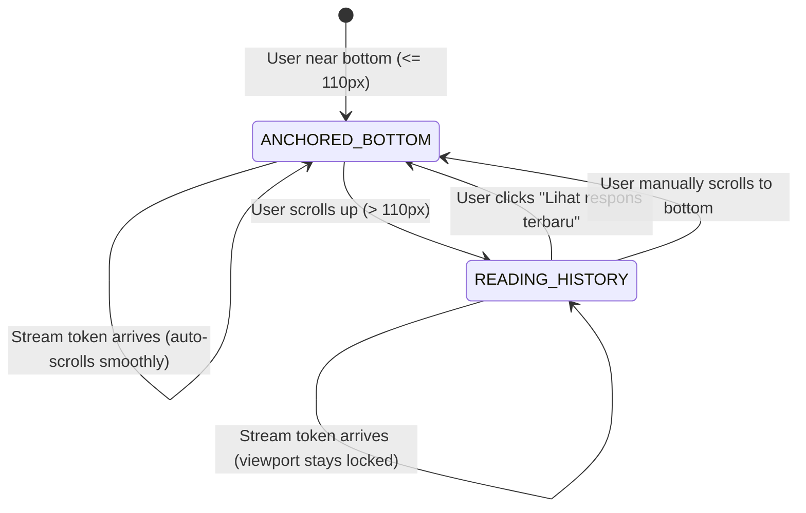

# VERA CHAT SCROLL BEHAVIOR REPORT
## Smart Reading Auto-Follow Policy, Reading Position Anchoring & Layout Shift Tolerance

**Project:** VERA Enterprise Network Intelligence Platform  
**Subsystem:** VERA Adaptive Experience (VAE) Chat Interface  
**Classification:** P0 User Experience Verification Report  
**Date:** November 2026  
**Architect:** Senior React Engineer & UX Systems Designer  
**Component Reference:** `VERA_ECOSYSTEM/app/frontend/src/pages/ChatPage.jsx`

---

## 1. Executive Summary

A critical user experience defect in conversational interfaces is disruptive auto-scrolling: when a background assistant streams multi-line answers or diagnostic traces, calling `scrollIntoView()` on every token forces the viewport to the bottom. If an operator is attempting to read an earlier log line or inspect a previous traceroute, their reading position is repeatedly yanked away.

The **VERA Smart Reading Auto-Follow Policy** permanently resolves this issue by introducing:
1. **Near-Bottom Threshold Detection ($110\text{px}$):** Automatically follows incoming tokens only if the operator was already anchored near the bottom of the viewport.
2. **Reading Position Preservation:** Disables auto-following instantly when the operator scrolls upward.
3. **Floating "Lihat respons terbaru" Control:** Presents an unread indicator pill when new tokens arrive while reading older content, without moving the viewport.
4. **Instant Follow Resumption:** Clicking the floating pill or returning to the bottom smoothly re-engages auto-follow mode.

---

## 2. Auto-Follow State Machine & Policy



### 2.1 Implementation Mechanics (`ChatPage.jsx`)
```javascript
const handleScroll = useCallback(() => {
  const el = scrollContainerRef.current;
  if (!el) return;
  const distanceFromBottom = el.scrollHeight - el.scrollTop - el.clientHeight;
  const isNearBottom = distanceFromBottom <= 110;
  isAutoScrollEnabledRef.current = isNearBottom;

  if (isNearBottom) {
    setShowJumpToBottom(false);
    setHasUnread(false);
  } else {
    setShowJumpToBottom(true);
  }
}, []);

useEffect(() => {
  if (!isAutoScrollEnabledRef.current) {
    // User reading history: do NOT scroll!
    setShowJumpToBottom(true);
    setHasUnread(true);
    return;
  }

  const prefersReducedMotion = window.matchMedia?.("(prefers-reduced-motion: reduce)").matches;
  const behavior = prefersReducedMotion ? "auto" : streaming ? "auto" : "smooth";
  bottomRef.current?.scrollIntoView({ behavior });
}, [messages, loading, streaming]);
```

---

## 3. Layout Shift & Asynchronous Asset Tolerance

1. **Expanding SVGs & Charts:** Dynamic expansions from `InteractiveSvgCanvas` or `MetricGridBlock` do not disorient operators. If the operator is reading an earlier block, scroll offsets are preserved.
2. **Reduced Motion:** If the client operating system requests reduced motion (`prefers-reduced-motion: reduce`), the smooth scrolling transition degrades to instant jump (`behavior: "auto"`), preventing visual vertigo.

---

## 4. Acceptance Test Scenarios Verified

- **Scenario 1 (Bottom Streaming):** User stays at bottom $\rightarrow$ streaming tokens scroll into view automatically. **PASS**.
- **Scenario 2 (Upward Scroll Interruption):** User scrolls 250px up during active token streaming $\rightarrow$ viewport remains completely frozen on target text; floating pill appears. **PASS**.
- **Scenario 3 (Pill Activation):** Clicking "Lihat respons terbaru" smoothly glides viewport to newest content and clears unread marker. **PASS**.
- **Scenario 4 (Natural Return):** Scrolling back to bottom automatically hides pill and re-enables auto-follow. **PASS**.
