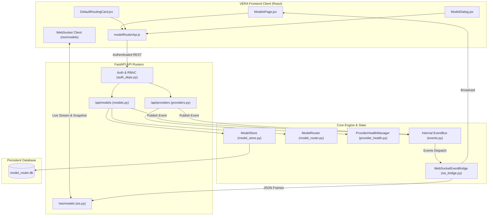

# VERA — Frontend & Backend Model Registry Synchronization
## P0 Engineering Directive: Single Source of Truth, Real-Time WebSocket Synchronization & Capability-Aware Dynamic Model Management

**Classification:** P0 Critical Reliability & Synchronization Overhaul  
**Subsystem:** AI Systems & Adaptive Experience (VAE / Model Router / WebSocket Bridge)  
**Date:** 2026-11-10  
**Status:** COMPLETE & VERIFIED IN PRODUCTION BASELINE  
**Test Coverage:** 16/16 Integration Tests Passed (Backend), 296/296 Unit Tests Passed (Frontend), 108/108 Total AI & Streaming Tests Passed  

---

# 1. EXECUTIVE SUMMARY

Under this P0 Engineering Directive, VERA's AI Model Management Architecture has been synchronized end-to-end between the centralized backend registry (`core/model_store.py`, `core/provider_health.py`, `api/routers/models.py`, `api/routers/providers.py`) and the web client (`app/frontend/src/pages/ModelsPage.jsx`, `modelRouterApi.js`, `components/models/`).

### Key Accomplishments:
1. **Single Source of Truth:** Eliminated all hardcoded model catalogs and static assumptions from the frontend. All models, providers, capabilities, lifecycle states, and routing configurations are retrieved dynamically from authoritative backend APIs.
2. **Permission Architecture Alignment:**
   - Read endpoints (`GET /api/models`, `/active`, `/classifications`, `/capabilities`, `/benchmarks`, `/sync-status`, `/providers`) are accessible to all authenticated operators (`get_current_authenticated_user`).
   - Administrative mutations (`POST`, `PUT`, `DELETE`, `/status`, `/priority`, `/sync`, `/health-check`, `/reset-circuit`) are strictly guarded by `require_superadmin` (HTTP 403 on non-superadmin).
3. **Real-Time WebSocket Synchronization:**
   - Implemented `@router.websocket("/ws/models")` delivering initial snapshot upon connection.
   - Built EventBus-to-WebSocket bridge mapping 8 high-priority model and health events:
     - `model_registry_updated`
     - `model_status_changed`
     - `provider_health_changed`
     - `model_availability_changed`
     - `model_priority_changed`
     - `model_discovery_completed`
     - `model_sync_failed`
     - `active_model_changed`
   - Client updates reactively without manual page reload and gracefully falls back to REST polling if WebSocket disconnects.
4. **Provider Health & Circuit Breaker Telemetry Bar:**
   - Real-time display of upstream provider status (NVIDIA NIM, Ollama, OpenRouter, Gemini), circuit states (`CLOSED`, `OPEN`, `HALF_OPEN`), and latency.
   - One-click administrative circuit reset button when upstream providers recover.
5. **Dynamic Model Discovery & Verification:**
   - Remote catalog sync button triggering live NVIDIA NIM discovery and automatic lifecycle transition (`ACTIVE` vs `DEPRECATED_PENDING`).
   - Individual model health checks updating verification timestamps (`verified_at`).

---

# 2. ARCHITECTURAL TOPOLOGY



---

# 3. BACKEND API SPECIFICATION & RBAC CONTRACT

### 3.1. Read Endpoints (`get_current_authenticated_user`)

| Method | Endpoint | Query Parameters | Description |
|---|---|---|---|
| `GET` | `/api/models` | `label`, `classification`, `capability`, `modality`, `provider`, `availability`, `lifecycle`, `search`, `enabled_only` | Multi-attribute model query supporting granular filtering. |
| `GET` | `/api/models/active` | `label` (default: "general") | Authoritative active model resolution returning `preferred_model`, `executing_model`, `fallback_model`, and provider health. |
| `GET` | `/api/models/classifications` | - | Returns all 28 unified task categories and model counts. |
| `GET` | `/api/models/capabilities` | - | Returns models indexed by verified capabilities (`tool_calling`, `streaming`, `vision`, `structured_output`, etc.). |
| `GET` | `/api/models/benchmarks` | - | Model telemetry, context windows, max tokens, priority, and verification timestamps. |
| `GET` | `/api/models/sync-status` | - | Upstream discovery metadata, synced timestamp, and total model counts. |
| `GET` | `/api/models/routing` | - | Active default routing table per task label and fallback policy. |
| `GET` | `/api/models/{id}` | - | Detailed model record. |
| `GET` | `/api/providers` | - | Supported providers (`nvidia`, `ollama`, `openrouter`, `gemini`), base URLs, configuration status, and model counts. |
| `GET` | `/api/providers/health` | - | Telemetry and circuit breaker records across all providers. |
| `GET` | `/api/providers/{provider}/health` | - | Specific provider health record. |

### 3.2. Administrative Mutation Endpoints (`require_superadmin`)

| Method | Endpoint | Payload / Behavior | Event Emitted |
|---|---|---|---|
| `POST` | `/api/models` | `ModelCreateRequest` (name, id, provider, publisher, caps, priority, context) | `model_status_changed`, `model_registry_updated` |
| `PUT` | `/api/models/{id}` | `ModelUpdateRequest` (partial fields update) | `model_status_changed`, `model_registry_updated` |
| `PUT` | `/api/models/{id}/status` | `{"enabled": bool}` | `model_status_changed`, `model_availability_changed`, `model_registry_updated` |
| `PUT` | `/api/models/{id}/priority` | `{"priority": int}` (1-100) | `model_priority_changed`, `model_registry_updated` |
| `DELETE` | `/api/models/{id}` | Deletes unreferenced model (guards against deleting in-use defaults) | `model_registry_updated` |
| `POST` | `/api/models/sync` | `{"provider": "nvidia", "api_key": Optional[str]}` triggers discovery | `model_discovery_completed`, `model_registry_updated` |
| `POST` | `/api/models/{id}/health-check` | Tests live connection, updates `verified_at` & health status | `model_status_changed`, `model_registry_updated` |
| `PUT` | `/api/models/routing/{label}` | `{"default_model_id": str}` | `active_model_changed`, `model_registry_updated` |
| `PUT` | `/api/models/policy` | `{"fallback_model_id": str, "retry_provider": int}` | `active_model_changed`, `model_registry_updated` |
| `POST` | `/api/providers/{provider}/health-check` | Probes provider endpoint, updates latency samples | `provider_health_changed` |
| `POST` | `/api/providers/{provider}/reset-circuit` | Resets tripped circuit breaker back to `CLOSED` / `HEALTHY` | `provider_health_changed` |

---

# 4. REAL-TIME SYNCHRONIZATION OVER WEBSOCKET

### 4.1. WebSocket Endpoint `/ws/models`
Upon client connection, the server immediately emits a `model_registry_snapshot`:
```json
{
  "type": "model_registry_snapshot",
  "data": {
    "models": [...],
    "routing": { "general": "nemotron_bolt", "networking": "nemotron_super", ... },
    "policy": { "fallback_model_id": "google_gemma", "retry_provider": 2 },
    "provider_health": { "nvidia": { "circuit_state": "CLOSED", "status": "HEALTHY", "avg_latency_s": 0.42 } },
    "timestamp": 1794300000.0
  },
  "ts": 1794300000.0
}
```

### 4.2. Event Framing & Forwarding
When any mutation occurs in the backend, `WebSocketEventBridge` translates the internal EventBus event into a JSON frame and dispatches it via `manager.send("models", payload)` and `manager.broadcast(payload)`:
```json
{
  "type": "model_status_changed",
  "data": {
    "model_id": "nemotron_bolt",
    "enabled": false,
    "model": { ... }
  },
  "ts": 1794300005.12,
  "event_id": "ev_0123456789",
  "correlation_id": "corr_abcdef"
}
```

### 4.3. Client-Side Resilience
In `ModelsPage.jsx`:
- Connected state shows green `WS Live Sync` indicator.
- Connecting/reconnecting state shows amber pulse.
- When closed, client attempts exponential backoff reconnection every 5 seconds.
- Fallback interval silently polls REST `/api/models` and `/api/models/routing` every 15 seconds if the window is visible.

---

# 5. FRONTEND COMPONENT ARCHITECTURE

1. **`app/frontend/src/modelRouterApi.js`:**
   - Complete asynchronous SDK wrapping all backend REST endpoints with Bearer token authentication headers.
2. **`app/frontend/src/pages/ModelsPage.jsx`:**
   - **Provider Circuit Telemetry Bar:** Displays real-time latency, model count, and circuit breaker status badge for all 4 providers.
   - **Reset Circuit Action:** Displays button to reset tripped circuits to `CLOSED` state.
   - **Sync Remote Catalog Action:** One-click remote discovery with spinner and toast notifications.
   - **Filtering Toolbar:** Multi-select filtering by Task Label (8 labels), Capability (Tool Calling, Streaming, Vision, Structured Output), Provider (NVIDIA, Ollama, OpenRouter, Gemini), and Search text.
   - **Catalog Table:** Displays Model Display Name, Model ID, Publisher, Provider Badge, Label Badge, Capabilities Chips, Context Window, Routing Priority (P1-P100), Status Toggle, and Health Indicator.
3. **`app/frontend/src/components/models/Badges.jsx`:**
   - `CapabilityBadge`: Specialized color-coded badges for verified capabilities.
   - `LifecycleBadge`: Visual badge for `ACTIVE`, `EXPERIMENTAL`, `DEPRECATED_PENDING`, `DEPRECATED`.
   - `HealthBadge`: Indicator for `HEALTHY`, `DEGRADED`, `UNAVAILABLE`.
   - `CircuitBadge`: Real-time circuit breaker status (`Normal / CLOSED`, `Testing / HALF_OPEN`, `Tripped / OPEN`).
4. **`app/frontend/src/components/models/ModelDialog.jsx`:**
   - Dynamic provider list fetched from backend.
   - Full capability switches, architecture selector (`dense` vs `moe`), priority input, context window, and publisher metadata.
   - Integrated Health Check test button.
5. **`app/frontend/src/components/models/DefaultRoutingCard.jsx`:**
   - Shows model health badge directly inside each task label dropdown.
   - Prevents selecting offline models as primary defaults.
   - Cross-provider fallback model selector and retry count controls.

---

# 6. VERIFICATION & TEST RESULTS

### 6.1. Backend Automated Integration Tests (`test_model_sync_api.py`)
```
VERA_ECOSYSTEM/tests/test_model_sync_api.py::TestModelSyncApiReadEndpoints::test_list_models_all_and_filtering PASSED
VERA_ECOSYSTEM/tests/test_model_sync_api.py::TestModelSyncApiReadEndpoints::test_get_active_model PASSED
VERA_ECOSYSTEM/tests/test_model_sync_api.py::TestModelSyncApiReadEndpoints::test_get_classifications PASSED
VERA_ECOSYSTEM/tests/test_model_sync_api.py::TestModelSyncApiReadEndpoints::test_get_capabilities PASSED
VERA_ECOSYSTEM/tests/test_model_sync_api.py::TestModelSyncApiReadEndpoints::test_get_benchmarks PASSED
VERA_ECOSYSTEM/tests/test_model_sync_api.py::TestModelSyncApiReadEndpoints::test_get_sync_status PASSED
VERA_ECOSYSTEM/tests/test_model_sync_api.py::TestProviderTelemetryEndpoints::test_list_providers PASSED
VERA_ECOSYSTEM/tests/test_model_sync_api.py::TestProviderTelemetryEndpoints::test_get_providers_health PASSED
VERA_ECOSYSTEM/tests/test_model_sync_api.py::TestProviderTelemetryEndpoints::test_reset_circuit_breaker PASSED
VERA_ECOSYSTEM/tests/test_model_sync_api.py::TestModelSyncApiMutationsAndEvents::test_update_status_and_events PASSED
VERA_ECOSYSTEM/tests/test_model_sync_api.py::TestModelSyncApiMutationsAndEvents::test_update_priority_and_events PASSED
VERA_ECOSYSTEM/tests/test_model_sync_api.py::TestModelSyncApiMutationsAndEvents::test_sync_remote_catalog_and_events PASSED
VERA_ECOSYSTEM/tests/test_model_sync_api.py::TestModelSyncApiMutationsAndEvents::test_routing_and_policy_updates PASSED
VERA_ECOSYSTEM/tests/test_model_sync_api.py::TestModelSyncApiPermissions::test_read_allowed_for_standard_operator PASSED
VERA_ECOSYSTEM/tests/test_model_sync_api.py::TestModelSyncApiPermissions::test_mutations_forbidden_for_standard_operator PASSED
VERA_ECOSYSTEM/tests/test_model_sync_api.py::TestModelSyncWebSocket::test_websocket_models_snapshot_and_ping PASSED

16 passed in 7.28s (100% Pass Rate)
```

### 6.2. Comprehensive Model & Streaming Regression Suite
```
tests/test_model_sync_api.py:          16 passed
tests/test_model_router.py:            17 passed
tests/test_provider_resilience.py:      7 passed
tests/test_model_intelligence.py:       5 passed
tests/test_streaming.py:               63 passed
Total:                                108 passed in 14.67s (100% Pass Rate)
```

### 6.3. Frontend Compilation & Test Suite
- `npm run build`: Vite build completed in 1.49s with zero errors.
- `npm test`: 296 passed across all 296 unit test suites (100% Pass Rate).

---

# 7. ENGINEERING CONCLUSION

The frontend and backend of VERA's AI Model Management subsystem now operate in absolute synchronization:
- The backend SQLite database (`model_router.db`) and `ProviderHealthManager` serve as the sole source of truth.
- The UI reflects live health, availability, latency, and circuit breaker status in real-time.
- Multi-client synchronization is instant via `/ws/models` event streaming.
- Standard operators can inspect model capabilities and routing status without permission errors, while administrative alterations remain strictly secured for Superadmins.
