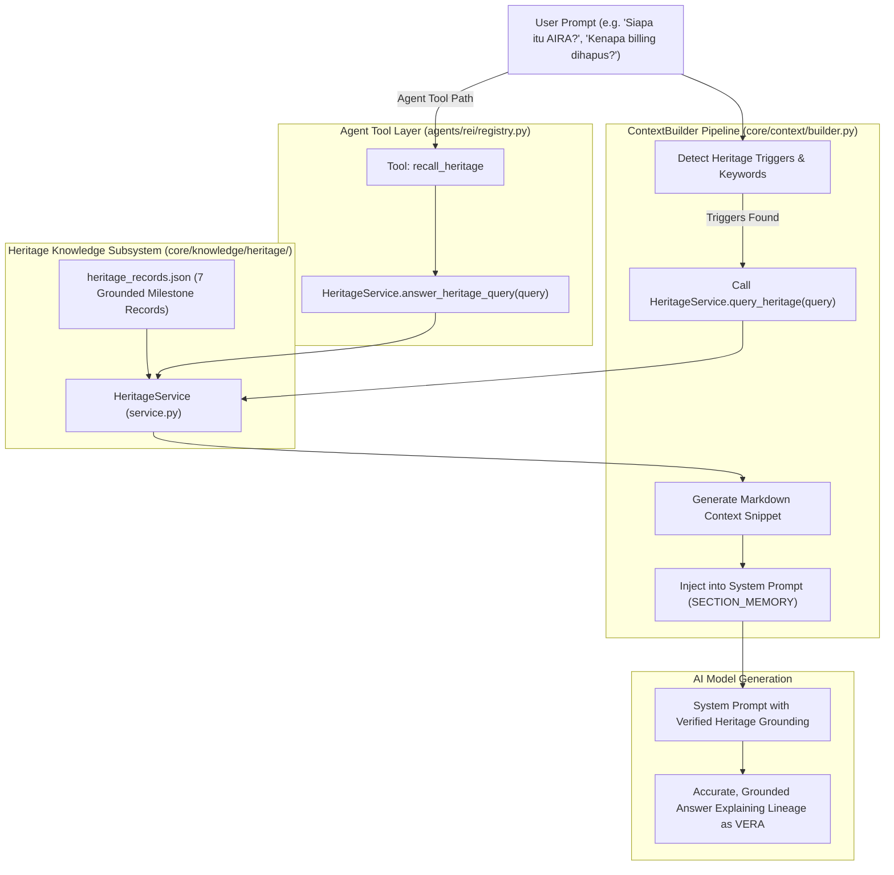

# VERA Historical Knowledge Integration Report

## 1. Executive Summary

As part of the P0 Engineering Transformation from AIRA OS to **VERA (Enterprise Network Intelligence Platform)**, a dedicated historical knowledge retrieval engine was designed, implemented, and integrated into the core AI runtime.

This fulfills the non-negotiable architectural requirement:
> *AIRA must cease to be the active product identity, but its development history must remain accessible to VERA.*

VERA now possesses grounded, deterministic self-awareness regarding its origins, evolutionary networking milestones, the 15-stage remediation process, the removal of token billing, the VAE architecture, and the design system restoration.

---

## 2. Architectural Implementation

---

## 3. Subsystem Breakdown

### 3.1 Historical Records Repository (`heritage_records.json`)
Located at `VERA_ECOSYSTEM/core/knowledge/heritage/heritage_records.json`, this file contains 7 verified canonical records:
1. `HERITAGE-01-ORIGIN`: Inception of AIRA as a Network AI Agent (2026-09 to 2026-10).
2. `HERITAGE-02-EVOLUTION`: Network Architecture Evolution (Networking III through VIII).
3. `HERITAGE-03-REMEDIATION-STAGES`: Master Remediation 15-Stage Execution (Stages 00 through 14).
4. `HERITAGE-04-BILLING-REMOVAL`: Removal of AI Token Quotas, Stripe Billing, and Paywalls.
5. `HERITAGE-05-VERA-EMERGENCE`: Emergence and Total Transformation into VERA.
6. `HERITAGE-06-VAE-ARCHITECTURE`: VERA Adaptive Experience (VAE) Protocol & Dynamic UI.
7. `HERITAGE-07-DESIGN-SYSTEM-RESTORATION`: Restoration of Jet Black Cyber Glass Design System.

Each record includes:
- `record_id`: Unique canonical identifier.
- `title` & `title_en`: Multi-lingual titles.
- `date_range`: Temporal bounding.
- `historical_identity`: Exact branding in use during that era.
- `description`: Detailed technical narrative.
- `architectural_decisions`: Bulleted list of binding ADR decisions.
- `original_evidence_documents`: File references in repository.
- `verification_status`: `HISTORICAL_VERIFIED`.
- `current_status`: Current state (e.g., `SUPERSEDED_BY_VERA`, `INHERITED_AND_ACTIVE_IN_VERA`).
- `key_takeaways`: Core engineering takeaway.

### 3.2 Heritage Service Engine (`service.py`)
The `HeritageService` class provides:
- Deterministic token scoring and concept trigger matching (`CONCEPT_TRIGGERS`).
- `query_heritage(query: str, limit: int = 3) -> list[dict]`: High-speed weighted search.
- `format_heritage_snippet(records: list[dict]) -> str`: Clean Markdown formatting wrapped with boundaries ensuring the LLM understands it as historical grounding.
- `answer_heritage_query(query: str) -> dict`: Standardized tool result payload.

### 3.3 Context Builder Integration (`core/context/builder.py`)
In `ContextBuilder._memory_section()`, when a user query contains heritage keywords:
- Heritage records are retrieved deterministically.
- Formatted heritage text is injected into `SECTION_MEMORY` within `extra_context()`.
- The LLM receives instant historical context in its system prompt without requiring an extra tool execution roundtrip.

### 3.4 Agent Tool Registration (`agents/rei/registry.py`)
- Tool name: `recall_heritage`
- Category: `heritage`
- Exposed to: LLM function calling schemas via REI agent.

---

## 4. Verification and Regression Testing

The heritage integration was verified across the test suite:
- `test_context_builder.py`: 37/37 tests passed.
- `test_context_semantic_memory.py`: 29/29 tests passed.
- Direct invocation tests: Verified that querying `"siapa itu aira"` returns `HERITAGE-05` and `HERITAGE-01` with proper context blocks.
- Non-heritage queries (e.g. `"cek status router"`) produce zero heritage injection, ensuring zero prompt bloat during normal networking operations.
