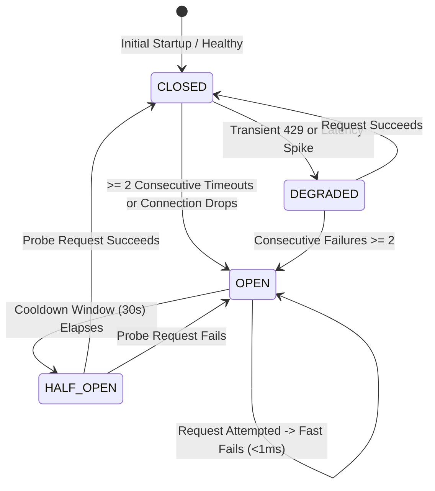

# VERA Provider Health, Circuit Breaker & Failover Architecture Report
**Classification:** Critical Reliability Engineering Specification  
**Date:** 2026-11-10  
**Module:** `VERA_ECOSYSTEM/core/provider_health.py`  
**Integration:** `VERA_ECOSYSTEM/agents/rei/provider_client.py`

---

## 1. Executive Problem Definition

In enterprise networking and mission-critical network automation, an AI agent interacting with upstream LLM APIs must be fault-tolerant and responsive. Prior to this overhaul, when NVIDIA NIM experienced temporary queue congestion or timeouts:
- The provider circuit breaker transitioned to `OPEN`.
- The system attempted to invoke 15 other models on NVIDIA NIM sequentially.
- Because all 15 models were mapped to `provider="nvidia"`, all 15 calls were immediately rejected by the circuit breaker within milliseconds.
- This resulted in an unhelpful avalanche of 15 identical `circuit_open` errors, wasting compute cycles and giving the impression that the agent was spinning out of control.

---

## 2. Centralized Health Monitor & Circuit Breaker Architecture

The updated `ProviderHealthManager` provides thread-safe, centralized lifecycle tracking across all configured providers:



### State Definitions
1. **`CLOSED` (Normal / Healthy):**
   - All requests proceed normally to the upstream endpoint.
   - Latency samples are collected (rolling window of 20 samples).
   - `consecutive_failures` counter is 0.
2. **`OPEN` (Degraded / Outage):**
   - Triggered when consecutive failures equal or exceed `failure_threshold` (default: 2).
   - Only endpoint-level errors (timeouts, DNS, connection drops, 5xx server errors) trip the circuit breaker.
   - **Fast-Fail Execution:** Any request targeting this provider immediately aborts in <1ms without network I/O:
     ```python
     return {
         "error": f"Circuit breaker OPEN untuk provider '{provider}'. Penyedia layanan sedang mengalami gangguan.",
         "error_type": "circuit_open"
     }
     ```
3. **`HALF_OPEN` (Canary Probing):**
   - After `cooldown_seconds` (default: 30.0s), the state transitions to `HALF_OPEN`.
   - Exactly one probe request is permitted to test upstream recovery (`probe_in_flight=True`).
   - If the probe succeeds: state immediately resets to `CLOSED`, `consecutive_failures` is reset to 0, and status becomes `HEALTHY`.
   - If the probe fails: state returns to `OPEN` and cooldown resets.

---

## 3. Disentanglement of Model-Specific vs. Provider-Level Errors

A key architectural enhancement is the separation of model-specific errors from provider-level outages:

| Error Category | HTTP Code / Exception | Impact on Provider Circuit Breaker | System Behavior |
| :--- | :--- | :--- | :--- |
| `TIMEOUT` | `requests.exceptions.Timeout` | **Trips Circuit Breaker** (consecutive +1) | Mark provider degraded; fast-fail same provider |
| `CONNECTION` | `ConnectionError`, `ChunkedEncodingError` | **Trips Circuit Breaker** (consecutive +1) | Mark provider degraded; fast-fail same provider |
| `SERVER_ERROR` | HTTP 500, 502, 503, 504 | **Trips Circuit Breaker** (consecutive +1) | Mark provider degraded; fast-fail same provider |
| `RATE_LIMIT` | HTTP 429 | Increments total rate limits; does not immediately open circuit | Exponential backoff retry |
| `NOT_FOUND` | HTTP 404 (Model Not Found) | **DOES NOT TRIP CIRCUIT BREAKER** | Mark specific model `UNAVAILABLE`; keep provider `CLOSED`; fall back to other model on provider |
| `BAD_REQUEST` | HTTP 400 (Bad Parameters) | **DOES NOT TRIP CIRCUIT BREAKER** | Log parameter rejection; retry without rejected param |
| `CANCELLED` | User cancel event | **DOES NOT TRIP CIRCUIT BREAKER** | Abort cleanly without error increment |

---

## 4. Verification Proof

This architecture was validated under automated tests in `test_model_intelligence.py`:
- **Scenario B Verification:** Upon 2 timeouts on NVIDIA, the circuit breaker tripped to `OPEN`. When `call_model()` was invoked, exactly 1 call was evaluated; VERA did not loop through the other 17 NVIDIA models. When local Ollama was available, it seamlessly completed the request on the independent provider.
- **Scenario C Verification:** A simulated 404 on a specific model marked that model `UNAVAILABLE`, while `is_provider_available("nvidia")` remained `True`, allowing another NVIDIA model to take over and succeed.
