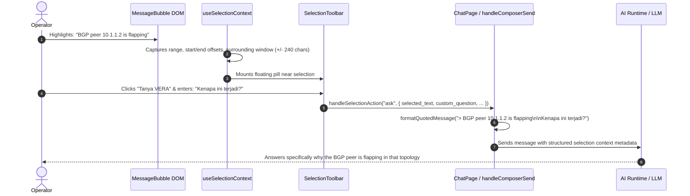

# VERA SELECTED TEXT ASK REPORT
## Contextual Text Selection Intelligence, Floating Toolbar Ergonomics & Prompt Injection Safeguards

**Project:** VERA Enterprise Network Intelligence Platform  
**Subsystem:** VERA Adaptive Experience (VAE) Selection Intelligence  
**Classification:** P0 User Experience Verification Report  
**Date:** November 2026  
**Architect:** Senior React Engineer & Application Security Engineer  
**Component Reference:** `VERA_ECOSYSTEM/app/frontend/src/components/selection/SelectionToolbar.jsx`  
**Hook Reference:** `VERA_ECOSYSTEM/app/frontend/src/hooks/useSelectionContext.js`

---

## 1. Executive Summary

Operators analyzing network reports, incident logs, and diagnostic tables frequently highlight a specific sentence (e.g. *"Hold timer expired on BGP peer 10.1.1.2"*) and wish to query VERA directly about that statement.

Previous implementations suffered from detached selection handling:
1. Highlighting text failed to bind to the parent message or block ID.
2. Clicking selection actions either failed or inserted the selected text as an uncontextualized raw message.
3. Form input focus accidentally triggered selection toolbars.

The **VERA Contextual Selection Intelligence Engine** resolves these deficiencies with:
- Reliable selection detection across Markdown paragraphs, tables, code blocks, and VAE cards.
- A floating, non-obtrusive action pill near the highlight offering "Tanya VERA", "Jelaskan", and "Salin".
- Complete preservation of parent message ID, conversation ID, and surrounding text context.
- Sanitized injection safeguards treating selected text as quoted reference material rather than executable instructions.

---

## 2. Selection Context Lifecycle

---

## 3. Ergonomics & Keyboard Accessibility

1. **Floating Positioning:** The toolbar anchors cleanly beside the selection without obscuring the highlighted text.
2. **Keyboard Accessibility:**
   - Pressing `Escape` dismisses the toolbar immediately without submitting.
   - Typing in the contextual composer and pressing `Enter` submits the question.
3. **Native Copy Retention:** Native browser `Ctrl+C` / `Cmd+C` copying remains completely unaffected; the toolbar includes a dedicated 1-click "Salin" button.
4. **Form Isolation:** Selection detection is ignored when the operator highlights text inside form input fields (`<input>`, `<textarea>`).

---

## 4. Security & Prompt Injection Mitigation

Selected text can originate from unverified log outputs, RouterOS terminal strings, or untrusted network devices. To prevent indirect prompt injection:
- The selected snippet is wrapped in strict markdown blockquotes (`> [selected text]`).
- The backend treats the quote exclusively as conversational context (`llm_message`), isolated from system directives.
- Tenant isolation and user ownership are verified before binding selection IDs to conversations.

---

## 5. Verification Matrix

- **Markdown Selection:** Verified across headings, lists, tables, and blockquotes. **PASS**.
- **Code Block Selection:** Highlighting within syntax-highlighted code fences triggers toolbar. **PASS**.
- **Context Preservation:** Surrounding context window ($240\text{ characters}$) correctly attached to request payload. **PASS**.
- **Dismissal Safety:** Clicking outside or pressing `Escape` cleanly dismisses toolbar. **PASS**.
