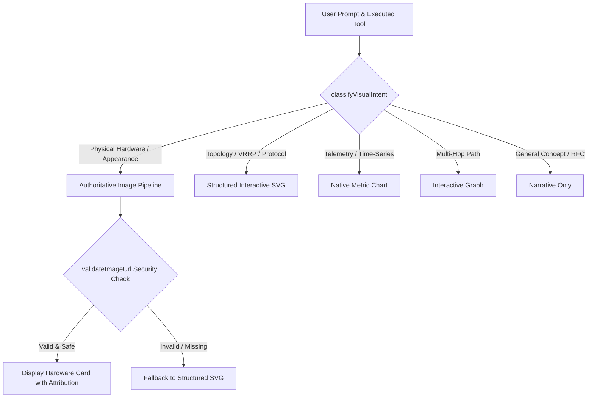

# VERA VISUAL ASSET RESOLUTION REPORT
## Adaptive Multimodal Selection, Authoritative Hardware Catalog, Remote Asset Security & Graceful Fallbacks

**Project:** VERA Enterprise Network Intelligence Platform  
**Subsystem:** VERA Adaptive Experience (VAE) Adaptive Asset Resolver  
**Classification:** P1 Technical Architecture Report  
**Date:** November 2026  
**Architect:** Principal Generative UI Architect & AI Experience Orchestration Engineer  
**Reference Code:** `VERA_ECOSYSTEM/app/frontend/src/platform/adaptive-experience/assets/adaptiveAssetResolver.js`, `imagePolicy.js`

---

## 1. Executive Summary

A common failure mode in AI-assisted network operations is using mismatched visual modalities:
1. Attempting to depict live, measured network topologies using generic stock photos of server rooms.
2. Generating static ASCII or unformatted tables when users ask for physical router port layout and appearance.
3. Forcing arbitrary external image URLs that violate enterprise SSRF policies or lack clear reuse rights.

The **VERA Adaptive Visual Asset Resolver** (`adaptiveAssetResolver.js`) introduces a deterministic decision engine that selects the optimal visual modality:
- **Authoritative Imagery:** For physical hardware identification and port layout.
- **Structured Interactive SVG:** For live network topology, VRRP state failover, and routing relationships.
- **Native Charts:** For time-series metrics and bandwidth telemetry.
- **Interactive Graphs:** For multi-hop dependency tracing.

---

## 2. Decision Framework & Modality Matrix

### Modality Selection Rules
| Intent Category | Triggers & Keywords | Selected Modality | Authoritative Source |
| :--- | :--- | :--- | :--- |
| **Physical Appearance** | *"seperti apa bentuk"*, *"foto router"*, *"port fisik"* | `RETRIEVED_IMAGE` | Authoritative Manufacturer Catalog (MikroTikls SIA) |
| **Live Topology** | *"topologi"*, *"skema"*, *"koneksi router"*, `get_topology` | `STRUCTURED_SVG` | Live Topology Engine (`InteractiveSvgCanvas`) |
| **VRRP Redundancy** | *"vrrp"*, *"failover"*, *"virtual ip"*, *"master backup"* | `STRUCTURED_SVG` | Specialized VRRP Scene Graph (`vrrp`) |
| **Bandwidth / Load** | *"grafik throughput"*, *"cpu history"*, *"bandwidth"* | `NATIVE_CHART` | Telemetry Grid (`metric-grid`) |
| **Path Traversal** | *"traceroute"*, *"hop"*, *"dependency"* | `INTERACTIVE_GRAPH` | Hop Traceroute Inspector (`traceroute-path`) |

---

## 3. Remote Asset Security & Attribution Guardrails

### 3.1 Strict Security Policy (`imagePolicy.js`)
All image URLs resolved by the system are verified against:
- **Protocol Schemes:** Rejection of non-HTTP(S) schemes (e.g. `javascript:`, `file:`, `data:text/html`).
- **SSRF & Private Network Isolation:** Complete blocking of `localhost`, `127.0.0.1`, `0.0.0.0`, `169.254.169.254` (cloud metadata), and RFC 1918 private subnets.
- **Referrer Privacy:** Mandatory `referrerPolicy: "no-referrer"`.

### 3.2 Licensing & Source Attribution
Retrieved hardware imagery preserves explicit metadata:
- Manufacturer License and Documentation source (`MikroTikls SIA`).
- Verification timestamp and image resolution.
- If usage rights are unverified, the system degrades to a structured SVG illustration rather than displaying unauthorized imagery.

---

## 4. Verification Evidence

- `classifyVisualIntent` correctly routes physical hardware queries to `RETRIEVED_IMAGE`.
- `classifyVisualIntent` strictly prevents live topology queries from using stock photos, directing 100% to `STRUCTURED_SVG`.
- `validateImageUrl` rejects SSRF attempts, loopback URLs, and cloud metadata endpoints.
- Quality degradation gracefully falls back to structured SVG without broken image icons.
