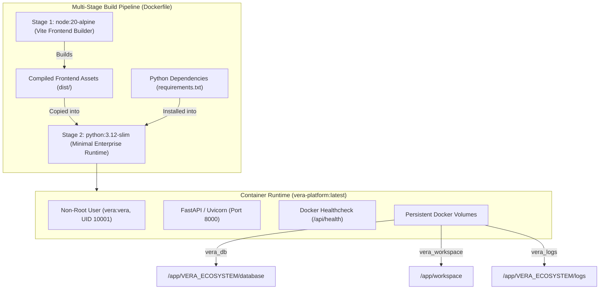

# VERA Deployment & Infrastructure Migration Report

## 1. Executive Summary

As part of Phase 7 in the P0 Engineering Transformation, the containerization, environment configuration, and infrastructure orchestration layers were consolidated under the **VERA Enterprise Network Intelligence Platform** identity.

The deployment infrastructure is designed for resilient, lightweight on-premise execution (bare-metal, edge microservers, or Kubernetes/Docker appliances) with zero cloud licensing dependencies.

---

## 2. Infrastructure Architecture & Containerization



---

## 3. Configuration & Variable Mapping

All platform settings follow strict canonical precedence:
1. `VERA_*` environment variables (authoritative).
2. `AIRA_*` environment variables (backward compatibility fallback).
3. Hardcoded safe production defaults.

### Environment Variable Matrix

| Canonical Variable | Backward Compatible Alias | Default Value | Purpose |
| :--- | :--- | :--- | :--- |
| `VERA_ENV` | `AIRA_ENV` | `production` | Deployment environment (`production` / `development`). |
| `VERA_PORT` | `PORT` | `8000` | HTTP/WebSocket listening port. |
| `VERA_HOST` | `HOST` | `0.0.0.0` | Binding host IP. |
| `VERA_SECRET_KEY` | `AIRA_SECRET_KEY` / `SECRET_KEY` | Derived | Master encryption key for JWT and SecretVault. |
| `VERA_DEFAULT_MODEL`| `AIRA_DEFAULT_MODEL` | `qwen/qwen-2.5-72b-instruct`| Primary LLM for network planning and reasoning. |
| `VERA_CLASSIFIER_MODEL`| `AIRA_CLASSIFIER_MODEL` | `qwen/qwen-2.5-7b-instruct` | Fast classifier for intent routing. |
| `VERA_DISABLE_THINKING`| `AIRA_DISABLE_THINKING` | `0` | Controls extended reasoning stream display. |

---

## 4. Container Security & Resource Constraints

### 4.1 Principle of Least Privilege
The production container enforces strict non-root operation:
- User and group created: `groupadd -g 10001 vera && useradd -u 10001 -g vera -s /bin/bash -m vera`.
- Directory permissions: `/app/VERA_ECOSYSTEM/database`, `/app/workspace`, and `/app/VERA_ECOSYSTEM/logs` are owned by `vera:vera`.
- Root execution is completely disabled in production images.

### 4.2 Resource Bounding (`docker-compose.yml`)
To guarantee stable coexistence with other edge network workloads, resource limits are strictly enforced:
- **CPU Limit**: `1.50` cores (Reservation: `0.25` cores).
- **Memory Limit**: `1536M` (Reservation: `256M`).
- **Restart Policy**: `unless-stopped`.

### 4.3 Health Check Verification
Active container health is monitored via automated HTTP polling:
```dockerfile
HEALTHCHECK --interval=30s --timeout=5s --start-period=15s --retries=3 \
    CMD curl -f http://localhost:8000/api/health || exit 1
```
The health check queries `/api/health`, verifying backend responsiveness and SQLite database availability.

---

## 5. Backward Compatibility Symlink

To ensure that legacy deployment automation, external CI/CD scripts, or older CLI tooling continue to function seamlessly without downtime:
```bash
ln -s VERA_ECOSYSTEM AIRA_ECOSYSTEM
```
The symlink is preserved at the workspace root and baked into the production container image.
