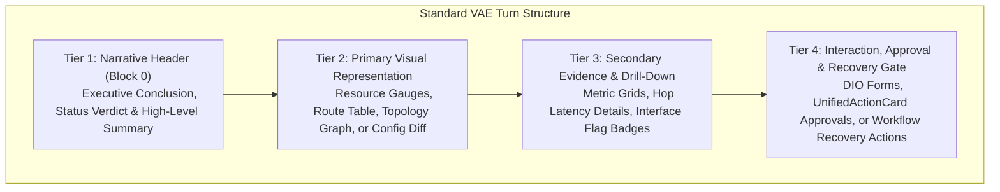

# VERA ADAPTIVE LAYOUT SPECIFICATION
## Responsive Composition Patterns, Structural Hierarchy & Multi-Device Experience Orchestration

**Project:** VERA — Enterprise Network Intelligence Platform  
**Subsystem:** VERA Adaptive Experience (VAE)  
**Classification:** P0 Technical Specification  
**Date:** November 2026  
**Architect:** Principal Generative UI Architect & Frontend Platform Architect  
**Implementation:** `VERA_ECOSYSTEM/app/frontend/src/platform/adaptive-experience/ExperienceRenderer.jsx`

---

## 1. Structural Hierarchy & The Four-Tier Composition Rule

Every conversational turn rendered via VAE follows a strict **Four-Tier Composition Hierarchy**. This ordering ensures cognitive clarity, immediate operational awareness, and zero confusion between informational text and actionable controls.



### Tier 1: Narrative Header (Mandatory Block 0)
- **Role:** Deliver an immediate, evidence-grounded operational verdict without requiring the user to interpret raw charts.
- **Rules:** Must never begin with raw tables or tool execution logs. Must state whether the system is healthy, degraded, or in need of intervention.

### Tier 2: Primary Visual Representation
- **Role:** Render the core visual entity matching the task intent (e.g., `resource-gauge` for resource queries, `route-table-view` for routing, `config-diff` for script changes).
- **Rules:** One primary visual representation per turn. Complex multi-entity views must use tabbed or drill-down structures.

### Tier 3: Secondary Evidence & Drill-Down
- **Role:** Provide contextual breakdown and empirical evidence supporting Tier 2 (e.g., storage disk counters under CPU gauges, per-hop jitter under a traceroute).
- **Rules:** Collapsible on smaller viewports to prevent vertical scroll fatigue.

### Tier 4: Interaction, Approval & Recovery Gate
- **Role:** Provide actionable controls when user intervention, authorization, or recovery is needed.
- **Rules:** When a workflow error occurs, the `workflow-recovery` block occupies this tier with prefilled, context-preserving recovery options.

---

## 2. Multi-Device Responsive Breakpoints

VAE layouts adapt dynamically across three enterprise operational form factors:

| Form Factor | Viewport Width | Layout Architecture | Block Behavior |
| :--- | :--- | :--- | :--- |
| **Desktop / Cockpit** | $\ge 1280\text{px}$ | Multi-column grid / Split view | Primary visuals and secondary metrics render side-by-side ($2:1$ or $1:1$ ratio). |
| **Laptop / Tablet** | $768\text{px}\text{ to }1279\text{px}$ | Flexible stacked grid | Visual gauges scale to full width; metric cards collapse to 2-column grids. |
| **Mobile / Field Tech** | $< 768\text{px}$ | Linear single-column stack | Tables become scrollable cards; gauges scale to compact badges; recovery buttons full width. |

---

## 3. Specialized Layout Patterns

### 3.1 Pattern A: Stacked Diagnostic Flow (Default)
Used for standard diagnostic queries (`ping`, `traceroute`, `resource`).
```
+-------------------------------------------------------+
| Narrative: "Router hAP-ac-lite beroperasi optimal..." |
+-------------------------------------------------------+
| [Primary Gauge: CPU 14%] [RAM 15.3%] [Disk 50.0%]     |
+-------------------------------------------------------+
| [Metric Grid: Uptime 2w4d | Version 6.49.10 | Model]  |
+-------------------------------------------------------+
```

### 3.2 Pattern B: Split-View Investigation (Incident / RCA)
Used for incident investigations requiring simultaneous reading of evidence logs and topology inspection.
- **Left Pane ($60\%$):** Narrative conclusion, incident summary card, root-cause explanation.
- **Right Pane ($40\%$):** `investigation-timeline` with chronological evidence pins and telemetry snapshots.

### 3.3 Pattern C: Guided Recovery Flow (Workflow Recovery)
Used whenever a backend operational tool encounters an error or conflict.
```
+-------------------------------------------------------+
| Narrative: "Pendaftaran perangkat tidak dapat..."     |
+-------------------------------------------------------+
| [Warning Badge: ⚠ Tindakan pemulihan diperlukan]     |
+-------------------------------------------------------+
| [WorkflowRecoveryBlock]                               |
| - Header: Konflik Pendaftaran (DUPLICATE_RESOURCE)     |
| - Existing Resource Context Card: CHR @ 192.168.0.1   |
| - Action Choices:                                     |
|   (o) Route A: Perbarui Data 'CHR' [Primary]          |
|   ( ) Route B: Ubah Nama Pendaftaran                  |
|   ( ) Route C: Lihat Rincian                          |
| - Embedded Pre-filled Form:                           |
|   [Host: 192.168.0.1] [Port: 22] [User: admin]        |
|   [Action: Perbarui Sekarang]                         |
+-------------------------------------------------------+
```

---

## 4. Layout Spacing & Overflow Management

1. **Horizontal Containment:** All tabular data (`route-table-view`, `interface-status`) must employ `overflow-x-auto` with sticky header support and distinct column widths.
2. **Vertical Rhythm:** Consistent 16px (`gap-4` / `space-y-4`) vertical rhythm between blocks. Internal card padding is standardized at 16px (`p-4`) or 20px (`p-5`).
3. **Card Boundaries:** Rounded corners (`rounded-xl` or `rounded-2xl`) with subtle 1px border (`border-white/10` or `border-slate-800`) against dark backgrounds (`#090D16` / `#0D1527`).
