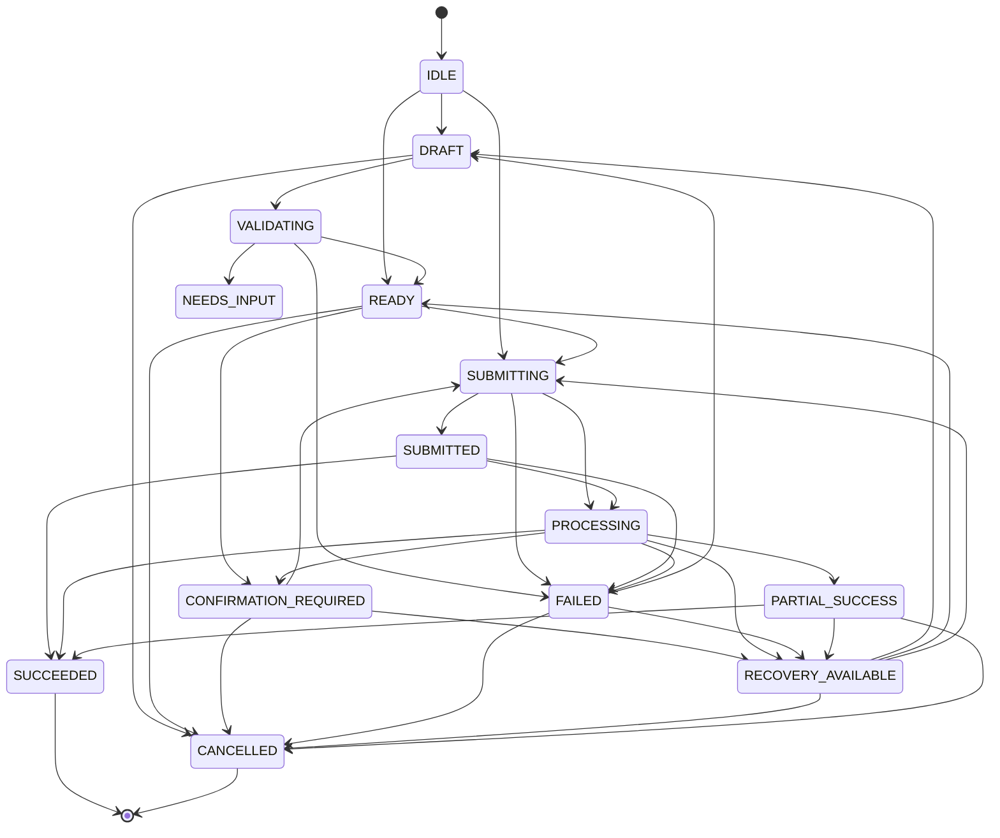

# VERA INTERACTION LIFECYCLE SPECIFICATION
## Formal 14-State Machine, Permitted Transition Graph, Accurate Status Communication & Audit Framework

**Project:** VERA — Enterprise Network Intelligence Platform  
**Subsystem:** VERA Adaptive Experience (VAE)  
**Classification:** P0 Technical Specification  
**Date:** November 2026  
**Architect:** Principal Generative UI Architect & AI Systems Engineer  
**Backend Implementation:** `VERA_ECOSYSTEM/core/vae/interaction.py`  
**Frontend Implementation:** `VERA_ECOSYSTEM/app/frontend/src/platform/adaptive-experience/ExperienceRenderer.jsx`

---

## 1. Executive Problem Statement

In previous versions of the platform, the interaction between user-facing form components and backend tool execution suffered from a severe lifecycle de-synchronization:

1. **Premature Success Signaling:** When an operator clicked "Kirim Formulir" on a device onboarding form, the frontend immediately rendered a green checkmark banner stating: `"✓ Form sudah dikirim."`
2. **Deceptive User Experience:** The banner was displayed prior to the backend completing tool execution. When the tool failed (e.g., due to duplicate names, SSH authentication failures, or unreachable network hosts), the UI showed a contradictory juxtaposition: a green success banner directly above a red error message.
3. **Loss of Interaction State:** Upon showing the success banner, the form was cleared, leaving the operator unable to adjust the input and retry without starting from scratch.

To permanently eradicate this defect, VERA implements a **Universal 14-State Interaction Lifecycle Engine**.

---

## 2. The 14 Interaction States

Every interactive workflow (device onboarding, config updates, credentials, automation) is governed by 14 formal states:

| State | Classification | Description | User Interface Presentation |
| :--- | :--- | :--- | :--- |
| **`IDLE`** | Initial | Workflow has not started; no user interaction has occurred. | Neutral form / prompt. |
| **`DRAFT`** | Authoring | Operator is actively editing form fields or adjusting parameters. | Active form with editable fields. |
| **`VALIDATING`** | Pre-flight | Client-side and schema validation rules are being evaluated. | Subtle inline spinners on field inputs. |
| **`READY`** | Validated | All required inputs satisfy constraints; ready for submission. | Enabled "Kirim" / "Submit" button. |
| **`SUBMITTING`** | Transit | HTTP payload is in transit to the backend gateway. | Disabled inputs, pulsating submit button. |
| **`SUBMITTED`** | Received | Gateway has acknowledged receipt of the payload. | *"Permintaan diterima, sedang diproses..."* |
| **`PROCESSING`** | Execution | Backend AI agent or network tool is actively executing on the device. | Processing badge with spinner. |
| **`SUCCEEDED`** | Terminal Success | Backend tool executed successfully and verified state changes. | Green checkmark: *"✓ Berhasil diselesaikan."* |
| **`FAILED`** | Terminal Error | Execution failed without immediate automatic retry. | Red error alert with root cause. |
| **`PARTIAL_SUCCESS`**| Mixed | Multi-device or multi-step operation partially succeeded. | Amber badge showing succeeded/failed units. |
| **`NEEDS_INPUT`** | Suspended | Validation or agent requires additional missing fields. | Field highlight with correction prompt. |
| **`CONFIRMATION_REQUIRED`** | Safety Gate | High-risk action requires cryptographic or operator confirmation. | Modal / ActionCard with Impact Preview. |
| **`RECOVERY_AVAILABLE`** | Actionable Error | Operation failed, but structured recovery routes have been planned. | Amber warning badge + `WorkflowRecoveryBlock`. |
| **`CANCELLED`** | Aborted | Operator explicitly cancelled the workflow. | Neutral dismissed card. |

---

## 3. Permitted State Transitions Graph

State transitions are strictly verified by `InteractionStateMachine`. Any illegal state transition raises a `ValueError` on the backend and is rejected by the frontend state machine:



### Transition Enforcement Code (`core/vae/interaction.py`)
```python
PERMITTED_TRANSITIONS = {
    InteractionState.IDLE: {InteractionState.DRAFT, InteractionState.READY, InteractionState.SUBMITTING},
    InteractionState.DRAFT: {InteractionState.VALIDATING, InteractionState.CANCELLED},
    InteractionState.VALIDATING: {InteractionState.READY, InteractionState.NEEDS_INPUT, InteractionState.FAILED},
    InteractionState.READY: {InteractionState.SUBMITTING, InteractionState.CONFIRMATION_REQUIRED, InteractionState.CANCELLED},
    InteractionState.SUBMITTING: {InteractionState.SUBMITTED, InteractionState.PROCESSING, InteractionState.FAILED},
    InteractionState.SUBMITTED: {InteractionState.PROCESSING, InteractionState.FAILED, InteractionState.SUCCEEDED},
    InteractionState.PROCESSING: {
        InteractionState.SUCCEEDED,
        InteractionState.FAILED,
        InteractionState.PARTIAL_SUCCESS,
        InteractionState.RECOVERY_AVAILABLE,
        InteractionState.CONFIRMATION_REQUIRED,
    },
    InteractionState.FAILED: {InteractionState.RECOVERY_AVAILABLE, InteractionState.DRAFT, InteractionState.CANCELLED},
    InteractionState.RECOVERY_AVAILABLE: {
        InteractionState.DRAFT,
        InteractionState.READY,
        InteractionState.SUBMITTING,
        InteractionState.CANCELLED,
    },
    ...
}
```

---

## 4. Accurate Lifecycle Status Communication Fix

### The Previous Bug
In `ExperienceRenderer.jsx`, the banner logic was:
```jsx
// PREVIOUS DEFECTIVE LOGIC
{interactionResolved ? (
  <div className="bg-emerald-500/10 text-emerald-400">
    ✓ Form sudah dikirim.
  </div>
) : (
  <DioRenderer ... />
)}
```
`interactionResolved` was a simple local boolean set to `true` whenever the form submission callback completed, regardless of whether the execution succeeded or threw an error.

### The Corrected Implementation
In the updated `ExperienceRenderer.jsx`, the renderer evaluates whether the resulting turn contains a `workflow-recovery` block or failed status:
```jsx
// CORRECTED LOGIC
const hasWorkflowRecovery = normalizedBlocks.some(
  b => b.type === 'workflow-recovery' || b.type === 'workflow_recovery'
);

{interactionResolved ? (
  hasWorkflowRecovery ? (
    <div className="flex items-center gap-2 rounded-lg bg-amber-500/10 border border-amber-500/30 px-3 py-2 text-xs font-medium text-amber-300">
      <AlertTriangle className="h-4 w-4 shrink-0 text-amber-400" />
      <span>Permintaan terkirim, namun memerlukan tindakan pemulihan di bawah ini.</span>
    </div>
  ) : (
    <div className="flex items-center gap-2 rounded-lg bg-emerald-500/10 border border-emerald-500/30 px-3 py-2 text-xs font-medium text-emerald-300">
      <CheckCircle2 className="h-4 w-4 shrink-0 text-emerald-400" />
      <span>✓ Permintaan berhasil diproses.</span>
    </div>
  )
) : (
  <DioRenderer ... />
)}
```
When an error occurs:
1. No green success banner is ever shown.
2. An amber status warning is displayed indicating that recovery action is required.
3. The `WorkflowRecoveryBlock` renders immediately below, preserving user input and providing one-click recovery routes.

---

## 5. Audit Logging & State Replay

Every `InteractionStateMachine` instance records complete history:
```python
self.history.append({
    "from": old_state.value,
    "to": target_state.value,
    "timestamp": time.time(),
    "event": event,
    "metadata": metadata or {},
})
```
This enables full operational forensic reconstruction of any user turn, ensuring that support engineers can pinpoint whether a failure occurred during client submission, backend parsing, or network tool execution.
