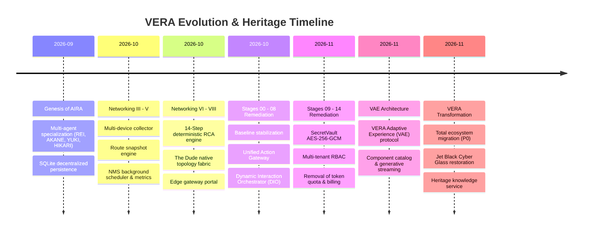

# VERA Platform History: From Network AI Agent Prototype to Enterprise Network Intelligence

## 1. Executive Overview

The **VERA (Visionary Enterprise Network Intelligence Platform)** represents the culmination of an intensive evolutionary engineering journey. Starting in Autumn 2026 as **AIRA (Adaptive Intelligent Reasoning Assistant)**, an exploratory multi-agent assistant for computer network administrators, the platform expanded through multiple major networking generations and a rigorous 15-stage architectural remediation before shedding its prototype identity and transforming into VERA.

This document serves as the permanent historical record of the platform's lineage, documenting the engineering rationale, key transitions, design challenges, and architectural solutions that shaped VERA.

---

## 2. Chronological Timeline of Evolution

---

## 3. Epoch 1: Genesis of AIRA (September 2026)

### 3.1 The Original Problem
Network engineers operating MikroTik RouterOS devices frequently face complex, repetitive tasks: diagnosing intermittent packet drops, tracing routing table discrepancies across BGP/OSPF sessions, and performing configuration changes over SSH terminal sessions.

AIRA was conceived as an intelligent agent platform capable of interacting with human network operators via natural language, translating high-level intents into verified RouterOS API and SSH commands, and visualizing network state.

### 3.2 Architectural Foundations
The early architecture established foundational patterns that remain active in VERA today:
1. **Internal Multi-Agent Specialization**:
   - **REI (Reasoning & Executive Interface)**: Orchestrator, planning, context assembly, and general reasoning.
   - **AKANE (Automated Knowledge & Network Execution)**: Network diagnostics, RouterOS API, SSH commands, configuration analysis.
   - **YUKI (Voice & Audio Companion)**: Audio transcription, TTS synthesis, voice activity detection.
   - **HIKARI (Visual & Optical Intelligence)**: Vision model routing, OCR, topology diagram parsing.
2. **Decentralized Domain Storage**:
   - Rather than relying on a monolithic relational database, the system utilized specialized SQLite databases per operational domain (`devices.db`, `metrics.db`, `topology.db`, `persona.db`, `auth.db`).
   - This provided zero-dependency on-premise portability and sub-millisecond query performance.

---

## 4. Epoch 2: The Networking Advancements (October 2026)

Between October 1 and October 20, 2026, the networking core underwent rapid iteration across six structured phases:

### 4.1 Networking III & IV: Multi-Device Telemetry and Routing Analysis
- Implemented concurrent device polling with CPU-bounding queues to prevent crashing resource-constrained MikroTik routers.
- Introduced cryptographic snapshotting of IP routing tables (`/ip/route/print detail`) to provide immutable records of routing state before and after network events.

### 4.2 Networking V & VI: NMS Scheduler and 14-Step Deterministic RCA
- **NMS Engine**: Background worker collecting CPU, memory, interface traffic, link flaps, and ping latencies.
- **14-Step Root Cause Analysis (RCA)**: A landmark engineering achievement that eliminated LLM hallucinations in mission-critical network diagnostics. The RCA engine analyzes telemetry deterministically through 14 sequential checks (physical link state, MTU mismatches, BGP peer state, gateway reachability, DNS resolution, ARP table integrity, CPU threshold exhaustion, etc.) to produce unambiguous diagnoses.

### 4.3 Networking VII & VIII: Topology Discovery and Edge Gateways
- **The Dude Native Protocol Discovery**: Parsing MikroTik Neighbor Discovery Protocol (MNDP), CDP, LLDP, and ARP caches to automatically map L2 and L3 adjacencies.
- **ISP Boundary Classification**: Algorithms to distinguish between managed enterprise infrastructure and external ISP upstream links.

---

## 5. Epoch 3: The 15-Stage Master Remediation (Late October – Early November 2026)

As AIRA accumulated features rapidly, technical debt and structural inconsistencies emerged. The platform underwent an exhaustive, audited 15-stage engineering remediation:

- **Stage 00**: Comprehensive repository baseline audit and dead code identification.
- **Stage 01**: Service lifecycle and FastAPI dependency injection stabilization.
- **Stage 02**: Database schema migration standardization and WAL mode enforcement.
- **Stage 03**: SecretVault credential encryption with AES-256-GCM.
- **Stage 04**: Multi-tenant operational isolation and schema segregation.
- **Stage 05**: Enterprise Role-Based Access Control (RBAC) with 82 granular permissions and permission simulation.
- **Stage 06**: Model Store and Multi-Model Router stabilization with fallback policies.
- **Stage 07**: Dynamic Interaction Orchestration (DIO) and structured human-in-the-loop forms.
- **Stage 08**: Network diagnostic engine stabilization and RouterOS API pooling.
- **Stage 09**: NMS background scheduler and alert hysteresis engine.
- **Stage 10**: Topology Fabric graph persistence and layout algorithms.
- **Stage 11**: Real-time event bus and WebSocket/SSE channel stabilization.
- **Stage 12**: PWA frontend performance optimization and lazy component loading.
- **Stage 13**: Removal of Token Quotas, Stripe Billing, and Paywall restrictions in favor of full on-premise enterprise deployment.
- **Stage 14**: Final remediation verification, zero-warning test pass, and production readiness audit.

---

## 6. Epoch 4: The VERA Transformation (November 2026)

### 6.1 The Need for Transformation
By November 2026, the platform had evolved from an experimental conversational assistant into a robust, enterprise-grade network intelligence and automation system. 

The name "AIRA" and its early identity as a casual assistant no longer represented the platform's professional capabilities. Furthermore, lingering prototype assumptions (such as user-facing AI token deductions or cloud paywalls) conflicted with enterprise on-premise operational mandates.

### 6.2 The Transformation Mandate
The executive directive established:
1. **Total Product Identity**: VERA is established as the sole active brand, service identity, and operational platform.
2. **Preservation of History**: AIRA's engineering journey and solutions are preserved as first-class historical knowledge, accessible via deterministic retrieval and AI queries.
3. **Restoration of Authoritative UX**: The Jet Black Cyber Glass design language (`#000000` OLED background, `#04060c` cards, `#38BDF8` cyan accents) is restored, eliminating accidental navy palette regressions.
4. **Architectural Parity**: Zero capability loss across all 27+ enterprise networking, security, orchestration, and AI subsystems.

---

## 7. Lineage Summary Table

| Operational Domain | AIRA Prototype Era | Remediation Era | VERA Enterprise Platform |
| :--- | :--- | :--- | :--- |
| **Product Identity** | AIRA OS / Network AI Agent | AIRA Core Remediation | **VERA — Enterprise Network Intelligence Platform** |
| **Ecosystem Root** | Root repository loose scripts | `AIRA_ECOSYSTEM/` | `VERA_ECOSYSTEM/` (symlink: `AIRA_ECOSYSTEM`) |
| **Assistant Persona** | AIRA / Multi-character | Configurable persona engine | **VERA Enterprise Network Specialist** |
| **Network Engine** | Ad-hoc RouterOS scripts | 14-Step RCA & NMS Scheduler | **Integrated Network Intelligence Fabric** |
| **Security** | Plaintext / Env tokens | SecretVault AES-256-GCM | **Enterprise Multi-Tenant SecretVault & RBAC** |
| **UI Design System** | Default cyber dark | Deep navy drift | **Authoritative Jet Black Cyber Glass (`#000000`)** |
| **Historical Knowledge**| Dispersed markdown docs | 15 Remediation Reports | **Embedded Deterministic Heritage Service** |
