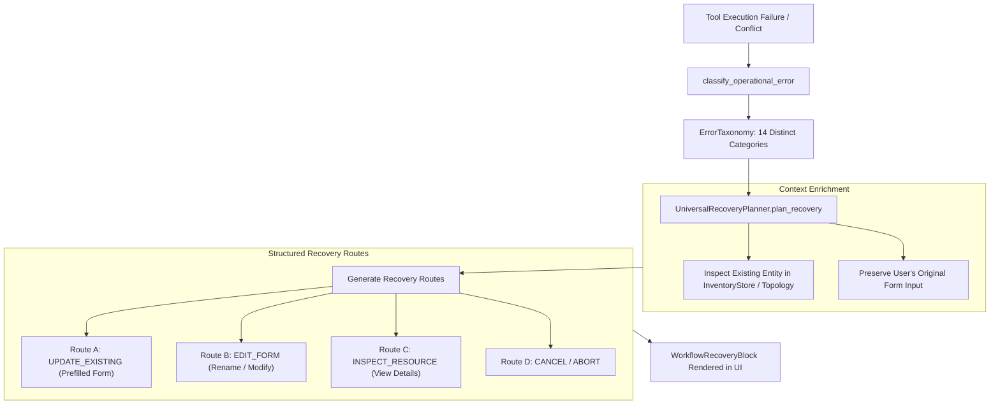

# VERA WORKFLOW RECOVERY SPECIFICATION
## Universal Error Taxonomy, Context Preservation, Recovery Path Planning & Dynamic Remediation Engine

**Project:** VERA — Enterprise Network Intelligence Platform  
**Subsystem:** VERA Adaptive Experience (VAE)  
**Classification:** P0 Technical Specification  
**Date:** November 2026  
**Architect:** Principal Generative UI Architect & Backend Integration Architect  
**Backend Implementation:** `VERA_ECOSYSTEM/core/vae/recovery.py`, `VERA_ECOSYSTEM/core/vae/interaction.py`  
**Frontend Block:** `VERA_ECOSYSTEM/app/frontend/src/platform/adaptive-experience/blocks/WorkflowRecoveryBlock.jsx`

---

## 1. System Vision & The "No Dead Ends" Principle

In enterprise network operations, operational errors (such as duplicate device names, SSH connection timeouts, credential authentication failures, or routing conflicts) are regular occurrences. Traditional chat interfaces treat errors as terminal stops: they output an error string, clear the user's form inputs, and leave the operator at a dead end.

VERA operates under the **Strict "No Dead Ends" Principle**:
> *Every operational error must be classified, paired with contextual evidence from existing data stores, and transformed into structured, actionable, and prefilled recovery routes.*



---

## 2. The 14-Category Error Taxonomy

The VAE taxonomy classifies all network and administrative failures into 14 distinct categories:

| Error Category | Typical Root Cause | Can Retry? | Can Edit? | Typical Recovery Strategy |
| :--- | :--- | :---: | :---: | :--- |
| **`DUPLICATE_RESOURCE`** | Entity name, IP, or identity already exists in database | No | Yes | Offer Update Existing vs Rename New |
| **`RESOURCE_NOT_FOUND`** | Device, interface, or route target missing from inventory | No | Yes | Reopen search, select from inventory |
| **`CONNECTION_FAILED`** | Socket refused, port closed, route unreachable | Yes | Yes | Ping diagnostic probe + edit IP/Port |
| **`DEVICE_OFFLINE`** | Device pingable but management agent dead or offline | Yes | No | Diagnose reachability, alert field team |
| **`TIMEOUT`** | SSH handshake or API query exceeded latency limit | Yes | Yes | Retry with increased timeout |
| **`AUTHENTICATION_REQUIRED`**| Wrong SSH password, expired token, invalid private key | No | Yes | Open credential prompt with prefilled username |
| **`PERMISSION_DENIED`** | RBAC or tenant isolation blocked command execution | No | No | Surface elevation request / simulated role |
| **`VALIDATION_ERROR`** | Missing required parameter, invalid CIDR, bad port number | No | Yes | Highlight invalid field with format hint |
| **`CONFLICT`** | Concurrent modification, route tag collision, ASN mismatch | Yes | Yes | Re-fetch latest snapshot + re-apply |
| **`UNSUPPORTED_OPERATION`**| RouterOS version lacks command or feature package | No | Yes | Suggest alternative command or upgrade |
| **`RATE_LIMITED`** | API quota exceeded on remote cloud or gateway | Yes | No | Backoff timer with countdown indicator |
| **`PARTIAL_SUCCESS`** | 3 of 4 routers updated; 1 failed | Yes | Yes | Targeted retry for failed node only |
| **`EXECUTION_FAILED`** | Non-zero exit code or RouterOS script syntax error | Yes | Yes | Edit script + syntax check |
| **`INTERNAL_ERROR`** | Unhandled exception in backend engine | Yes | No | Collect trace ID + report to admin |

---

## 3. Universal Recovery Planner Architecture (`UniversalRecoveryPlanner`)

When `ExperienceComposer` detects an error step, it calls `UniversalRecoveryPlanner.plan_recovery(tool_name, tool_input, error_output)`:

```python
@dataclass
class RecoveryAction:
    action_id: str
    action_type: str             # "UPDATE_EXISTING", "EDIT_FORM", "INSPECT_RESOURCE", etc.
    label: str                   # Button label in UI
    description: str             # Explanatory tooltip
    target_tool: str             # Tool to dispatch upon selection
    prefilled_data: Dict[str, Any]
    schema: Optional[Dict[str, Any]] = None  # Pre-filled interactive form schema
    is_primary: bool = False
    requires_confirmation: bool = False

@dataclass
class RecoveryPlan:
    workflow_id: str
    error_classification: ErrorClassification
    summary: str
    original_tool: str
    original_input: Dict[str, Any]
    recovery_actions: List[RecoveryAction]
    existing_resource: Optional[Dict[str, Any]] = None
    created_at: float = field(default_factory=time.time)
```

---

## 4. Specialized Recovery Handlers

### 4.1 Duplicate Device Registration Handler (`_plan_device_duplicate_recovery`)
When an `add_device` call fails with `DUPLICATE_RESOURCE`:
1. **Target Identification:** Extracts conflicting device name from error message or input payload (e.g., `CHR`).
2. **Entity Lookup:** Queries `InventoryStore.get_device("CHR")` to fetch existing configuration without secrets.
3. **Synthesis of Recovery Routes:**
   - **Route A (`UPDATE_EXISTING`, Primary):** Synthesizes a prefilled `update_device` form schema using the new IP/port values requested by the operator, allowing immediate update in one click.
   - **Route B (`EDIT_FORM`):** Reopens the `add_device` registration form with all previous inputs intact, allowing the user to rename the device (e.g., `CHR-Backup`).
   - **Route C (`INSPECT_RESOURCE`):** Provides a direct inspection link to view the currently registered device record.
   - **Route D (`CANCEL`):** Closes the recovery interaction cleanly.

### 4.2 Connection Failure Handler (`_plan_connection_failure_recovery`)
When SSH or API connection to a device fails:
1. **Diagnostic Probe:** Synthesizes a high-priority `DIAGNOSTIC_PROBE` action targeting `network_ping` with the target host IP to test layer-3 connectivity.
2. **Edit Connection:** Reopens the connection parameters form with host IP, port, and credentials prefilled for verification.
3. **Retry:** Provides an immediate retry button if connection drops were transient.

---

## 5. Form State Preservation Guarantee

A core mandate of VERA is that **user input is never discarded upon failure**.
- When `RecoveryPlan` is serialized to `VaeBlock(type="workflow-recovery")`, the `original_input` is preserved in the block data payload.
- Interactive schemas embedded in `recovery_actions` automatically populate `default` values with the user's submitted inputs.
- The operator can edit the prefilled values directly within `WorkflowRecoveryBlock` and re-submit without having to re-type a single unchanged field.
